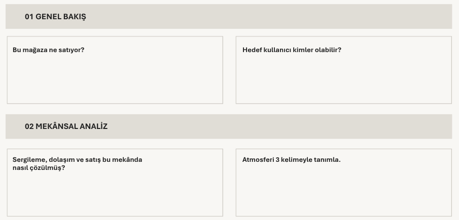
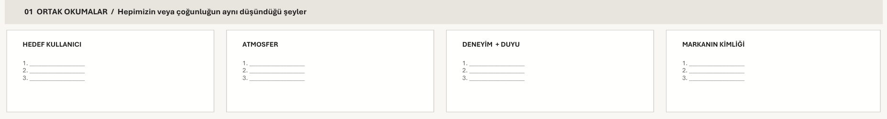
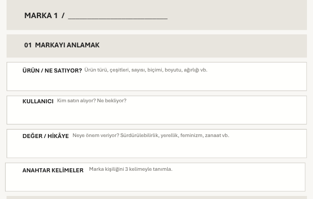
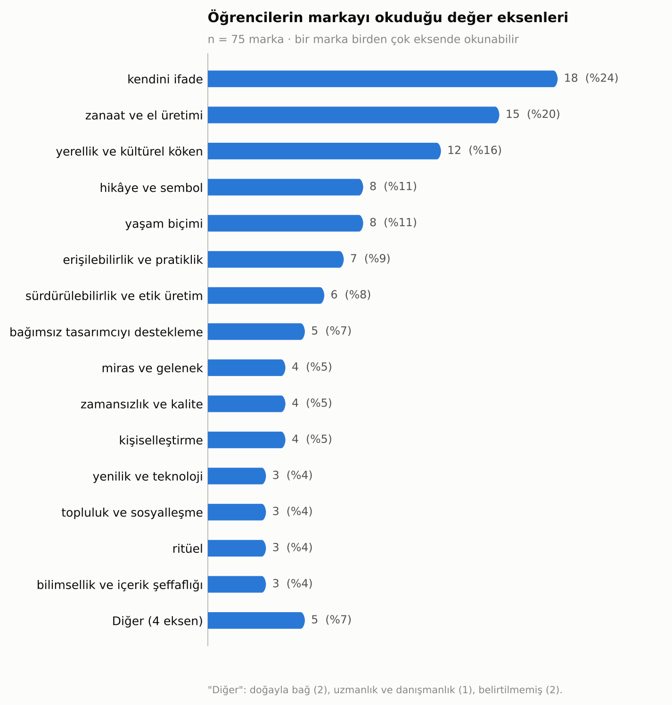
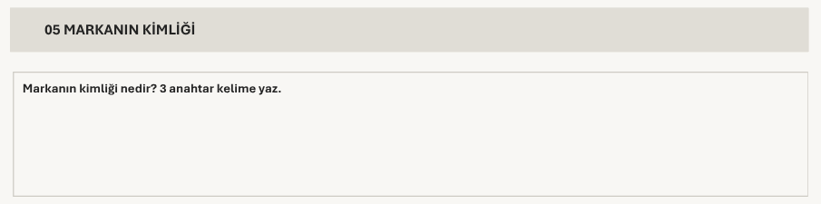
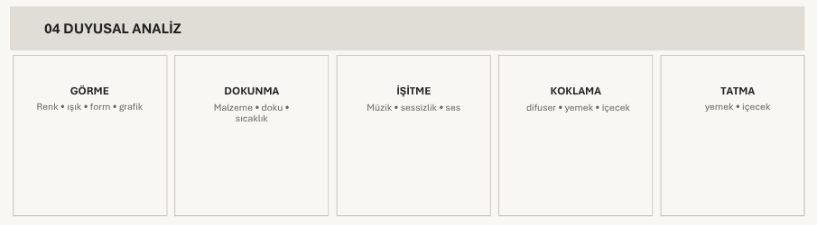
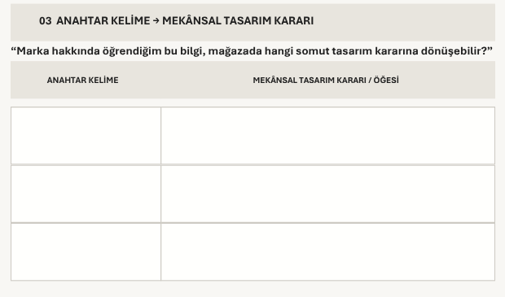
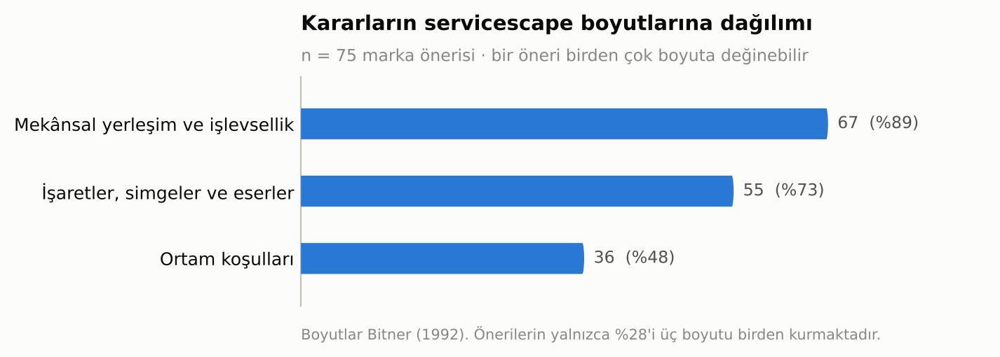
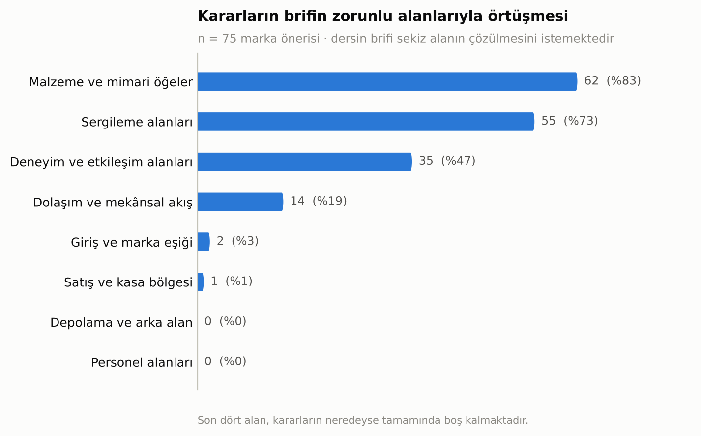

# Markayı Okumaktan Mekânı Kurmaya: İç Mimarlık Stüdyosunda Marka Kimliğinin Mekânsal Tasarım Kararlarına Dönüşümü

**Betül Ünal**
Dr. Öğr. Üyesi, Kapadokya Üniversitesi, Mimarlık, Tasarım ve Güzel Sanatlar Fakültesi, İç Mimarlık ve Çevre Tasarımı Bölümü

---

## Özet

Perakende mekânı tasarımı stüdyosunda öğrencinin karşılaştığı temel güçlük biçim üretmek değil, ürettiği biçimi gerekçelendirmektir. Marka kimliği tam da bu gerekçeyi sağlayabilecek bir veridir; ancak kimliğin soyut nitelikleri ile çizilebilir mekânsal kararlar arasındaki geçiş, stüdyo pratiğinde çoğunlukla sezgiye bırakılır. Bu çalışma söz konusu geçişi doğrudan araştırma nesnesi yapmaktadır. Veri, Kapadokya Üniversitesi İç Mimarlık ve Çevre Tasarımı Bölümü üçüncü sınıf stüdyosunda (IMC301) 29 öğrenciyle yürütülen bir giriş atölyesine aittir. Atölye üç çalışma kâğıdı üzerinden kurgulanmıştır: rastgele atanan beş perakende mekânının bireysel okunması, aynı mekâna düşen öğrencilerin grup sentezi ve sunumu, ve fiziksel mağazası bulunmayan niş markalar arasından üç aday markanın araştırılarak anahtar kelimelerinin mekânsal karara çevrilmesi. Toplanan 25 teslim, 75 marka önerisi ve 225 anahtar kelime – mekânsal karar eşleşmesi içerik analiziyle incelenmiş; kararlar hem tasarım öğesi ailelerine hem de Bitner'ın (1992) üç servicescape boyutuna göre sınıflandırılmış, ardından dersin brifindeki sekiz zorunlu alanla karşılaştırılmıştır. Öğrencilerin markayı en çok kendini ifade (%24), zanaat ve el üretimi (%20) ile yerellik ve kültürel köken (%16) eksenlerinden okudukları; buna karşılık ürettikleri anahtar kelimelerin yalnızca %4,9'unun doğrudan bir duyuya gönderme yaptığı görülmüştür. Kararlar sergileme birimi (%73) ve malzeme-yüzey (%60) alanlarında yoğunlaşmakta, dolaşım ve plan kurgusu %19'da, koku ve ses donatısı %9'da kalmaktadır. Servicescape boyutları bakımından önerilerin %89'u mekânsal yerleşim ve işlevselliğe, %73'ü işaret ve simgelere değinirken yalnızca %48'i ortam koşullarına ulaşmakta; üç boyutu birden kuran öneri oranı %28'dir. Brifin sekiz zorunlu alanıyla karşılaştırıldığında, kararların giriş ve marka eşiğine yalnızca iki, satış ve kasa bölgesine bir öneride ulaştığı, depolama ve personel alanlarına hiç ulaşmadığı saptanmıştır. Kimliğin mekânda en açık karşılık bulduğu durumlar ortak bir işaret taşımaktadır: öğrenci, kurduğu birimi markanın kendi diliyle adlandırmaktadır.

**Anahtar kelimeler:** perakende mekânı tasarımı, iç mimarlık stüdyo eğitimi, marka kimliği, marka analizi, mekânsal tasarım kararı, servicescape

## Abstract

The core difficulty a student faces in the retail design studio is not producing form but justifying the form produced. Brand identity is precisely the kind of data that can supply that justification; yet the passage from a brand's abstract attributes to drawable spatial decisions is usually left to intuition in studio practice. This study makes that passage its direct object of inquiry. The data comes from an introductory workshop with 29 third-year students in the Interior Architecture and Environmental Design programme at Cappadocia University (IMC301), structured around three worksheets: individual reading of five randomly assigned retail interiors, group synthesis and presentation by students assigned to the same space, and investigation of three candidate niche brands without physical stores, translating their keywords into spatial decisions. The resulting 25 submissions, 75 brand proposals and 225 keyword-to-decision pairings were examined through content analysis; decisions were classified both by design element family and by Bitner's (1992) three servicescape dimensions, then compared against the eight areas the course brief requires students to resolve. Students read brands primarily through self-expression (24%), craft and handmaking (20%) and locality and cultural origin (16%), yet only 4.9% of the keywords they produced referred directly to a sense. Decisions concentrate in display units (73%) and material-surface choices (60%), while circulation and plan configuration remain at 19% and scent-sound provision at 9%. Across servicescape dimensions, 89% of proposals address spatial layout and functionality and 73% address signs and symbols, but only 48% reach ambient conditions; just 28% build all three. Measured against the brief's eight required areas, decisions reach the entrance and brand threshold in only two proposals and the checkout in one, and never reach storage or staff areas. Where identity does find its clearest spatial equivalent, a common marker appears: the student names the unit in the brand's own language.

**Keywords:** retail interior design, interior design studio education, brand identity, brand analysis, spatial design decision, servicescape

---

## 1. Giriş

Perakende mekânı, iç mimarlık pratiğinin ürün ile beden, kimlik ile yüzey, anlatı ile rota arasındaki ilişkiyi en yoğun biçimde kurduğu alanlardan biridir. Teknolojik, ekonomik ve sosyokültürel eğilimlerin biçimlendirdiği perakende ortamı sürekli dönüşmekte; markalar mekânın müşteri deneyimi üzerindeki belirleyici etkisini giderek daha açık biçimde tanımaktadır (Petermans ve Van Cleempoel 2009). Bu dönüşüm, alanı yalnızca bir tasarım pratiği değil, ayrı bir uzmanlık hâline getirmiştir. Perakende tasarımı; markalaşma ve pazarlama, mimarlık ve iç mimarlık, psikoloji, lojistik, teknoloji entegrasyonu ve kullanıcı deneyimi tasarımını bir araya getiren çok disiplinli bir alandır ve tasarımcıdan marka ile müşteri arasında kalıcı bir bağ kurmasını bekler (Quartier, Claes ve Vanrie 2017, 2020; Lemon ve Verhoef 2016). Bu beklenti, tasarım eğitimi için doğrudan bir müfredat sorusu üretir: soyut bir marka kimliği, hangi öğretilebilir adımlarla çizilebilir bir mekânsal karara dönüşür?

Sorunun stüdyo içindeki karşılığı pedagojiktir ve sanıldığından daha temeldir. Üçüncü sınıf düzeyinde bir öğrencinin asıl güçlüğü biçim üretmek değildir; öğrenciler çoğunlukla biçim üretmekte zorlanmaz. Güçlük, ürettikleri biçimi gerekçelendirmektir. Gerekçesi olmayan bir tasarım, kritikte savunulamaz hâle gelir; öğrenci de bu durumda ya estetik tercihe ya da yürütücüsünün beğenisine sığınır. Marka kimliği tam olarak bu boşluğu dolduracak bir veridir: dışarıdan gelen, araştırmayla elde edilen, tartışılabilir ve sınanabilir bir ölçüt sağlar. Bir mağazada niş duvarının neden kavisli, aydınlatmanın neden noktasal, rotanın neden kıvrımlı olduğu sorusunun yanıtı "böyle güzel oluyor" değil, "marka zanaati görünür kılmak üzerine kurulu" olabilir. Dönem projesinin marka kimliği üzerine kurgulanmasındaki temel gerekçe budur: öğrencinin boşlukta tasarım yapmasını önlemek.

Ancak bu gerekçenin işlemesi, kimliğin gerçekten mekânsal bir karara dönüşmesine bağlıdır. Öğrenciler markayı araştırmayı görece hızlı öğrenir; araştırmanın çıktısı olan anahtar kelimeyi üretmeyi de öğrenir. Fakat anahtar kelimenin kendisi hiçbir şey çizmez. "Zarafet" bir plan üretmez; "zanaat" bir kesit vermez; "sürdürülebilirlik" bir detay doğurmaz. Çeviri tam olarak burada — kelimeyle çizgi arasındaki boşlukta — gerçekleşir ya da gerçekleşmez. Gerçekleşmediğinde ortaya çıkan şey, marka araştırması yapılmış ama tasarıma hiç yansımamış bir proje; yani gerekçenin yalnızca pafta üzerinde durduğu, mekânın ise hâlâ boşlukta kurulduğu bir durumdur.

Bu makale söz konusu geçişi doğrudan incelemektedir. İnceleme birimi bitmiş proje değil, çevirinin kendisidir: bir öğrencinin belirli bir marka için ürettiği belirli bir anahtar kelimenin karşısına yazdığı belirli mekânsal karar. Veri, dönem sonunda değil, dönemin ilk haftasında — henüz hiçbir kritik müdahalesi yapılmamışken — üretilmiştir. Bu tercih, öğrencinin stüdyoya getirdiği beceriyi olduğu gibi görünür kılar ve müfredat müdahalesinin nereye yapılması gerektiğini gösterir.

Araştırma soruları şunlardır: Öğrenciler bir markayı neyin üzerinden okumakta, hangi değerleri kimliğin taşıyıcısı saymaktadır? Bu okumadan hangi anahtar kelimeler çıkmaktadır? Kelimeler hangi tasarım alanlarında mekânsal karara dönüşmekte, hangi alanlar boş kalmaktadır? Üretilen kararlar, bütüncül bir perakende ortamı kurmaya ve dersin brifinin talep ettiği programı karşılamaya yetmekte midir?

---

## 2. Kuramsal Arka Plan

Perakende mekânının bir iletişim aracı olarak kavramsallaştırılması Kotler'in (1973) *atmospherics* kavramıyla başlar. Kotler, satın alma kararının yalnızca ürün ve fiyat tarafından değil, mekânın bilinçli olarak tasarlanmış duyusal niteliklerince de belirlendiğini öne sürerek mekânı pazarlama değişkenleri arasına katmıştır. Mehrabian ve Russell'ın (1974) çevre psikolojisi modeli bu etkinin mekanizmasını haz–uyarılma–baskınlık üçlüsü üzerinden formüle ederek atmosfer ile davranış arasındaki bağı deneysel olarak çalışılabilir kılmıştır.

Bu çizginin iç mimarlık açısından en kullanışlı halkası Bitner'ın (1992) *servicescape* kavramıdır. Bitner, fiziksel çevreyi üç boyutta çözümler: **ortam koşulları** (ışık, ses, koku, ısı gibi arka plan nitelikleri), **mekânsal yerleşim ve işlevsellik** (donatı, ekipman ve mobilyanın düzeni, boyutu ve aralarındaki ilişkiler) ve **işaretler, simgeler ve eserler** (yönlendirme, grafik, malzeme ve dekor yoluyla taşınan iletişimsel ipuçları). Bu üçlü, pazarlama kökenli olmasına karşın doğrudan iç mimarlığın karar alanlarına karşılık gelir ve bir mekânın yalnızca bir boyutla değil üçünün birlikte kurulmasıyla bütünlendiğini söyler. Bitner ayrıca fiziksel çevrenin yalnızca müşteri değil çalışan davranışını da biçimlendirdiğini göstererek arka alan ve personel mekânlarını tartışmaya dâhil etmiştir — bu makalenin bulguları açısından önem taşıyan bir noktadır.

Pine ve Gilmore'un (1999) deneyim ekonomisi tezi bu birikimi ekonomik bir dönüşüm iddiasına bağlamış; Lemon ve Verhoef (2016) müşteri deneyimini tek bir temas anı değil, satın alma öncesi, satın alma ve sonrası evrelerinden oluşan çok kanallı bir yolculuk olarak yeniden tanımlamıştır. Stein ve Ramaseshan (2016) bu yolculuğun temas noktalarını atmosferik, teknolojik, iletişimsel, süreçsel, çalışan–müşteri etkileşimi, müşteri–müşteri etkileşimi ve ürün etkileşimi olmak üzere yedi öğeye ayırmıştır. Bu kavramsallaştırma iç mimarlık stüdyosu için önemli bir sonuç doğurur: mekân statik bir kap değil, zaman içinde açılan bir sekanstır ve bu sekansın her durağı ayrı bir tasarım sorusudur.

Marka kimliğini sistematik olarak çözümleme çabası tasarım alanına büyük ölçüde Wheeler'ın (2017) çalışmasıyla aktarılmıştır. Wheeler, bütüncül bir marka deneyimini imge ve kimlik, ürün ve hizmetler, insanlar ve kültür, satış süreçleri, fiziksel ve sanal mekânlar ile farkındalık stratejisi olmak üzere altı bileşen üzerinden kurar; bu çerçeve fiziksel mekânı marka kimliğinin eşdeğer bir taşıyıcısı olarak konumlandırdığı için iç mimarlık açısından doğrudan kullanışlıdır. Marka anahtarı araçları — hedef kitle, misyon, değerler, faydalar, kişilik, görsel dil, iletişim tonu — markayı çözümlenebilir bileşenlere ayırır ve öğrenciye araştırma için bir iskelet verir.

Ancak bu araçların tasarım eğitimine aktarımında kritik bir eşik vardır: marka anahtarı markayı *anlamak* için tasarlanmıştır, markayı *çizmek* için değil. Bir markanın misyonunu, değerlerini ve kişiliğini eksiksiz çözümlemiş bir öğrenci, bu çözümlemeden tek bir duvar kesiti çıkarmak zorunda değildir. Klingmann'ın (2010) brandscape kavramı ile Klanten, Ehmann ve Borges'in (2013) derlediği markalı mimarlık örnekleri kimliğin mekânsallaşmasının mümkün olduğunu gösterir; ancak bu örnekler ürünü sunar, yöntemi değil. Köprülü ve Boz (2023) tek bir showroom örneği üzerinden marka hikâyesinin mekân tasarımına dönüşme sürecini izleyerek bu boşluğa yaklaşmıştır. Mesher (2010) ise perakende tasarımını doğrudan bir eğitim nesnesi olarak ele alan sayılı kaynaktan biri olarak marka ve kimliği konsept geliştirmenin başlangıç noktası sayar; markayı bir tema değil bir başlangıç verisi olarak konumlandırır.

Perakende atmosferinin yalnızca görsel olmadığına ilişkin kanıt birikimi güçlüdür. Spence ve arkadaşları (2014) mağaza ortamının görsel, işitsel, dokunsal, kokusal ve tatsal boyutlarına ilişkin bilimsel kanıtları derleyerek çok duyulu atmosfer kavramını sistemleştirmiş; duyular arası uyumun tek bir duyuya yapılan yatırımdan daha güçlü etkiler ürettiğini göstermiştir. Underhill (2008) alışveriş davranışının beden ölçeğindeki belirleyicilerini — geçiş genişlikleri, dokunma eğilimi — etnografik gözlemle ortaya koymuştur. Mimarlık kuramı tarafında Pallasmaa (2005) modern mimarlığın göz-merkezliliğini eleştirerek mekânın bedenin tamamıyla deneyimlendiğini savunur; bu, görselleştirme araçlarının hâkim olduğu bir temsil kültüründe tasarım düşüncesinin yapısal olarak görmeye doğru yanlılaşacağı uyarısını taşır.

Perakende tasarımı eğitimini kendisine araştırma nesnesi yapan çizgi büyük ölçüde Quartier ve arkadaşlarının çalışmalarıyla şekillenmiştir. Quartier, Claes ve Vanrie (2017) hızla evrilen disiplinde perakende tasarımcısının hangi yetkinliklere gereksinim duyduğunu sormuş; aynı ekip (2020) araştırma, tasarım, sosyokültürel bilimler, markalaşma, pazarlama ve strateji, çok kanallılık ve dijital, iletişim ile örgütlenme ve yönetim olmak üzere sekiz temada toplanan kapsamlı bir yetkinlik çerçevesi geliştirmiştir. Di Iorio ve Spagnoli (2023) deneyim temelli öğrenme için yeniden çerçevelenmiş öğrenme araçları önermiş; Rolla, Hasırcı, Anal ve Edes (2021) disiplinlerarası bir konsept mağaza tasarım sürecini belgelemiştir. Sunar Bükülmez, Girginkaya Akdağ ve Ekin (2025) marka anahtarı ve müşteri yolculuğu haritalamayı bir iç mimarlık stüdyosuna entegre eden sınanmış bir çerçeve sunmuştur.

Bu birikim, markanın mekânsallaşmasının mümkün olduğunu ve bu aktarımın eğitimde ölçülebileceğini göstermektedir. Arada kalan şey çevirinin kendisidir: hangi tür bir marka okuması hangi tasarım alanında karşılık bulur, hangi alanlar boş kalır? Bu makale söz konusu soruya, bir atölyenin birincil ürünleri üzerinden yanıt aramaktadır.

---

## 3. Yöntem

### Bağlam ve atölyenin kurgusu

Araştırma, Kapadokya Üniversitesi Mimarlık, Tasarım ve Güzel Sanatlar Fakültesi İç Mimarlık ve Çevre Tasarımı Bölümü'nde yürütülen IMC301 İç Mimari Tasarım Stüdyosu IV dersi kapsamında gerçekleştirilmiştir. Ders, 2026–2027 Güz yarıyılında haftada sekiz saat yüz yüze ve on dört hafta süreyle yürütülen zorunlu bir stüdyo dersidir; derse kayıtlı öğrenci sayısı 29'dur. Dönem projesinin alanı Mersin Marina'dır. Proje tanımı öğrencilerden az bilinen bir perakende markası seçmelerini, alanı çözümlemelerini ve kullanıcı odaklı, etkileşimli, duyusal bir mekânsal deneyim geliştirmelerini beklemektedir. Brif, tasarımda **sekiz alanın zorunlu olarak çözülmesini** istemektedir: giriş ve marka eşiği, sergileme alanları, dolaşım ve mekânsal akış, satış ve kasa bölgesi, depolama ve arka alan, personel alanları, deneyim ve etkileşim alanları, malzeme ve mimari öğeler. Bu liste, bulgular bölümünde bir karşılaştırma ölçütü olarak kullanılmaktadır. Dersin ayırt edici odağı, izlencede açıkça belirtildiği üzere "bir markanın kimliğinin çözümlenip mekânsal bir dile çevrilmesi"dir.

Bu araştırmanın verisi dönemin ilk haftasına ve onu izleyen iki haftalık teslim penceresine aittir. Veri, bireysel kritik sürecinin henüz başlamadığı bir anda üretilmiştir ve öğrencilerin stüdyoya getirdiği beceriyi olduğu gibi temsil eder.

İlk hafta iki oturumluk bir giriş atölyesi olarak kurgulanmıştır. Kuramsal girişte marka kimliği, kullanıcı profili ve müşteri yolculuğu kavramları dört başlık altında sunulmuştur: markadan mekâna, kullanıcı, deneyim ve etkileşim, mekân. Müşteri yolculuğu sekiz aşamalı olarak tanımlanmıştır (farkındalık, çekim, eşik, yönlenme, keşif, etkileşim, satın alma, ayrılış). Duyusal çerçeve beş duyu ve bedensel algı üzerinden kurulmuş; anahtar kelime üretimi için üç ölçüt verilmiştir: her markaya uyacak kadar genel olmamalı, araştırmada karşılığı bulunmalı, mekânda somut bir karşılığı kurulabilmeli.

Kuramsal girişin ardından atölye üç çalışma kâğıdı üzerinden ilerlemiştir (Tablo 1). Kâğıtların ilgili bölümleri, bulgular sunulurken ait oldukları yerde ayrıca gösterilmektedir.

**Tablo 1. Atölyenin üç çalışma kâğıdı**

| | Çalışma Kâğıdı 1 | Çalışma Kâğıdı 2 | Çalışma Kâğıdı 3 |
|---|---|---|---|
| **Başlık** | Bir Mağazayı Okumak: Bireysel Çalışma | Bir Mağazayı Okumak: Grup Sentezi | Marka Araştırması |
| **Çalışma biçimi** | Bireysel | Grup (aynı mekâna atananlar) | Bireysel, ödev |
| **Girdi** | Rastgele atanan, marka adı verilmemiş bir perakende mekânının fotoğraf seti | Grup üyelerinin bireysel okumaları | Öğrencinin kendi seçtiği üç aday marka |
| **Bölümler** | Genel bakış · mekânsal analiz · deneyim analizi · duyusal analiz · markanın kimliği | Ortak okumalar · markadan tasarıma · mekânı çizimle anlat · mekân–marka analizi · görüş ve öneriler | Markayı anlamak · mekânın ihtiyacı · anahtar kelime → mekânsal tasarım kararı |
| **Çıktı** | Üç kelimelik atmosfer ve kimlik okuması | Dört başlıkta üçer ortak madde, diyagram, stüdyo sunumu | Marka başına üç anahtar kelime ve üç mekânsal karar |

Çalışma Kâğıdı 1 için seçilen beş mekân, perakende tipolojisi ve atmosfer stratejisi bakımından bilinçli olarak farklılaştırılmıştır (Şekil 1, Tablo 2). Mekânlar öğrencilere marka adı verilmeksizin, yalnızca fotoğraf setleri hâlinde sunulmuş; kimliğin mekândan geriye doğru okunması istenmiştir. Farklılaştırma, atölyenin temel sorusunu beş ayrı atmosfer stratejisi üzerinden sınamayı amaçlamaktadır: renk, doku, strüktür, hammadde ve saydamlık, her biri bir başka mekânda baskın taşıyıcı konumundadır.

**Şekil 1.** Çalışma Kâğıdı 1'in beş vaka mekânı, öğrencilere dağıtılan fotoğraf setleri hâlinde. Soldan sağa: Mekân 1–5.

**Tablo 2. Çalışma Kâğıdı 1'in beş vaka mekânı**

| No | Tipoloji | Atmosfer stratejisi |
|---|---|---|
| 1 | Çocuk ve genç giyim | Yoğun renk bloklaması, kemerli nişler, oyunsu geometri |
| 2 | Gözlük / optik markası mağazası | Perde, kanelürlü yüzey, sıcak ışık; yumuşak doku |
| 3 | Kitabevi | Parametrik ahşap tavan, sürekli raf duvarları, geniş hacim |
| 4 | Giyim | Brüt beton, ahşap makas, mekân ortasında canlı ağaç; ham-doğal |
| 5 | Moda | Mermer, ahşap çerçeve, yarı saydam tekstil bölücüler; minimal-rafine |

### Veri ve analiz

Çalışma Kâğıdı 3 için 25 teslim arşivlenmiştir (kayıtlı öğrencilerin %86'sı). Her teslim üç marka önerisi, her öneri üç çeviri satırı içerdiğinden toplam **75 marka önerisi** ve **225 anahtar kelime – mekânsal karar eşleşmesi** elde edilmiştir. Çalışma Kâğıdı 2 için dört grubun sentezi incelenebilmiştir (Mekân 1–4).

Veri, nitel içerik analizi ve bunu izleyen betimsel istatistikle incelenmiştir (Krippendorff 2019). Dört eksende kodlama yapılmıştır.

**Markanın okunduğu değer ekseni.** Çalışma kâğıdının "değer / hikâye" alanında öğrencinin markayı neyin üzerinden tanımladığı; marka başına bir ya da iki etiketle, çok etiketli olarak kodlanmıştır.

**Anahtar kelimeler.** Marka başına üç kelime; sıklık dağılımı ve tematik kümeler üzerinden incelenmiştir.

**Tasarım öğesi ailesi.** Her kararın hangi tasarım alanına değindiği, çok etiketli olarak kodlanmıştır: sergileme birimi; malzeme ve yüzey; aydınlatma; dolaşım ve plan kurgusu; grafik ve anlatı yüzeyi; üretim görünürlüğü; kişiselleştirme ve etkileşim istasyonu; dijital ve teknoloji; renk; oturma ve dinlenme; koku, ses ve duyusal donatı; giriş ve marka eşiği; satış ve kasa bölgesi. Son iki aile yalnızca karar metninde açıkça geçtiğinde kodlanmış, diğer alanlardan türetilmemiştir.

**Servicescape boyutu.** Tasarım öğesi aileleri, Bitner'ın (1992) üç boyutuna eşlenmiştir (Tablo 3). Bu eşleme, kararların yalnızca hangi öğeye değindiğini değil, bütüncül bir perakende ortamının hangi katmanlarını kurduğunu görmeyi sağlar.

**Tablo 3. Tasarım öğesi ailelerinin servicescape boyutlarına eşlenmesi**

| Servicescape boyutu (Bitner 1992) | Bu araştırmadaki tasarım öğesi aileleri |
|---|---|
| **Ortam koşulları** | Aydınlatma · renk · koku, ses ve duyusal donatı |
| **Mekânsal yerleşim ve işlevsellik** | Sergileme birimi · dolaşım ve plan kurgusu · oturma ve dinlenme · kişiselleştirme ve etkileşim istasyonu · dijital ve teknoloji · giriş ve marka eşiği · satış ve kasa bölgesi |
| **İşaretler, simgeler ve eserler** | Malzeme ve yüzey · grafik ve anlatı yüzeyi · üretim görünürlüğü |

Son olarak kararlar, dersin brifindeki sekiz zorunlu alanla karşılaştırılmıştır. Marka önerileri ayrıca ürün kategorisi, menşe ve ölçek bakımından kodlanmıştır.

---

## 4. Bulgular

### 4.1. Mekândan kimliğe: mağazayı okumak

Çalışma Kâğıdı 1, mekânı katman katman okutur: önce ne satıldığı ve kime satıldığı, ardından sergileme, dolaşım ve satışın nasıl çözüldüğü, sonra atmosferin üç kelimeyle tanımlanması (Şekil 2). Bu sıralama, öğrenciyi doğrudan estetik yargıdan uzaklaştırıp mekânı bir işleyiş olarak görmeye zorlar.

**Şekil 2.** Çalışma Kâğıdı 1'in ilk iki bölümü: mekânın kime hitap ettiği ve sergileme–dolaşım–satış kurgusunun nasıl çözüldüğü sorulur.

Grup sentezleri, farklı bireysel okumaların ortak bir sözlükte buluşma kapasitesini göstermektedir (Şekil 3, Tablo 4). Dört grubun tamamı atmosfer okumasını üç sıfata indirgemeyi başarmıştır.

**Şekil 3.** Çalışma Kâğıdı 2'nin ilk bölümü: grup, bireysel okumaları dört başlıkta üçer ortak maddeye indirger.

**Tablo 4. Grup sentezlerinin ortak okumaları**

| Mekân | Hedef kullanıcı | Atmosfer | Markanın kimliği |
|---|---|---|---|
| **1** Çocuk ve genç giyim | çocuklar · aile · gençler | dikkat çekici · renkli · eğlenceli | eğlence · renk · dinamik |
| **2** Gözlük / optik | deneyim · görme · lüks ve prestij amaçlı | ritim · lüks · kontrollü | zarif · dinamik · estetik |
| **3** Kitabevi | araştırmacılar · akademisyenler · düzenli okuyucular | sıcak · sakin · modern | prestij · organik · değişim |
| **4** Giyim (ham-doğal) | sürdürülebilir modayı benimseyen · premium tasarım arayan · dingin mekân tercih eden | sakin ve dingin · doğal ve organik · ferah ve modern | sürdürülebilirlik · zarafet ve lüks · modern |

Daha dikkate değer olan, grupların kendi okumalarını eleştirebilmesidir. Mekân 2 grubu, "kullanılan renk tonları sebebiyle mekânı deneyimleme yetersiz kalmıştır; ruhsuz bir mekân yaratılmıştır, burası bir lobi ya da eczane gibi mekânları andırıyor ve gözlüğe doğrudan bir vurgu yapılmamış" değerlendirmesiyle marka–mekân uyumsuzluğunu teşhis etmiştir. Mekân 4 grubu uyumun "mekânın merkezindeki canlı ağaç ve organik dairesel zemin kurgusunda" okunduğunu saptamış ve mekânı bir merkez–çeper diyagramına dönüştürmüştür. Mekân 3 grubu ise beş mekânı tek bir eksen üzerinde (4 ↔ 1 ↔ 2 ↔ 5 ↔ 3) sıralayarak kendi mekânını diğerlerine göre konumlandırmıştır; bu, atölyenin istemediği ancak ürettiği bir çıktıdır.

Grup aşamasında üretilen kararlar, bireysel çalışmaya kıyasla belirgin biçimde daha somuttur. Mekân 2 grubu "dinamik" kelimesini "rafların bir bütün hâlinde kıvrımlı şekilde devam etmesi, rafların arkasında sarı ışıkla birlikte perde kullanımı, kıvrımlı-dalga şeklinde dairesel banko tasarımı" biçiminde açmış; Mekân 4 grubu "organik" kelimesini "merkezine canlı bir ağacı alan dairesel zemin kurgusu ve akışkan yollar sayesinde katı, keskin hatlardan uzak bir dolaşım şeması" olarak tanımlamıştır. Her iki karar da öğeyi mekândaki bir konuma ve bir harekete bağlamaktadır. Grupların öneri bölümünde de aynı somutluk sürmektedir: "mekândaki pencerenin konumu değiştirilmeli, ayna boyutu büyütülmeli, çocuklar için elverişli askılık yüksekliği olmalı, oturma alanı eklenmeli" ya da "yönlendirmeler artırılabilir ve okuma alanlarında ergonomiyi düşünerek konfor arttırılabilir". Öğrenciler mevcut bir mekânı yargılarken ölçü, konum ve yükseklik gibi kavramlara kendiliğinden başvurmaktadır.

Bu bulgular atölyenin ilk iki aşamasının amacına ulaştığını göstermektedir. Önlerinde okunacak bir mekân bulunduğu sürece öğrenciler kimliği mekândan çıkarabilmekte, ortak bir sözlüğe indirgeyebilmekte ve bu sözlüğü eleştirel biçimde sınayabilmektedir. Asıl güçlük bir sonraki adımdadır — okunan mekân ortadan kalkıp yerine yalnızca bir marka kaldığında.

### 4.2. Hangi markalar seçildi

Yetmiş beş marka önerisinin ürün kategorisi dağılımı belirgin biçimde yoğunlaşmıştır (Şekil 4). İlk dört kategori — giyim, ev ve yaşam ürünleri, takı ve mücevher, parfüm ve koku — önerilerin %64'ünü oluşturmaktadır.

**Şekil 4.** Önerilen markaların ürün kategorisi dağılımı.

Bu yoğunlaşma atölye sunumunda verilen ürün grubu listesiyle uyumludur; ancak listenin daha az temsil edilen uçlarının (halı ve kilim, bisiklet, seramik) neredeyse hiç seçilmediğini de göstermektedir. Öğrenciler kendi tüketim deneyimlerine en yakın kategorilere yönelmektedir.

Markaların %74,7'si Türkiye menşelidir; bu, "az bilinen marka" kısıtının yerel bağımsız markaları görünür kıldığını göstermektedir. Önerilerin %81,3'ü niş-bağımsız ölçektedir, yani brifin temel kısıtına uyulmuştur. Buna karşılık yedi öğrenci (%28) en az bir yerleşik kurumsal marka önermiştir. Bu sapma briften kopuş olarak değil, bir okuma güçlüğü olarak yorumlanmalıdır: "az bilinen" ile "benim bilmediğim" arasındaki fark öğrenciler için her zaman açık değildir ve brifin bu kısıtı ölçütlendirilmeye muhtaçtır.

### 4.3. Marka neyin üzerinden okundu

Çalışma Kâğıdı 3'ün ilk bölümü, markayı dört soruyla açar: ne satıyor, kim satın alıyor, neye önem veriyor, kişiliği hangi üç kelimeyle tanımlanır (Şekil 5). Bunlardan "değer / hikâye" alanı, öğrencinin markayı hangi eksenden tanımladığını gösterir ve bu bakımdan tüm çevirinin başlangıç noktasıdır. Bir markayı zanaat ekseninden okuyan öğrenci farklı bir mekân kuracak, erişilebilirlik ekseninden okuyan başka bir mekân kuracaktır.

**Şekil 5.** Çalışma Kâğıdı 3'ün birinci bölümü. "Değer / hikâye" satırı, markanın hangi eksenden okunduğunu kaydeder.

Yetmiş beş markanın değer okumaları Şekil 6'da verilmiştir.

**Şekil 6.** Öğrencilerin markayı okuduğu değer eksenleri.

En sık başvurulan eksen **kendini ifade**dir (%24): markanın kullanıcıya kendi kimliğini, tarzını ya da kişiliğini kurma imkânı sunduğu okuması. Öğrenciler bunu "kendini ifade etme ve kişilik keşfetme", "makyajı kişisel tarzı ifade etmenin bir yolu olarak görüyor", "klasik moda anlayışına bağlı kalmadan kendilerini özgürce ifade etmesini destekliyor" gibi ifadelerle yazmıştır. İkinci sırada **zanaat ve el üretimi** (%20) yer almaktadır: "el yapımı", "usta tezgâhı", "slow fashion", "tek bir zanaatkâr tarafından baştan sona üretilebiliyor". Bunu **yerellik ve kültürel köken** (%16) izlemektedir: "İstanbul'da eczacılık kökeninden gelen geleneksel kolonya kültürü", "yerli üretim", "kültürel kökler, modern vizyon".

Bu üç baskın eksenin mekânsal tasarım açısından ortak ve önemli bir özelliği vardır: üçü de mekânda bir karşılık *gerektirir*. Kendini ifade, kullanıcının denediği, seçtiği, kendine göre düzenlediği bir alan ister; zanaat, üretimin görünür kılındığı bir yüzey ya da bir tezgâh ister; yerellik, malzemenin ve coğrafyanın anlatıldığı bir bağlam ister. Bu, atölyenin varsayımını destekleyen bir bulgudur: öğrenciler markayı, mekâna çevrilebilecek eksenlerden okumaktadır.

Buna karşılık **sürdürülebilirlik ve etik üretim** (%8) ile **bilimsellik ve içerik şeffaflığı** (%4) gibi, güncel perakende söyleminde merkezî yer tutan eksenler geride kalmıştır. Dersin öğrenme çıktıları arasında sürdürülebilirlik açıkça sayılmasına rağmen, öğrenciler markayı bu eksenden okumaya ilk haftada pek yönelmemektedir. İki öneride ise değer alanı hiç doldurulmamış, markanın hikâyesi yalnızca "moda" ya da "kalite" gibi bir sektör adıyla geçiştirilmiştir.

### 4.4. Anahtar kelimeler

Çalışma Kâğıdı 1 ve 3, markanın kimliğini üç kelimeye indirgemeyi ister (Şekil 7). Bu indirgeme, araştırmanın tasarıma devredilebilir hâle geldiği andır: üç kelime, öğrencinin dönem boyunca savunacağı ölçüttür.

**Şekil 7.** Markanın kimliğini üç anahtar kelimeye indirgeyen bölüm.

Yetmiş beş marka için üretilen 225 anahtar kelime etiketinin 146'sı tekildir ve bunların 107'si yalnızca bir kez kullanılmıştır. En sık kullanılan on kelime toplam etiketlerin yalnızca dörtte birini oluşturmaktadır. Sözlük, kısacası, son derece dağınıktır. Olumlu okumada bu, öğrencilerin markaya özgü ve kalıplaşmamış sözcükler ürettiğini gösterir; olumsuz okumada, ortak bir mesleki sözlüğün yokluğu stüdyo içi tartışmayı ve karşılaştırmayı güçleştirir. Kök düzeyinde birleştirildiğinde en sık kümeler şunlardır: *doğal / doğallık / doğa* (14), *zarif / zarafet* (10), *özgün / özgünlük* (10), *zanaat / el işçiliği / el yapımı* (9), *keşif* (7), *konfor / konforlu / rahatlık* (7).

**Şekil 8.** Anahtar kelimelerin tematik kümelere dağılımı.

Şekil 8'de dikkat çekici olan, duyusallık kümesinin sondan ikinci sırada yer almasıdır. Doğrudan duyuya gönderme yapan etiketler tüm etiketlerin yalnızca %4,9'unu oluşturmaktadır. Oysa Çalışma Kâğıdı 1, beş duyu için ayrı ayrı kutular ayırmaktadır (Şekil 9) ve bu kutular doldurulmuştur. Yani duyusal çerçeve araçta mevcuttur ve öğrenci tarafından kullanılmıştır; ancak anahtar kelime üretimine taşınmamıştır. Öğrenciler duyuyu bir deneyim açıklaması olarak yazmakta, markanın kimliğini tanımlayan bir nitelik olarak kodlamamaktadır.

**Şekil 9.** Çalışma Kâğıdı 1'in duyusal analiz bölümü. Beş duyu için ayrı alan açılmasına karşın, duyu kimlik kelimelerine yansımamaktadır.

Değer ekseni ile anahtar kelime arasındaki ilişki genellikle doğrudandır: markayı zanaat ekseninden okuyan öğrenci "zanaat", "el işçiliği" ya da "iz" kelimesini üretmekte; kendini ifade ekseninden okuyan "özgünlük", "kimlik" ya da "özgüven" demektedir. Bu, çalışma kâğıdının ilk iki bölümünün birbirini beslediğini göstermektedir.

### 4.5. Kelimeler hangi tasarım alanlarına dönüştü

Çalışma Kâğıdı 3'ün son bölümü, çeviriyi doğrudan talep eder: "Marka hakkında öğrendiğim bu bilgi, mağazada hangi somut tasarım kararına dönüşebilir?" (Şekil 10). Her marka için üç satır doldurulur; bu araştırmanın inceleme birimi bu satırlardır.

**Şekil 10.** Çalışma Kâğıdı 3'ün üçüncü bölümü: anahtar kelimeyi mekânsal tasarım kararına bağlayan iki sütunlu tablo.

Kararların hangi tasarım alanına değindiği Şekil 11'de verilmiştir.

**Şekil 11.** Mekânsal kararların tasarım öğesi ailelerine dağılımı.

İki alan — sergileme birimi (%73) ve malzeme-yüzey (%60) — repertuvarı domine etmektedir; dokuz öneri (%12) yalnızca bu ikisiyle sınırlı kalmıştır. Buna karşılık dolaşım ve plan kurgusu önerilerin yalnızca %19'unda, koku ve ses donatısı yalnızca %9'unda görünmektedir. Yirmi beş öğrenciden yalnızca 11'i en az bir kez dolaşım kararı, yalnızca 7'si en az bir kez duyusal donatı kararı üretmiştir.

Bu dağılım bir **nesne–mekân** dengesizliğine işaret etmektedir: öğrenciler markayı mekânın içine yerleştirilen nesnelere çevirmektedir (raf, kaide, vitrin, yüzey), mekânın kendisine değil (rota, görüş hattı, eşik sekansı, bölgeler arası ilişki). Veride bunun tipik görünümü, bir markanın üç kararının da sergileme ve malzeme üzerinden kurulmasıdır: "ince profilli vitrinler", "tekil ürün standları", "ahşap raflar ve taş yüzeyler". Üç karar da doğru, üçü de aynı aileden ve hiçbiri mağazanın nasıl gezileceğine dair bir şey söylememektedir. Dolaşım kararı üretebilen öğrencilerin çıktıları ise niteliksel olarak farklıdır: "giriş → teknik / yarış bölümü → günlük giyim → kabinler, iskele gibi uzun bir rota", "kıvrımlı rota, nişler arasında duraklar", "kokuların aşamalı deneyimlendiği keşif rotası". Bu ifadeler bir sıra ve bir yön içerir; mekânı zamansal bir sekans olarak kurarlar.

Kararlar Bitner'ın (1992) üç boyutuna göre sınıflandırıldığında dengesizlik daha net görünmektedir (Şekil 12).

**Şekil 12.** Kararların servicescape boyutlarına dağılımı.

Önerilerin %89'u mekânsal yerleşim ve işlevselliğe, %73'ü işaret, simge ve eserlere değinmekte; buna karşılık yalnızca %48'i ortam koşullarına ulaşmaktadır. Daha önemlisi, üç boyutu birden kuran öneri oranı **%28**'dir: önerilerin yarıdan fazlası (%57) yalnızca iki boyutla, %12'si tek bir boyutla yetinmektedir. Bitner'ın temel savı, bir servicescape'in etkisinin bu üç boyutun *birlikte* kurulmasından doğduğudur; bu ölçüte göre öğrencilerin ilk hafta ürettiği kararların çoğunluğu eksik bir ortam tarif etmektedir. Eksik kalan boyut, neredeyse her zaman ortam koşullarıdır — yani ışık, ses, koku ve ısının bir arada düşünüldüğü katman.

Ortam koşullarına ulaşabilen önerilerin hangi ürün kategorilerinden geldiği bu eksikliğin nedenini açıklamaktadır. Parfüm ve koku kategorisindeki sekiz önerinin %62'si üç boyutu birden kurmaktadır; çünkü koku satan bir marka, öğrenciyi kokuyu mekânda tutmaya, taşımaya ya da ayırmaya zorlar. Giyim kategorisinde bu oran %24'tür. Ürünün kendisi bir duyuyu dayatmadığında, öğrenci ortam koşullarını kendiliğinden hatırlamamaktadır. Buna karşılık markanın ölçeği ve menşei bakımından tutarlı bir fark saptanmamıştır: kurumsal ölçekteki markalarda üç boyutu kurma oranı niş markalardan yüksek (%50'ye %23), menşe bakımından ise fark düzensizdir. Yani çeviri başarısını belirleyen şey markanın ne kadar bilindiği değil, ürünün hangi duyuları zorunlu kıldığıdır.

Kararlar son olarak brifin sekiz zorunlu alanıyla karşılaştırılmıştır (Şekil 13). Bu karşılaştırma, bulguların stüdyo açısından en doğrudan sonucunu vermektedir.

**Şekil 13.** Kararların brifin zorunlu alanlarıyla örtüşmesi.

Kararlar, brifin istediği sekiz alandan dördünü kayda değer ölçüde kapsamaktadır: malzeme ve mimari öğeler (%83), sergileme alanları (%73), deneyim ve etkileşim alanları (%47), dolaşım ve mekânsal akış (%19). Geri kalan dördü ise neredeyse hiç görünmemektedir. **Giriş ve marka eşiği yalnızca iki öneride, satış ve kasa bölgesi bir öneride** geçmekte; **depolama ve arka alan ile personel alanları hiçbir kararda** yer almamaktadır.

Bu, iç mimarlık açısından çarpıcı bir boşluktur. Giriş ve eşik, müşteri yolculuğunda ilk izlenimin kurulduğu ve markanın kendini ilk kez beyan ettiği yerdir; kasa, son temas noktasıdır. Her ikisi de marka deneyiminin en çok belirlendiği anlardır ve brif ikisini de açıkça talep etmektedir. Öğrencilerin kelimeleri bu alanlara hiç ulaşmamaktadır. Eşiğin yokluğunun bir belirtisi, öğrencilerin "vitrin" sözcüğünü hem cephedeki sergi penceresi hem de iç mekândaki teşhir dolabı için ayrım yapmadan kullanmasıdır; cephe–eşik–giriş sekansı bir tasarım sorunu olarak kurulmamaktadır.

Eşiğin yokluğu, dönem projesinin alanı düşünüldüğünde ayrıca önem kazanmaktadır. Mersin Marina'daki bir perakende birimi, bir alışveriş merkezi içindeki tipik bir dükkândan farklı bir eşik koşuluna sahiptir: cephe açık havaya, yaya promenadına ve denize bakar; gün ışığı, rüzgâr ve manzara doğrudan iç mekâna girer. Bu, eşiği güçlü bir tasarım fırsatı hâline getiren bir bağlamdır. Öğrencilerin markayı eşikte hiç düşünmemesi, yalnızca bir program eksikliği değil, alanın sunduğu en belirgin mimari imkânın gözden kaçması anlamına gelmektedir.

Arka alan ve personel mekânlarının yokluğu ise farklı bir sorunu işaret eder. Çalışma Kâğıdı 3'ün ikinci bölümü depolamayı açıkça sormakta ve öğrenciler bu alanı doldurmaktadır: "beden stoğu gizli depoda", "stok arkada", "güvenli kapalı depolama". Yani depolama *bir ihtiyaç olarak* biliniyor, fakat *marka kimliğiyle ilişkili bir tasarım kararı olarak* düşünülmüyor. Oysa Bitner (1992) servicescape'in çalışan davranışını da biçimlendirdiğini göstermiştir; arka alan, markanın yalnızca müşteriye değil kendi çalışanına da ne söylediğinin kurulduğu yerdir.

### 4.6. Markanın diliyle adlandırılan birimler

Kararların on ikisinde (%16) ortak ve beklenmedik bir örüntü saptanmıştır: bu öğrenciler kurdukları birime **markanın kendi dilinden türetilmiş özel bir ad** vermiştir (Tablo 5).

**Tablo 5. Markanın diliyle adlandırılan mekânsal birimler**

| Birim | Marka | Tanımı |
|---|---|---|
| *Patina Wall* | Philini | Derinin zamanla kazandığı yüzey değişimini sergileyen duvar |
| *Visible Atelier* | Philini | Üretim sürecinin gizlenmediği, görünür atölye bölümü |
| *Leather Library* | Philini | Farklı deri, renk ve dokuların denendiği alan |
| *Scent Bar* · *Ingredient Library* | Montale Paris | Koku ailelerinin ve ham maddelerin aşamalı deneyimlendiği istasyonlar |
| *Stone / Diamond Library* · *Custom Atelier* | Āzlee | Taş ve kesim seçeneklerinin karşılaştırıldığı ve kişiselleştirmenin yapıldığı birimler |
| *Light Experience* | Āzlee | Mücevherin farklı aydınlatma koşullarında denendiği alan |
| *Koku Barı (Fragrance Bar)* | MAD Parfüm | Mağaza merkezinde, damıtma havası veren dairesel interaktif birim |
| Form imzası | Shulebags | Çanta sapının geometrisinden türetilip mekânda tekrar eden form |
| Atölye köşesi · malzeme duvarı | Hereu · Art Doku Halı | Usta tezgâhının ve dokuma detaylarının görünür kılındığı birimler |

Bu öneriler ölçülebilir biçimde daha bileşiktir: adlandırma yapan önerilerde öneri başına ortalama 3,50 tasarım öğesi ailesine değinilirken, diğerlerinde bu sayı 2,62'dir. Yani ad veren öğrenci, aynı kararda birden çok tasarım alanını birlikte düşünmektedir.

Ancak bu zenginlik, bütüncül bir ortam kurmaya dönüşmemektedir. Adlandırma yapan öneriler, üç servicescape boyutunu birden kurma bakımından diğerlerinden farklı değildir (%25'e karşı %29) ve ortam koşullarına ulaşma oranları daha da düşüktür (%33'e karşı %51). Bunun nedeni, adlandırılan birimlerin neredeyse tamamının bir *nesne* ya da bir *yüzey* olmasıdır: bir duvar, bir bar, bir kütüphane, bir tezgâh. Öğrenci markanın diline bağlı güçlü bir mekânsal fikir üretmekte, fakat bu fikrin çevresindeki ışığı, sesi ve ısıyı düşünmemektedir. Adlandırma, kararın marka ile bağını kurmanın güçlü bir göstergesidir; kararın mekânı bütünlediğinin göstergesi değildir. İkisi birbirinden bağımsız iki beceridir ve stüdyoda ayrı ayrı çalışılmaları gerekir.

Örüntünün rastlantısal olmadığı açıktır, çünkü bir birime ad vermek üç şeyi aynı anda gerektirir. Kararın bir tekillik taşıdığının, yani genel bir raf ya da genel bir vitrin olmadığının farkına varmak; birimin mekân içinde bir yer ve sınır edindiğini kabul etmek; ve birimin marka anlatısıyla doğrudan bağını kurmak — çünkü ad çoğunlukla markanın kendi sözlüğünden gelmektedir. "Patina" deri markasının, "ingredient" parfüm markasının kelimesidir.

Adlandırmanın ikinci bir işlevi, birimi tekrarlanabilir kılmasıdır. "Nişler ve kaideler" demekle "Stone Library" demek arasındaki fark, ikincisinin mekânda bir kez görünüp geçmeyecek olmasıdır; ad, birimi mağazanın diğer bölümlerinde de aranacak bir sabit hâline getirir. Shulebags önerisindeki "çanta sapının geometrisinden türetilip mekânda tekrar eden form" bu mantığı en açık biçimde dile getirmektedir: öğrenci burada tek bir öğe değil, mekân boyunca uygulanacak bir kural tanımlamaktadır.

Üçüncüsü, adlandırılan birimlerin çoğunun bir *eylem* barındırdığı dikkat çekicidir. "Scent Bar"da koklanır, "Light Experience"ta denenir, "Custom Atelier"de birlikte tasarlanır, "Visible Atelier"de izlenir. Bu birimler yalnızca ürünü göstermez; müşteriye yapacak bir şey verir. Deneyimsel perakendenin temel vaadi — mağazanın bir sahne değil bir etkinlik yeri olması — veride en açık biçimde bu on iki öneride karşılık bulmaktadır.

---

## 5. Tartışma ve Sonuç

Bulguların bütünü, marka kimliğinin mekânsal karara dönüşmesinin öğretilebilir bir beceri olduğunu desteklemektedir. Öğrenciler markayı okuyabilmekte, okumadan anahtar kelime çıkarabilmekte, hatta önlerinde bir mekân varken bu kelimeleri somut tasarım kararlarına bağlayabilmektedir. Kopuş, mekân ortadan kalkıp yerine yalnızca marka ve kelime kaldığında yaşanmaktadır. Bu bir yetenek sorunu değil, bir kapsam sorunudur: öğrenciler mekânın bazı katmanlarını kurarken diğerlerini hiç düşünmemektedir.

Araştırmanın en açık sonucu, bu kapsam eksikliğinin rastgele olmadığıdır. Kararlar sergileme ve malzeme alanlarında toplanmakta, ortam koşulları ve dolaşım geride kalmakta, brifin dört zorunlu alanı ise hiç görünmemektedir. Üç boyutu birden kuran öneri oranının %28'de kalması, öğrencilerin markayı mekâna değil mekândaki nesnelere çevirdiğini göstermektedir. Nesne yanlılığının pratik sonucu şudur: marka, mağazanın raflarında ve yüzeylerinde görünür, fakat kapısında, rotasında ve kasasında görünmez. Oysa marka deneyimi en çok bu üç yerde kurulur.

Bu eksikliğin bir kısmı doğrudan aracın tasarımından kaynaklanmaktadır. Çalışma Kâğıdı 3'ün "mekânın ihtiyacı" bölümü sergileme, aydınlatma, davranış ve duyu başlıklarını içermekte; dolaşım, eşik, kasa ve arka alan için ayrı bir alan içermemektedir. Araç ne sorarsa, öğrenci onu üretmektedir. Depolama örneği bunu doğrulamaktadır: kâğıt depolamayı bir ihtiyaç olarak sorduğu için öğrenciler depolamayı yazmakta, ancak kâğıt depolamayı bir marka kararı olarak sormadığı için depolama hiçbir çeviri satırında görünmemektedir. Aynı mantık duyusal boyut için de geçerlidir. Beş duyu için ayrı kutular açılmış ve bu kutular doldurulmuştur; fakat duyu, kimlik kelimelerine ve oradan karar sütununa taşınmamıştır. İstisnalar kuralı doğrulamaktadır: duyusal donatıyı karara taşıyan öğrenciler bunu bir mekânsal nesne icat ederek yapmıştır — "Koku Barı", "koku istasyonları" ve özellikle dikkate değer biçimde "mağazadaki yoğun esans kokularını sürekli tazeleyen gizli havalandırma ve iklimlendirme kanalları". Sonuncusu kokuyu bir atmosfer sıfatı olarak değil, bir tesisat kararı olarak ele almaktadır. Buradan çıkan ilke açıktır: duyusal tasarım, duyu hakkında yazmakla öğretilemez; duyunun bir donatıya, bir yüzeye, bir havalandırma kanalına ya da bir akustik bölücüye bağlanması istenmelidir.

Markanın okunduğu değer ekseni ile kararın niteliği arasındaki ilişki de bu yöndedir. Öğrenciler markayı ağırlıklı olarak kendini ifade, zanaat ve yerellik eksenlerinden okumuştur; üçü de mekânda bir karşılık gerektiren eksenlerdir ve nitekim en bileşik kararlar bu okumalardan çıkmıştır. Buna karşılık değer alanını "moda" ya da "kalite" gibi bir sektör adıyla geçiştiren öneriler, karar sütununda da genel sıfatların ötesine geçememiştir. Marka okumasının zayıflığı doğrudan tasarım kararının zayıflığına dönüşmektedir. Bu, atölyenin temel varsayımını doğrulayan ama koşulunu da gösteren bir bulgudur: marka gerekçe olarak ancak yeterince somut bir okumadan çıkarsa iş görür.

Çeviri başarısının markanın tanınırlığıyla ilişkili olduğu yönündeki sezgisel beklentinin ise veride karşılığı yoktur. Niş markalar, kurumsal markalara göre daha bileşik kararlar üretmemiştir; aksine üç boyutu birden kurma oranı kurumsal markalarda daha yüksektir. Belirleyici olan markanın ölçeği değil, ürünün hangi duyuları zorunlu kıldığıdır: koku satan bir marka öğrenciyi ortam koşullarını düşünmeye zorlarken, giyim gibi en yerleşik tipoloji bunu yapmamaktadır. Bu, brifin marka seçimi kısıtının gerekçesini değiştirmez — "fiziksel mağazası olmayan az bilinen marka" kısıtı öğrenciyi gerçekten araştırma yapmaya zorlamakta ve çevrim içi doğan markaların fiziksel mağazaya geçişi gibi güncel bir perakende sorusuyla örtüşmektedir — ancak kısıttan beklenmemesi gereken şeyi de göstermektedir: niş olmak, tek başına daha iyi bir mekânsal çeviri getirmemektedir.

Bu bulgular atölye kurgusunda birkaç düzeltmeyi işaret etmektedir. En doğrudan olanı, karar tablosunun brifin kendi alanlarıyla hizalanmasıdır: üç serbest satır yerine, kararların en az birinin giriş ve eşikle, birinin dolaşımla, birinin de ortam koşullarıyla ilgili olması istenebilir. Bu, saptanan üç yapısal açığı aynı anda hedefler ve öğrenciyi dönem projesinin gerçekten çözmesi gereken alanlara ilk haftadan yönlendirir. Buna, kelimeden doğrudan nesneye yapılan sıçramayı yavaşlatmak için tabloya bir ara sütun eklenmesi eşlik edebilir: anahtar kelime, mekânsal ilke, tasarım öğesi. Atölye sunumunun kendi örnek vakası bu üçlü yapıyı zaten kullanmaktadır ("görünürlük → görüş hattı ve sınır → camlı atölye duvarı"); yapının çalışma kâğıdına taşınması yeterlidir. Öğrencilerden her marka için en az bir birimi markanın kendi sözlüğünden türetilmiş bir adla adlandırmaları beklenebilir; bulgular bu edimin belirgin biçimde daha bileşik kararlarla birlikte gittiğini göstermektedir. Son olarak "az bilinen niş marka" ifadesi kontrol edilebilir ölçütlere bağlanmalıdır: Türkiye'de fiziksel mağazası bulunmayan, yalnızca çevrim içi ya da seçili satış noktaları üzerinden satan, ulusal zincir olmayan.

### Sınırlılıklar

Bu çalışmanın sonuçları aşağıdaki sınırlar içinde okunmalıdır.

Birincisi ve en önemlisi, **kodlamanın tek araştırmacı tarafından yapılmış olmasıdır.** İçerik analizinde kategori atamaları yorum içerir ve bu yorumun güvenirliği ancak bağımsız kodlayıcılarla sınanabilir; bu araştırmada kodlayıcılar arası güvenirlik katsayısı hesaplanmamıştır. En çok yoruma açık nokta, tasarım öğesi ailelerinin servicescape boyutlarına eşlenmesidir. Örneğin malzeme ve yüzey kararları burada "işaretler, simgeler ve eserler" boyutuna atanmıştır — çünkü malzeme, Bitner'ın şemasında dekor yoluyla anlam taşıyan bir iletişim aracıdır — ancak bir malzeme kararı aynı zamanda dokunsal bir ortam koşulu olarak da okunabilir. Benzer biçimde dijital ekranlar, donanım oldukları için yerleşim boyutuna atanmış olsa da iletişimsel işlevleriyle işaret boyutuna girebilirler. Bu tür sınır kararları toplam dağılımı kaydırabilir; eşleme tablosu (Tablo 3) bu nedenle açıkça verilmiştir. Bulguların doğrulanması için bir sonraki adım, verinin en az beşte birinin ikinci bir kodlayıcı tarafından bağımsız olarak kodlanması ve uyum katsayısının raporlanmasıdır.

İkincisi, **örneklemin tek bir bağlamla sınırlı olmasıdır.** Veri tek bir kurumda, tek bir dönemde ve tek bir öğrenci grubunda toplanmıştır. Yirmi beş teslim, istatistiksel genelleme için küçük bir örneklemdir; bazı ürün kategorilerinde n üç ya da beştir ve bu kategorilere ilişkin oranlar yalnızca betimleyici değer taşır. Bulgular, benzer düzeydeki başka stüdyolar için bir hipotez kaynağı sayılmalı, bir genelleme olarak değil.

Üçüncüsü, **tasarımın kesitsel olmasıdır.** Veri dönemin ilk haftasına aittir; bu, kritik müdahalesinden arındırılmış bir taban çizgisi sağladığı için bilinçli bir tercihtir, ancak becerinin dönem içinde nasıl geliştiğini görmeyi imkânsız kılar. İlk haftada giriş ve eşiği hiç düşünmemiş bir öğrencinin ara jüride bu alanı çözüp çözmediği bu veriden bilinemez. Dolayısıyla çalışma, çeviri becerisinin düzeyini değil, stüdyoya getirilen başlangıç düzeyini betimlemektedir.

Dördüncüsü, **brifin alanlarıyla yapılan karşılaştırmanın yalnızca karar sütununa dayanmasıdır.** Giriş, kasa, depolama ve personel alanlarının kararlarda görünmemesi, öğrencilerin bu alanları hiç düşünmediği anlamına gelmez; nitekim depolama, kâğıdın ihtiyaç bölümünde düzenli biçimde yazılmıştır. Bulgu, bu alanların *marka kimliğiyle ilişkilendirilmediğini* söylemektedir, bilinmediğini değil. Bu ayrım, sonucun yorumlanmasında korunmalıdır.

Beşincisi, **analizin yalnızca yazılı çıktıya dayanmasıdır.** Çalışma kâğıtları öğrencinin düşüncesinin tamamını değil, kâğıda geçirdiği kadarını kaydeder. Bir öğrenci kararını sözlü sunumda ayrıntılandırmış, çizimle açıklamış ya da yalnızca yazıya dökmekte zorlanmış olabilir. Bu, yazılı çalışma kâğıdına dayanan her analizin paylaştığı bir kısıttır ve bulguların, öğrenci yeterliğine ilişkin bir yargı olarak değil, aracın ürettiği çıktıya ilişkin bir betimleme olarak okunmasını gerektirir.

### Sonuç

Bu çalışma, perakende tasarımı stüdyosunda marka kimliğinin mekânsallaşması sorusunu bitmiş projeden alıp çevirinin kendisine taşımıştır. Öğrenciler markayı ağırlıklı olarak kendini ifade, zanaat ve yerellik eksenlerinden okumakta; bu okumadan markaya özgü ama dağınık bir anahtar kelime sözlüğü üretmektedir. Kelimelerin mekânsal karara dönüşmesinde ise belirgin ve sistematik bir kapsam eksikliği vardır: kararlar sergileme ve malzeme alanlarında yoğunlaşmakta, ortam koşulları yarısından azında kurulmakta, önerilerin yalnızca %28'i bütüncül bir perakende ortamının üç boyutunu birden ele almaktadır. Dersin brifinin zorunlu kıldığı sekiz alandan dördü — giriş ve marka eşiği, satış ve kasa, depolama ve arka alan, personel alanları — kararlarda neredeyse hiç görünmemektedir. Kimliğin mekânda en açık karşılık bulduğu durumlar ise ortak bir işaret taşımaktadır: öğrenci, kurduğu birimi markanın kendi diliyle adlandırmakta ve aynı kararda birden çok tasarım alanını birlikte düşünmektedir.

Bu bulguların toplamı basit ama sonuçları geniş bir savı destekler. Marka kimliğinin mekâna çevrilmesi sezgisel bir sıçrama değil, kapsamı tanımlanabilir bir beceridir; dolayısıyla öğretilebilir ve geliştirilebilir. Daha da önemlisi, bu beceri yalnızca bir teknik değildir: öğrencinin tasarımını gerekçelendirebilmesinin, yani boşlukta tasarım yapmamasının koşuludur. Dönem sonunda "konsept ile tasarım arasında kopukluk" olarak görünen şey, dönemin ilk haftasında, markanın mağazanın kapısına ve kasasına hiç ulaşmadığı anda başlamaktadır. Müdahalenin yeri de burasıdır.

---

## Kaynakça

Bitner, Mary Jo. 1992. "Servicescapes: The Impact of Physical Surroundings on Customers and Employees." *Journal of Marketing* 56 (2): 57–71. https://doi.org/10.1177/002224299205600205

Di Iorio, Mariagiovanna ve Alessandra Spagnoli. 2023. "Retail Design Education: Designing New and Reframed Learning Tools for Experience-Based Learning." *9th International Conference on Higher Education Advances (HEAd'23)* bildiri kitabı. Valencia. https://doi.org/10.4995/HEAd23.2023.16111

Klanten, Robert, Sven Ehmann ve Sofia Borges, ed. 2013. *Brand Spaces: Branded Architecture and the Future of Retail Design*. Berlin: Gestalten.

Klingmann, Anna. 2010. *Brandscapes: Architecture in the Experience Economy*. Cambridge, MA: MIT Press.

Kotler, Philip. 1973. "Atmospherics as a Marketing Tool." *Journal of Retailing* 49 (4): 48–64.

Köprülü, Amara ve Yunus E. Boz. 2023. "Process of Telling the Brand Story Through Space Design in Interior-Brand Interaction: The Case of Decovita Etiler Showroom Store." *ICCAUA Proceedings* 6 (1): 169–184. https://doi.org/10.38027/iccaua2023en0282

Krippendorff, Klaus. 2019. *Content Analysis: An Introduction to Its Methodology*. 4. baskı. Thousand Oaks, CA: SAGE.

Lemon, Katherine N. ve Peter C. Verhoef. 2016. "Understanding Customer Experience Throughout the Customer Journey." *Journal of Marketing* 80 (6): 69–96. https://doi.org/10.1509/jm.15.0420

Mehrabian, Albert ve James A. Russell. 1974. *An Approach to Environmental Psychology*. Cambridge, MA: MIT Press.

Mesher, Lynne. 2010. *Basics Interior Design: Retail Design*. Lozan: AVA Publishing.

Pallasmaa, Juhani. 2005. *Tenin Gözleri: Mimarlık ve Duyular*. İstanbul: YEM Yayın.

Petermans, Ann ve Koenraad Van Cleempoel. 2009. "Retail Design and the Experience Economy: Where Are We (Going)?" *Design Principles and Practices* 3 (1): 171–182. https://doi.org/10.18848/1833-1874/cgp/v03i01/37604

Pine, B. Joseph ve James H. Gilmore. 1999. *The Experience Economy: Work Is Theatre and Every Business a Stage*. Boston: Harvard Business School Press.

Quartier, Katelijn, Stephanie Claes ve Jan Vanrie. 2017. "Rethinking the Education of Retail Design: What Are the Competences a Retail Designer Needs in This Fast Evolving Discipline?" *The Design Journal* 20 (sup1): 1285–1292. https://doi.org/10.1080/14606925.2017.1352657

Quartier, Katelijn, Stephanie Claes ve Jan Vanrie. 2020. "A Holistic Competence Framework for (Future) Retail Design and Retail Design Education." *Journal of Retailing and Consumer Services* 55: 101914. https://doi.org/10.1016/j.jretconser.2019.101914

Rolla, Silvia, Deniz Hasırcı, Yücel Selin Anal ve Zeynep Edes. 2021. "Designing a Concept Store: An Interdisciplinary Design Process." *GRID – Architecture, Planning and Design Journal* 4 (2): 101–145. https://doi.org/10.37246/grid.889515

Spence, Charles, Nancy M. Puccinelli, Dhruv Grewal ve Anne L. Roggeveen. 2014. "Store Atmospherics: A Multisensory Perspective." *Psychology & Marketing* 31 (7): 472–488. https://doi.org/10.1002/mar.20709

Stein, Alisha ve B. Ramaseshan. 2016. "Towards the Identification of Customer Experience Touch Point Elements." *Journal of Retailing and Consumer Services* 30: 8–19. https://doi.org/10.1016/j.jretconser.2015.12.001

Sunar Bükülmez, Pınar, Suzan Girginkaya Akdağ ve Gamze Ekin. 2025. "Retail Design Competencies and Customer Journey Mapping Tools: A Holistic Interior Design Studio Perspective." *The International Journal of Design Education* 19 (2): 25–50. https://doi.org/10.18848/2325-128X/CGP/v19i02/25-50

Underhill, Paco. 2008. *Why We Buy: The Science of Shopping*. New York: Simon & Schuster.

Wheeler, Alina. 2017. *Designing Brand Identity: An Essential Guide for the Whole Branding Team*. 5. baskı. Hoboken, NJ: Wiley.

---

## Ek

Yirmi beş teslimde önerilen 75 marka; kategori, menşe, ölçek, değer ekseni, anahtar kelimeler ve tasarım öğesi kodlarıyla birlikte `makale/veri/marka-onerileri.md` ve `makale/veri/kodlama.csv` dosyalarında listelenmiştir. Metindeki tüm sayısal bulgular `makale/veri/analiz.py`, şekiller ise `makale/veri/sekiller.py` çalıştırılarak yeniden üretilebilir.
