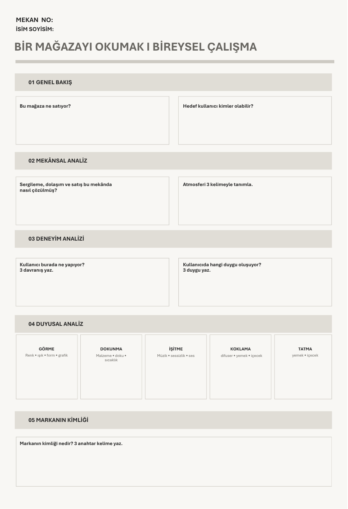
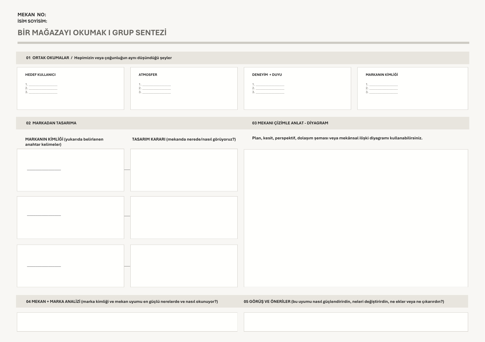
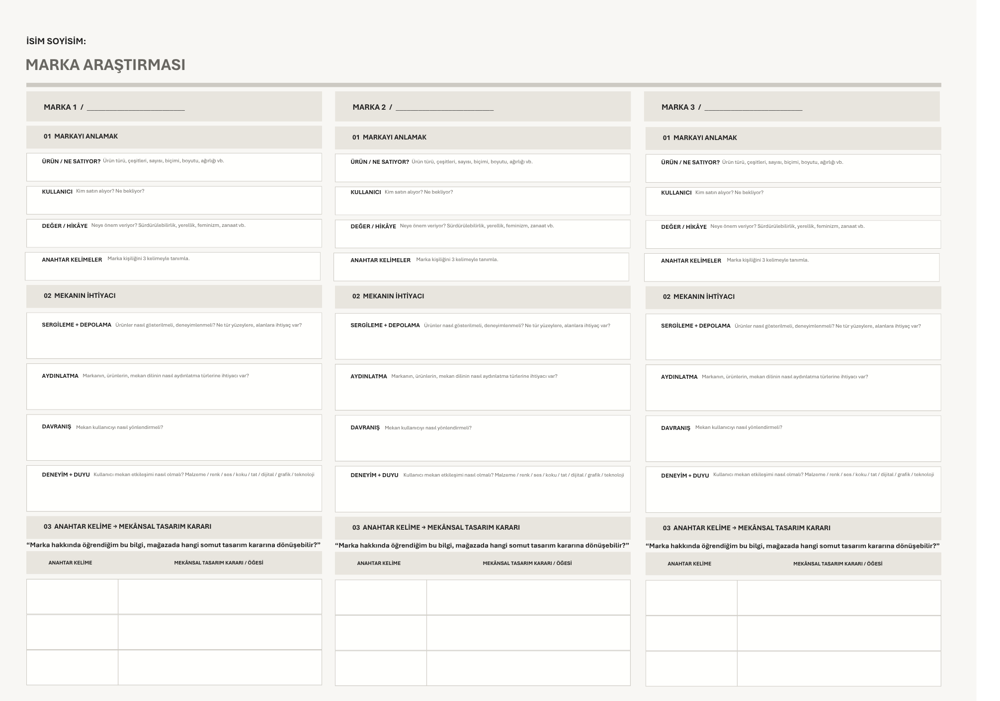
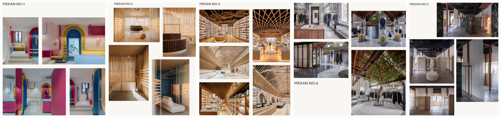
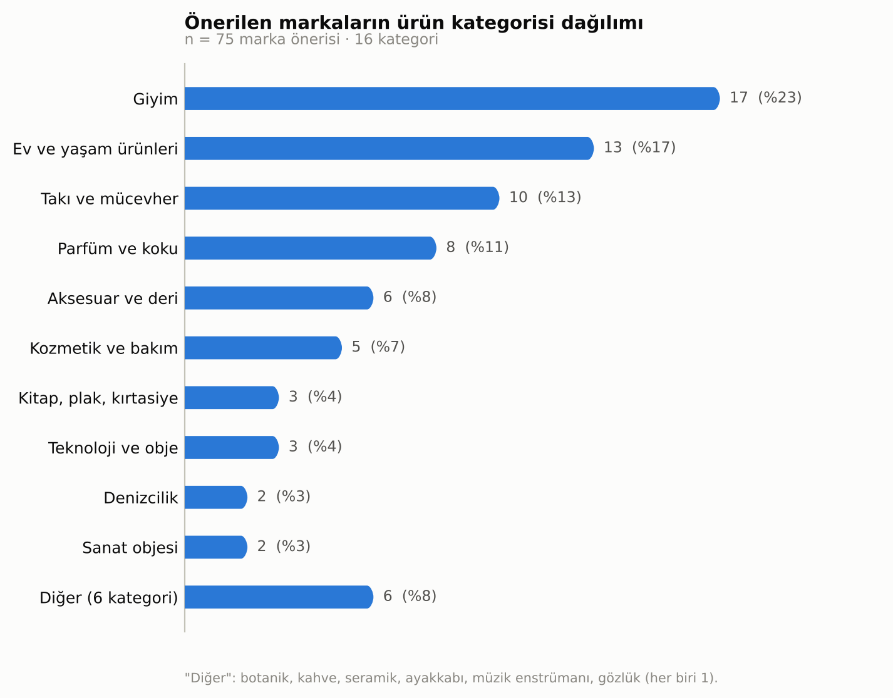
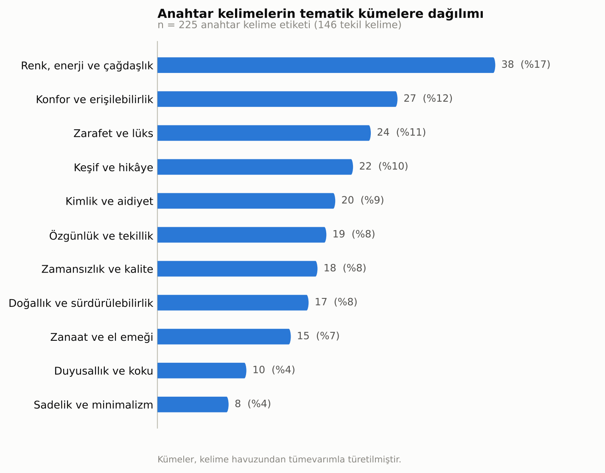
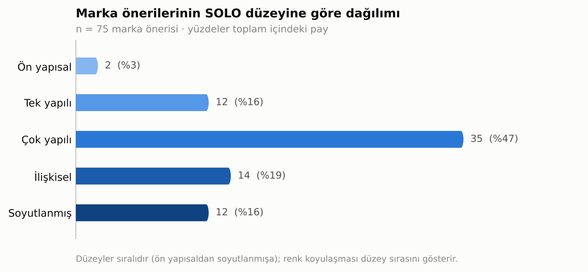
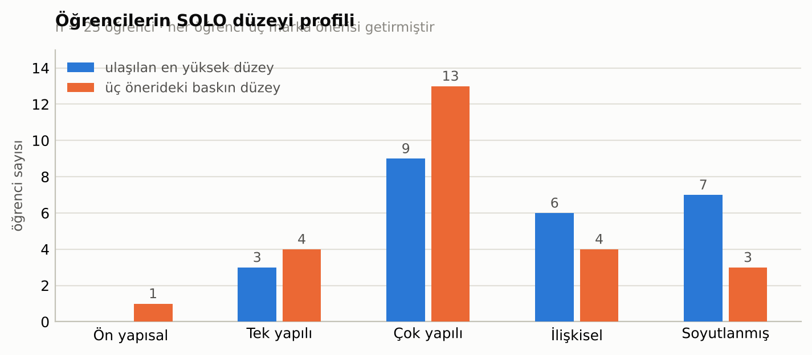
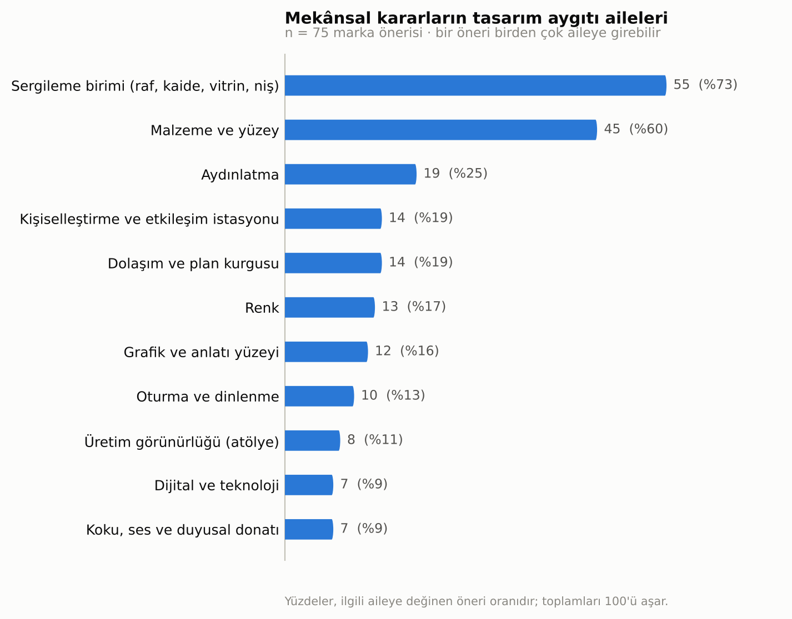

# Anahtar Kelimeden Mekânsal Karara: Perakende Tasarımı Stüdyosunda Marka Kimliğinin Çevrilebilirliği

**Betül Ünal**
Dr. Öğr. Üyesi, Kapadokya Üniversitesi, Mimarlık, Tasarım ve Güzel Sanatlar Fakültesi, İç Mimarlık ve Çevre Tasarımı Bölümü

---

## Özet

Perakende mekânı tasarımı eğitiminde en kritik ve en az incelenmiş an, bir marka kimliğinin soyut niteliklerinin çizilebilir bir mekânsal karara dönüştüğü andır. Alanyazın, müşteri yolculuğu haritalama ve marka anahtarı gibi deneyim tasarımı araçlarının stüdyoya aktarımını büyük ölçüde dönem sonu ürünleri ve jüri notları üzerinden değerlendirmiştir. Bu çalışma odağı öne çeker: değerlendirme birimi bitmiş proje değil, çevirinin kendisi, yani "anahtar kelime → mekânsal tasarım kararı" hücresidir. Veri, Kapadokya Üniversitesi İç Mimarlık ve Çevre Tasarımı Bölümü üçüncü sınıf stüdyosunda (IMC301) 29 öğrenciyle yürütülen bir giriş atölyesine aittir. Atölye üç çalışma kâğıdı üzerinden kurgulanmıştır: rastgele atanan beş perakende mekânının bireysel okunması, aynı mekâna düşen öğrencilerin grup sentezi ve sunumu, ve fiziksel mağazası bulunmayan niş markalar arasından üç aday markanın araştırılarak anahtar kelimelerinin mekânsal karara çevrilmesi. Toplanan 25 teslim, 75 marka önerisi ve 225 çeviri hücresi nitel içerik analiziyle incelenmiş; çeviri çıktıları Biggs ve Collis'in (1982) SOLO taksonomisine göre kodlanmıştır. Bulgular, önerilerin %65,3'ünün çok yapılı düzeyde ve altında kaldığını, ilişkisel düzeye yalnızca %34,7'sinin geçtiğini göstermektedir. En büyük yığılma (%46,7), bir tasarım öğesini adlandıran fakat o öğeyi mekândaki bir konum ya da ilişkiye bağlamayan çok yapılı düzeydedir. Tasarım aygıtı repertuvarı belirgin biçimde dengesizdir: sergileme birimi (%73) ve malzeme-yüzey (%60) kararları baskınken, dolaşım ve plan kurgusu %19, koku ve ses donatısı %9 oranında görünmektedir. Anahtar kelime havuzundaki 225 etiketin 146'sı tekil olup %73'ü yalnızca bir kez kullanılmıştır. En yüksek düzey olan soyutlanmış düzeye ulaşan 12 öneri (%16), istisnasız biçimde markanın kendi sözlüğünden türetilmiş ve mekânda tekrar eden *adlandırılmış bir aygıt* üretmiştir. Çalışma, bu bulgular ışığında stüdyo giriş haftası için uygulanabilir bir çalışma kâğıdı revizyonu önermektedir.

**Anahtar kelimeler:** perakende mekânı tasarımı, iç mimarlık stüdyo eğitimi, marka kimliği, mekânsal çeviri, SOLO taksonomisi, içerik analizi

## Abstract

The most critical and least examined moment in retail design education is when the abstract attributes of a brand identity become a drawable spatial decision. Existing scholarship has largely assessed the transfer of experience design tools into the studio through end-of-semester outputs and jury grades. This study moves the focus forward: the unit of assessment is not the finished project but the act of translation itself — the "keyword → spatial design decision" cell. The data comes from an introductory workshop with 29 third-year students in the Interior Architecture and Environmental Design programme at Cappadocia University (IMC301), structured around three worksheets: individual reading of five randomly assigned retail interiors, group synthesis and presentation by students assigned to the same space, and investigation of three candidate niche brands without physical stores, translating their keywords into spatial decisions. The resulting 25 submissions, 75 brand proposals and 225 translation cells were examined through qualitative content analysis, with translation outputs coded against Biggs and Collis's (1982) SOLO taxonomy. Findings show 65.3% of proposals remain at or below the multistructural level, with only 34.7% crossing into the relational level. The largest cluster (46.7%) is multistructural: a design element is named, but not tied to a position or relationship in space. The device repertoire is markedly unbalanced — display units (73%) and material-surface decisions (60%) dominate, while circulation and plan configuration appear in 19% and scent-sound provision in 9% of proposals. Of 225 keyword tags, 146 are unique and 73% occur once. The twelve proposals (16%) reaching the extended abstract level all produced a *named device* derived from the brand's own lexicon and repeating across the space. The study proposes an applicable worksheet revision for the studio's introductory week.

**Keywords:** retail interior design, interior design studio education, brand identity, spatial translation, SOLO taxonomy, content analysis

---

## 1. Giriş

Perakende mekânı, iç mimarlık pratiğinin ürün ile beden, kimlik ile yüzey, anlatı ile rota arasındaki ilişkiyi en yoğun biçimde kurduğu alanlardan biridir. Son yirmi yılda bu alanın tanımı "ürünün sergilendiği yer"den "markanın bedenlendiği yer"e doğru kaymıştır. Perakende tasarımını ayrı bir uzmanlık olarak çerçeveleyen çalışmalar, tasarımcıdan yalnızca mekânsal yetkinlik değil; markalaşma, pazarlama, tüketici psikolojisi, teknoloji entegrasyonu ve kullanıcı deneyimi tasarımını kapsayan çok disiplinli bir donanım beklendiğini ortaya koymuştur (Petermans ve Van Cleempoel 2009; Quartier, Claes ve Vanrie 2017, 2020; Lemon ve Verhoef 2016). Bu beklenti, eğitim programları açısından doğrudan bir müfredat sorusu üretir: Soyut bir marka kimliği, hangi öğretilebilir adımlarla çizilebilir bir mekânsal karara dönüşür?

Bu soru stüdyo pratiğinde çoğu zaman sezgiye bırakılan bir boşluğa işaret eder. Öğrenciler markayı araştırmayı görece hızlı öğrenir; marka araştırmasının çıktısı olan anahtar kelimeyi üretmeyi de öğrenir. Ancak anahtar kelimenin kendisi hiçbir şey çizmez. "Zarafet" bir plan üretmez; "zanaat" bir kesit vermez; "sürdürülebilirlik" bir detay doğurmaz. Çeviri tam olarak burada — kelimeyle çizgi arasındaki boşlukta — gerçekleşir ya da gerçekleşmez. Stüdyo kültürü bu boşluğu çoğunlukla kritikle, yani sözlü ve bireysel bir müdahaleyle doldurur. Bu müdahale değerlidir; ancak izlenebilir ve dönemler arasında karşılaştırılabilir bir veri üretmez.

Alanyazın, deneyim tasarımı araçlarının stüdyoya aktarımını belgelemiştir. Bu çizginin Türkiye bağlamındaki en kapsamlı örneği olan Sunar Bükülmez, Girginkaya Akdağ ve Ekin (2025) çalışması, profesyonel bir deneyim tasarımı ajansıyla iş birliği içinde yürütülen on dört haftalık bir perakende stüdyosunda otuz projeyi dört uzmanın beşli Likert ölçeğiyle yeniden değerlendirmesi yoluyla yetkinlik kazanımlarını izlemiş; öğrencilerin analiz ve konsept tasarım aşamasında (ortalama 3,60) somutlaştırma ve detay tasarımı aşamasına (3,17) göre belirgin biçimde daha başarılı olduğunu göstermiştir. Bu, perakende tasarımı eğitimi açısından önemli ve genellenebilir bir bulgudur.

Ancak bu tür değerlendirmelerin yapısal bir sınırı vardır: analiz birimi projedir. Proje, onlarca kararın birikmiş sonucudur ve bir projenin marka analizi başlığından yüksek puan alması, o projedeki hangi çeviri hamlesinin işlediğini söylemez. Uzman değerlendirmesi sonucu ölçer, süreci değil. Dahası, dönem sonu ürünü üzerinden yapılan bir okuma, haftalarca süren kritik müdahalesinin etkisini öğrencinin kendi çeviri becerisinden ayrıştıramaz.

Bu makale odağı bilinçli olarak daraltır ve öne çeker. Değerlendirme birimi proje değil, *çeviri hücresi*dir: bir öğrencinin belirli bir marka için ürettiği belirli bir anahtar kelimenin karşısına yazdığı belirli mekânsal karar. Veri, dönem sonunda değil, dönemin ilk haftasında — henüz hiçbir kritik müdahalesi yapılmamışken — üretilmiştir. Bu tercih, öğrencinin stüdyoya getirdiği çeviri becerisinin taban çizgisini görünür kılar ve müfredat müdahalesinin nereye yapılması gerektiğini gösterir.

Araştırma soruları şunlardır:

1. Üçüncü sınıf iç mimarlık öğrencileri, bir marka kimliğinden türettikleri anahtar kelimeleri hangi yapısal düzeyde mekânsal karara çevirebilmektedir?
2. Bu çeviride hangi tasarım aygıtı aileleri öne çıkmakta, hangileri sistematik olarak eksik kalmaktadır?
3. Öğrencilerin ürettiği anahtar kelime sözlüğünün yapısı nedir ve bu yapı çeviri başarısıyla nasıl ilişkilenir?
4. Yüksek düzeyli çeviriyi düşük düzeyliden ayıran gözlemlenebilir bir gösterge tanımlanabilir mi?

---

## 2. Kuramsal Arka Plan

Perakende mekânının bir iletişim aracı olarak kavramsallaştırılması Kotler'in (1973) *atmospherics* kavramıyla başlar. Kotler, satın alma kararının yalnızca ürün ve fiyat tarafından değil, mekânın bilinçli olarak tasarlanmış duyusal niteliklerince de belirlendiğini öne sürerek mekânı pazarlama değişkenleri arasına katmıştır. Mehrabian ve Russell'ın (1974) çevre psikolojisi modeli bu etkinin mekanizmasını haz–uyarılma–baskınlık üçlüsü üzerinden formüle ederek atmosfer ile davranış arasındaki bağı deneysel olarak çalışılabilir kılmış; Bitner (1992) *servicescape* kavramıyla modeli hizmet ortamlarına genişletmiş ve fiziksel çevrenin yalnızca müşteri değil çalışan davranışını da biçimlendirdiğini göstermiştir. Pine ve Gilmore'un (1999) deneyim ekonomisi tezi bu çizgiyi ekonomik bir dönüşüm iddiasına bağlamış; Lemon ve Verhoef (2016) müşteri deneyimini tek bir temas anı değil, satın alma öncesi, satın alma ve sonrası evrelerinden oluşan çok kanallı bir yolculuk olarak yeniden tanımlamıştır. Stein ve Ramaseshan (2016) bu yolculuğun temas noktalarını atmosferik, teknolojik, iletişimsel, süreçsel, çalışan–müşteri etkileşimi, müşteri–müşteri etkileşimi ve ürün etkileşimi olmak üzere yedi öğeye ayırmış; Zomerdijk ve Voss (2010) yolculuk haritasını deneyimin kritik anlarını diziye koyan bir storyboard olarak okumuştur. Bu birikim iç mimarlık stüdyosu için önemli bir sonuç doğurur: mekân statik bir kap değil, zaman içinde açılan bir sekanstır.

Marka kimliğini sistematik olarak çözümleme çabası tasarım alanına büyük ölçüde Wheeler'ın (2017) çalışmasıyla aktarılmıştır. Wheeler, bütüncül bir marka deneyimini imge ve kimlik, ürün ve hizmetler, insanlar ve kültür, satış süreçleri, fiziksel ve sanal mekânlar ile farkındalık stratejisi olmak üzere altı bileşen üzerinden kurar; bu çerçeve pazarlama kökenli olmasına karşın iç mimarlık için doğrudan kullanışlıdır, çünkü fiziksel mekânı marka kimliğinin eşdeğer bir taşıyıcısı olarak konumlandırır. Ancak marka anahtarı araçlarının tasarım eğitimine aktarımında kritik bir eşik vardır: bu araçlar markayı *anlamak* için tasarlanmıştır, markayı *çizmek* için değil. Klingmann'ın (2010) brandscape kavramı ile Klanten, Ehmann ve Borges'in (2013) derlediği markalı mimarlık örnekleri kimliğin mekânsallaşmasının mümkün olduğunu gösterir; ancak bu örnekler ürünü sunar, yöntemi değil. Köprülü ve Boz (2023), tek bir showroom örneği üzerinden marka hikâyesinin mekân tasarımına dönüşme sürecini izleyerek bu boşluğa yaklaşmıştır. Mesher (2010) ise perakende tasarımını doğrudan bir eğitim nesnesi olarak ele alan sayılı kaynaktan biri olarak marka ve kimliği konsept geliştirmenin başlangıç noktası sayar; markayı bir tema değil bir başlangıç verisi olarak konumlandırır.

Perakende atmosferinin yalnızca görsel olmadığına ilişkin kanıt birikimi güçlüdür. Spence ve arkadaşları (2014) mağaza ortamının görsel, işitsel, dokunsal, kokusal ve tatsal boyutlarına ilişkin bilimsel kanıtları derleyerek çok duyulu atmosfer kavramını sistemleştirmiş; duyular arası uyumun tek bir duyuya yapılan yatırımdan daha güçlü etkiler ürettiğini göstermiştir. Underhill (2008) alışveriş davranışının beden ölçeğindeki belirleyicilerini — geçiş genişlikleri, dokunma eğilimi — etnografik gözlemle ortaya koymuştur. Mimarlık kuramı tarafında Pallasmaa (2005), modern mimarlığın göz-merkezliliğini eleştirerek mekânın bedenin tamamıyla deneyimlendiğini savunur; bu, görselleştirme araçlarının hâkim olduğu bir temsil kültüründe tasarım düşüncesinin yapısal olarak görmeye doğru yanlılaşacağı uyarısını taşır. Bu makalenin bulgularından biri, söz konusu uyarının ampirik karşılığını göstermektedir.

Perakende tasarımı eğitimini kendisini araştırma nesnesi yapan çizgi büyük ölçüde Quartier ve arkadaşlarının çalışmalarıyla şekillenmiştir. Quartier, Claes ve Vanrie (2017) hızla evrilen disiplinde perakende tasarımcısının hangi yetkinliklere gereksinim duyduğunu sormuş; aynı ekip (2020) araştırma, tasarım, sosyokültürel bilimler, markalaşma, pazarlama ve strateji, çok kanallılık ve dijital, iletişim ile örgütlenme ve yönetim olmak üzere sekiz temada toplanan kapsamlı bir yetkinlik çerçevesi geliştirmiştir. Di Iorio ve Spagnoli (2023) deneyim temelli öğrenme için yeniden çerçevelenmiş öğrenme araçları önermiş; Rolla, Hasırcı, Anal ve Edes (2021) disiplinlerarası bir konsept mağaza tasarım sürecini belgelemiştir.

Bu birikim iki uçta yoğunlaşmaktadır. Bir uçta markanın mekânsallaşmasının mümkün olduğunu gösteren örnek ve vaka çalışmaları, diğer uçta bu aktarımın sonuçlarını yetkinlik çerçeveleri üzerinden ölçen eğitim araştırmaları bulunur. Arada kalan şey çevirinin kendisidir: hangi tür bir anahtar kelime hangi tür bir mekânsal karara dönüşür, bir öğrenci "zanaat" kelimesinden "camlı atölye duvarı"na nasıl geçer, geçemediğinde yerine ne koyar? Bu makale söz konusu boşluğu doldurmayı amaçlamaktadır.

Bu boşluğu ölçülebilir kılmak için uygun aracın niteliği de tartışmayı gerektirir. Quartier ve arkadaşlarının (2020) yetkinlik çerçevesi, bir tasarımcının *neyi bilmesi ve yapabilmesi* gerektiğini haritalar; bu haliyle müfredat tasarımı ve mezun profili için güçlü bir araçtır. Ancak yetkinlik çerçeveleri, tek bir tasarım kararının *yapısal olgunluğunu* derecelendirmek üzere kurulmamıştır. Burada gereken, bir yetkinliğin var olup olmadığını değil, belirli bir öğrenme çıktısının ne kadar karmaşık biçimde yapılandığını söyleyen bir ölçüdür. Biggs ve Collis'in (1982) SOLO taksonomisi tam da bunu yapar: bir yanıtın içeriğinden bağımsız olarak, yanıtın kaç öğeyi ve bu öğeler arasında hangi ilişkileri kurduğunu beş düzeyde sıralar. Taksonominin ayırt edici özelliği, "doğru/yanlış" eksenini "yapısal olgunluk" ekseniyle değiştirmesidir; bu da tasarım gibi tek doğrusu olmayan alanlarda onu özellikle kullanışlı kılar (Biggs ve Tang 2011). Bir tasarım kararı yanlış olmayabilir ama yapısal olarak eksik olabilir — "ahşap raf" yanlış bir karar değildir, yalnızca mekânla ilişkisi kurulmamış bir karardır. SOLO bu ayrımı adlandırmaya izin verir. Bu nedenle mevcut araştırma, kendi ölçeğini icat etmek yerine yerleşik bir öğrenme çıktısı taksonomisini çeviri hücrelerine uyarlamayı tercih etmiştir.

---

## 3. Yöntem

### Bağlam ve atölyenin kurgusu

Araştırma, Kapadokya Üniversitesi Mimarlık, Tasarım ve Güzel Sanatlar Fakültesi İç Mimarlık ve Çevre Tasarımı Bölümü'nde yürütülen IMC301 İç Mimari Tasarım Stüdyosu IV dersi kapsamında gerçekleştirilmiştir. Ders, 2026–2027 Güz yarıyılında haftada sekiz saat yüz yüze ve on dört hafta süreyle yürütülen zorunlu bir stüdyo dersidir; derse kayıtlı öğrenci sayısı 29'dur. Dönem projesinin alanı Mersin Marina'dır. Proje tanımı öğrencilerden az bilinen bir perakende markası seçmelerini, alanı çözümlemelerini ve kullanıcı odaklı, etkileşimli, duyusal bir mekânsal deneyim geliştirmelerini beklemektedir. Çözülmesi zorunlu alanlar arasında giriş ve marka eşiği, sergileme alanları, dolaşım ve mekânsal akış, satış ve kasa bölgesi, depolama, personel alanları, deneyim ve etkileşim alanları ile malzeme ve mimari öğeler sayılmıştır. Dersin ayırt edici odağı, izlencede açıkça belirtildiği üzere "bir markanın kimliğinin çözümlenip mekânsal bir dile çevrilmesi"dir.

Bu araştırmanın verisi dönemin ilk haftasına ve onu izleyen iki haftalık teslim penceresine aittir. Bu nokta yöntemsel olarak kritiktir: veri, bireysel kritik sürecinin henüz başlamadığı bir anda üretilmiştir ve öğrencilerin stüdyoya getirdiği çeviri becerisinin taban çizgisini temsil eder.

İlk hafta iki oturumluk bir giriş atölyesi olarak kurgulanmıştır. Kuramsal girişte marka kimliği, kullanıcı profili ve müşteri yolculuğu kavramları dört başlık altında sunulmuştur: markadan mekâna, kullanıcı, deneyim ve etkileşim, mekân. Müşteri yolculuğu sekiz aşamalı olarak tanımlanmıştır (farkındalık, çekim, eşik, yönlenme, keşif, etkileşim, satın alma, ayrılış). Duyusal çerçeve beş duyu ve bedensel algı üzerinden kurulmuş; anahtar kelime üretimi için üç ölçüt verilmiştir: her markaya uyacak kadar genel olmamalı, araştırmada karşılığı bulunmalı, mekânda somut bir karşılığı kurulabilmeli. Son ölçüt, bu araştırmanın ölçme nesnesinin doğrudan ifadesidir.

Kuramsal girişin ardından atölye üç çalışma kâğıdı üzerinden ilerlemiştir (Tablo 1, Şekil 1–3).

**Tablo 1. Atölyenin üç çalışma kâğıdı**

| | Çalışma Kâğıdı 1 | Çalışma Kâğıdı 2 | Çalışma Kâğıdı 3 |
|---|---|---|---|
| **Başlık** | Bir Mağazayı Okumak: Bireysel Çalışma | Bir Mağazayı Okumak: Grup Sentezi | Marka Araştırması |
| **Çalışma biçimi** | Bireysel | Grup (aynı mekâna atananlar) | Bireysel, ödev |
| **Girdi** | Rastgele atanan, marka adı verilmemiş bir perakende mekânının fotoğraf seti | Grup üyelerinin bireysel okumaları | Öğrencinin kendi seçtiği üç aday marka |
| **Bölümler** | Genel bakış · mekânsal analiz · deneyim analizi · duyusal analiz · markanın kimliği | Ortak okumalar · markadan tasarıma · mekânı çizimle anlat · mekân–marka analizi · görüş ve öneriler | Markayı anlamak · mekânın ihtiyacı · anahtar kelime → mekânsal tasarım kararı |
| **Çıktı** | Üç kelimelik atmosfer ve kimlik okuması | Dört başlıkta üçer ortak madde, diyagram, stüdyo sunumu | Marka başına üç anahtar kelime ve üç mekânsal karar |

**Şekil 1.** Çalışma Kâğıdı 1 — "Bir Mağazayı Okumak: Bireysel Çalışma". Kâğıt, mekânı beş katmanda okutur: ne satıyor ve kime, sergileme–dolaşım–satış nasıl çözülmüş, kullanıcı ne yapıyor ve ne hissediyor, beş duyu, markanın kimliği.

**Şekil 2.** Çalışma Kâğıdı 2 — "Grup Sentezi". Bireysel okumalar dört başlıkta üçer ortak maddeye indirgenir; ikinci bölüm bu maddeleri tasarım kararlarıyla eşleştirir.

**Şekil 3.** Çalışma Kâğıdı 3 — "Marka Araştırması". Üç aday marka yan yana çalışılır. Alt bölümdeki iki sütunlu tablo ("anahtar kelime → mekânsal tasarım kararı / öğesi") bu araştırmanın analiz birimini oluşturur.

Çalışma Kâğıdı 1 için seçilen beş mekân, perakende tipolojisi ve atmosfer stratejisi bakımından bilinçli olarak farklılaştırılmıştır (Şekil 4, Tablo 2). Mekânlar öğrencilere marka adı verilmeksizin, yalnızca fotoğraf setleri hâlinde sunulmuş; kimliğin mekândan geriye doğru okunması istenmiştir. Farklılaştırma, atölyenin temel sorusunu beş ayrı atmosfer stratejisi üzerinden sınamayı amaçlamaktadır: renk, doku, strüktür, hammadde ve saydamlık, her biri bir başka mekânda baskın taşıyıcı konumundadır.

**Şekil 4.** Çalışma Kâğıdı 1'in beş vaka mekânı, öğrencilere dağıtılan fotoğraf setleri hâlinde. Soldan sağa: Mekân 1–5.

**Tablo 2. Çalışma Kâğıdı 1'in beş vaka mekânı**

| No | Tipoloji | Atmosfer stratejisi |
|---|---|---|
| 1 | Çocuk ve genç giyim | Yoğun renk bloklaması, kemerli nişler, oyunsu geometri |
| 2 | Gözlük / optik markası mağazası | Perde, kanelürlü yüzey, sıcak ışık; yumuşak doku |
| 3 | Kitabevi | Parametrik ahşap tavan, sürekli raf duvarları, geniş hacim |
| 4 | Giyim | Brüt beton, ahşap makas, mekân ortasında canlı ağaç; ham-doğal |
| 5 | Moda | Mermer, ahşap çerçeve, yarı saydam tekstil bölücüler; minimal-rafine |

### Veri ve kodlama

Çalışma Kâğıdı 3 için 25 teslim arşivlenmiştir (kayıtlı öğrencilerin %86'sı). Her teslim üç marka önerisi, her öneri üç çeviri satırı içerdiğinden toplam **75 marka önerisi** ve **225 çeviri hücresi** elde edilmiştir. Çalışma Kâğıdı 2 için dört grubun sentezi incelenebilmiştir (Mekân 1–4); beşinci grubun sentezi arşivde bulunmamaktadır.

Veri nitel içerik analiziyle (Krippendorff 2019; Mayring 2014) ve bunu izleyen betimsel istatistikle incelenmiştir. Çeviri çıktılarının yapısal düzeyi, bu çalışma için geliştirilmiş bir ölçekle değil, **Biggs ve Collis'in (1982) SOLO taksonomisiyle** kodlanmıştır. SOLO (*Structure of the Observed Learning Outcome*), bir öğrenme çıktısının *içeriğini* değil *yapısal karmaşıklığını* beş düzeyde derecelendiren ve tasarım dâhil pek çok alanda yaygın biçimde kullanılan yerleşik bir değerlendirme çerçevesidir (Biggs ve Tang 2011). Taksonominin bu araştırma bağlamındaki işlemsel karşılıkları Tablo 3'te verilmiştir.

**Tablo 3. SOLO taksonomisinin çeviri hücrelerine uyarlanması**

| Düzey | SOLO tanımı | Bu araştırmadaki işlemsel ölçüt | Veriden örnek |
|---|---|---|---|
| **Ön yapısal** | İlgisiz ya da konu dışı yanıt | Mekânsal içerik yok; ürün ya da pazarlama ifadesinin tekrarı | "Güncel modaya uygun"; "Uygun fiyatlı ürün seçenekleri" |
| **Tek yapılı** | Tek bir ilgili öğeye tutunma | Tek bir genel atmosfer sıfatı; çizilemez, ölçülemez | "Sade ve estetik"; "Doğayı mekânda hissedebilmeli"; "Ferah dolaşım alanları" |
| **Çok yapılı** | Birkaç öğe sayılır, aralarında ilişki kurulmaz | Bir ya da birkaç tasarım öğesi *tür* düzeyinde adlandırılır | "Ahşap raflar"; "Ray spot aydınlatma"; "Açık raf düzeni"; "Nötr renk paleti" |
| **İlişkisel** | Öğeler birbirine ve bütüne bağlanır | Öğe, mekândaki bir konum, ilişki ya da ölçüyle bağlanır | "Camlı atölye duvarı ve açık kuruma rafı"; "Rafların arkasında sarı ışıkla birlikte perde kullanımı" |
| **Soyutlanmış** | Verili bağlamın ötesine genelleme | Markanın kendi sözlüğünden adlandırılmış, mekânda tekrar eden aygıt | "Patina Wall"; "Visible Atelier"; "Scent Bar"; "Koku Barı (Fragrance Bar)" |

Çok yapılı ile ilişkisel düzey arasındaki eşik belirleyicidir ve SOLO alanyazınının klasik darboğazıdır: "vitrin" bir türdür, "giriş aksında, arkasında çalışan çarkın görüldüğü tek parçalık vitrin" bir ilişkidir.

Her öneri ayrıca, kararın değindiği **tasarım aygıtı aileleri** bakımından çok etiketli olarak kodlanmıştır. On bir aileden oluşan kategori sistemi, kelime havuzundan tümevarımla türetilmiş; dersin izlencesindeki "çözülmesi zorunlu alanlar" listesi ve Stein ve Ramaseshan'ın (2016) temas noktası öğeleriyle çapraz denetlenmiştir. Aileler şunlardır: sergileme birimi; malzeme ve yüzey; aydınlatma; dolaşım ve plan kurgusu; grafik ve anlatı yüzeyi; üretim görünürlüğü; kişiselleştirme ve etkileşim istasyonu; dijital ve teknoloji; renk; oturma ve dinlenme; koku, ses ve duyusal donatı. Marka önerileri ayrıca ürün kategorisi, menşe ve ölçek bakımından kodlanmıştır.

Uzman panelinin beşli Likert ölçeğiyle yeniden değerlendirmesi (Sunar Bükülmez vd. 2025) bu araştırmada tercih edilmemiştir; çünkü söz konusu yöntem bitmiş *projeyi* puanlar, oysa buradaki analiz birimi tek tek *çeviri edimidir* ve doğrudan belgeden okunabilmektedir. Likert temelli ikinci bir değerlendirme katmanı, ara jüri ve final teslimlerini kapsayacak bir devam çalışması için uygun olacaktır.

---

## 4. Bulgular

### 4.1. Mekânı okumak

Grup sentezleri, farklı bireysel okumaların ortak bir sözlükte buluşma kapasitesini göstermektedir (Tablo 4). Dört grubun tamamı atmosfer okumasını üç sıfata indirgemeyi başarmıştır.

**Tablo 4. Grup sentezlerinin ortak okumaları**

| Mekân | Hedef kullanıcı | Atmosfer | Markanın kimliği |
|---|---|---|---|
| **1** Çocuk ve genç giyim | çocuklar · aile · gençler | dikkat çekici · renkli · eğlenceli | eğlence · renk · dinamik |
| **2** Gözlük / optik | deneyim · görme · lüks ve prestij amaçlı | ritim · lüks · kontrollü | zarif · dinamik · estetik |
| **3** Kitabevi | araştırmacılar · akademisyenler · düzenli okuyucular | sıcak · sakin · modern | prestij · organik · değişim |
| **4** Giyim (ham-doğal) | sürdürülebilir modayı benimseyen · premium tasarım arayan · dingin mekân tercih eden | sakin ve dingin · doğal ve organik · ferah ve modern | sürdürülebilirlik · zarafet ve lüks · modern |

Daha dikkate değer olan, grupların kendi okumalarını eleştirebilmesidir. Mekân 2 grubu, "kullanılan renk tonları sebebiyle mekânı deneyimleme yetersiz kalmıştır; ruhsuz bir mekân yaratılmıştır, burası bir lobi ya da eczane gibi mekânları andırıyor ve gözlüğe doğrudan bir vurgu yapılmamış" değerlendirmesiyle marka–mekân uyumsuzluğunu teşhis etmiştir. Mekân 4 grubu uyumun "mekânın merkezindeki canlı ağaç ve organik dairesel zemin kurgusunda" okunduğunu saptamış ve mekânı bir merkez–çeper diyagramına dönüştürmüştür. Mekân 3 grubu ise beş mekânı tek bir eksen üzerinde (4 ↔ 1 ↔ 2 ↔ 5 ↔ 3) sıralayarak kendi mekânını diğerlerine göre konumlandırmıştır; bu, atölyenin istemediği ancak ürettiği bir çıktıdır.

Grup sentezlerinin ikinci bölümü, belirlenen üç anahtar kelimeyi tasarım kararlarıyla eşleştirmeyi istemektedir; yani Çalışma Kâğıdı 3'teki çeviri işleminin grup ölçeğindeki provasıdır. Burada üretilen kararlar, bireysel çalışmaya kıyasla belirgin biçimde daha ilişkiseldir. Mekân 2 grubu "dinamik" kelimesini "rafların bir bütün hâlinde kıvrımlı şekilde devam etmesi, rafların arkasında sarı ışıkla birlikte perde kullanımı, kıvrımlı-dalga şeklinde dairesel banko tasarımı" biçiminde açmış; Mekân 4 grubu "organik" kelimesini "merkezine canlı bir ağacı alan dairesel zemin kurgusu ve akışkan yollar sayesinde katı, keskin hatlardan uzak bir dolaşım şeması" olarak tanımlamıştır. Her iki karar da öğeyi mekândaki bir konuma ve bir harekete bağlamaktadır. Grup tartışmasının, bireysel çalışmanın ulaşamadığı ilişkisel düzeyi kolaylaştırdığı izlenimi güçlüdür; ancak bu izlenim, grup ve bireysel çıktıların aynı ölçütle karşılaştırıldığı bir tasarımla sınanmaya muhtaçtır.

Grupların beşinci bölümde ürettiği öneriler de aynı yönde çalışmaktadır. Mekân 1 grubu "mekândaki pencerenin konumu değiştirilmeli, ayna boyutu büyütülmeli, çocuklar için elverişli askılık yüksekliği olmalı, oturma alanı eklenmeli" diyerek doğrudan ergonomi ve yerleşim diline geçmiş; Mekân 3 grubu "yönlendirmeler artırılabilir ve okuma alanlarında ergonomiyi düşünerek konfor arttırılabilir" demiştir. Eleştiri kipinin, öneri kipinden daha somut sonuç verdiği görülmektedir: öğrenciler mevcut bir mekânı yargılarken ölçü, konum ve yükseklik gibi kavramlara kendiliğinden başvurmaktadır.

Bu bulgular atölyenin ilk iki aşamasının amacına ulaştığını göstermektedir: mekânı okumak, okumayı ortak bir sözlüğe indirgemek ve bu sözlüğü eleştirel biçimde sınamak üçüncü sınıf düzeyinde edinilmiş becerilerdir. Asıl güçlük bir sonraki adımdadır — okunan mekân ortadan kalkıp yerine yalnızca bir marka ve bir kelime kaldığında.

### 4.2. Marka seçimi

Yetmiş beş marka önerisinin ürün kategorisi dağılımı belirgin biçimde yoğunlaşmıştır (Şekil 5). İlk dört kategori — giyim, ev ve yaşam ürünleri, takı ve mücevher, parfüm ve koku — önerilerin %64'ünü oluşturmaktadır.

**Şekil 5.** Önerilen markaların ürün kategorisi dağılımı.

Bu yoğunlaşma atölye sunumunda verilen ürün grubu listesiyle uyumludur; ancak listenin daha az temsil edilen uçlarının (halı ve kilim, bisiklet, seramik) neredeyse hiç seçilmediğini de göstermektedir. Öğrenciler kendi tüketim deneyimlerine en yakın kategorilere yönelmektedir.

Markaların %74,7'si Türkiye menşelidir; bu, "az bilinen marka" kısıtının yerel bağımsız markaları görünür kıldığını göstermektedir. Önerilerin %81,3'ü niş-bağımsız ölçektedir, yani brifin temel kısıtına uyulmuştur. Buna karşılık yedi öğrenci (%28) en az bir yerleşik kurumsal marka önermiş; iki öğrencinin üç önerisinin tamamı kurumsal ölçekte kalmıştır. Bu sapma briften kopuş olarak değil, bir okuma güçlüğü olarak yorumlanmalıdır: "az bilinen" ile "benim bilmediğim" arasındaki fark öğrenciler için her zaman açık değildir ve brifin bu kısıtı ölçütlendirilmeye muhtaçtır.

İki öğrencinin bağımsız olarak aynı markayı (Atelier Rebul) seçmiş olması beklenmedik bir doğrulama fırsatı sunmuştur. Her iki öğrencinin ürettiği anahtar kelime setleri — *zarafet · nostalji · duyusallık* ve *zarif · geleneksel · duyusal* — üç kelimeden ikisinde kök düzeyinde örtüşmektedir. Aynı araştırma protokolünün farklı kişilerce uygulandığında benzer kelimelere yakınsaması, çalışma kâğıdının bir ölçme aracı olarak tutarlılığına ilişkin bir işaret sayılabilir.

### 4.3. Anahtar kelime havuzu

Yetmiş beş marka için üretilen 225 anahtar kelime etiketinin 146'sı tekildir (tip-belirti oranı 0,65). Tekil kelimelerin %73'ü (107 kelime) yalnızca bir kez kullanılmıştır; bu, tüm etiketlerin %48'ine karşılık gelir. En sık kullanılan on kelime toplam etiketlerin yalnızca %24'ünü oluşturmaktadır. Bu, oldukça dağınık bir sözlüktür. Olumlu okumada öğrenciler markaya özgü ve kalıplaşmamış sözcükler üretmektedir; olumsuz okumada ortak bir mesleki sözlüğün yokluğu stüdyo içi tartışmayı ve karşılaştırmayı güçleştirmektedir. İki okuma birbirini dışlamaz; veriler her ikisini de desteklemektedir.

Kök düzeyinde birleştirildiğinde en sık kelime kümeleri şunlardır: *doğal / doğallık / doğa* (14), *zarif / zarafet* (10), *özgün / özgünlük* (10), *zanaat / el işçiliği / el yapımı* (9), *keşif* (7), *konfor / konforlu / rahatlık* (7), *zamansız / zamansızlık* (6), *kişisel / kişisellik / kişiselleştirme* (6).

**Şekil 6.** Anahtar kelimelerin tematik kümelere dağılımı.

Şekil 6’da dikkat çekici olan, duyusallık kümesinin sondan ikinci sırada yer almasıdır. Doğrudan duyuya gönderme yapan etiketler tüm etiketlerin yalnızca %4,9'unu oluşturmaktadır. Oysa atölyenin kuramsal girişi beş duyu ve bedensel algı üzerine kurulmuş, Çalışma Kâğıdı 1 beş duyu için ayrı kutular ayırmış, Çalışma Kâğıdı 3'te "Deneyim + Duyu" başlığı ayrı bir alan olarak yer almıştır. Yani duyusal çerçeve araçta mevcuttur ancak anahtar kelime üretimine taşınmamaktadır. Öğrenciler duyuyu bir deneyim açıklaması olarak yazmakta, bir kimlik niteliği olarak kodlamamaktadır.

### 4.4. Çeviri düzeyi

Yetmiş beş marka önerisinin SOLO dağılımı Şekil 7’de verilmiştir.

**Şekil 7.** Marka önerilerinin SOLO düzeyine göre dağılımı.

Önerilerin %65,3'ü çok yapılı düzeyde ve altında kalmakta; ilişkisel düzeye yalnızca %34,7'si geçmektedir. En büyük yığılma, önerilerin neredeyse yarısını (%46,7) kapsayan çok yapılı düzeydedir. Bu, araştırmanın en öğretici bulgusudur: **öğrencilerin çoğunluğu "ne" sorusunu yanıtlamakta, "nerede, neyle, hangi ilişkide" sorusunu yanıtlamamaktadır.** Öğrenciler bir tasarım öğesini doğru biçimde adlandırabilmekte, fakat o öğeyi mekânın kurgusuna bağlayamamaktadır.

Düzeyler arasındaki farkın niteliği, tek bir anahtar kelimenin farklı teslimlerdeki karşılıkları yan yana konduğunda netleşir. "Zanaat" ve türevleri (el işçiliği, el yapımı) veri setinde dokuz kez geçmekte ve çeviri çıktıları taksonominin neredeyse tüm düzeylerine dağılmaktadır (Tablo 5). Aynı kelime, aynı hafta, aynı brif altında beş farklı yapısal olgunlukta karşılık bulmaktadır.

**Tablo 5. Tek bir anahtar kelimenin ("zanaat / el işçiliği") düzeylere göre karşılıkları**

| Düzey | Veriden karşılık | Neden bu düzey |
|---|---|---|
| Tek yapılı | "Ürün detaylarının yakından görülebileceği sergileme alanları" | Bir nitelik beyan ediliyor; hangi öğeyle sağlanacağı yok |
| Çok yapılı | "Ahşap, deri ve doğal taş gibi malzemelerin kullanılması" | Malzemeler sayılıyor; aralarında ya da mekânla ilişki kurulmuyor |
| Çok yapılı | "Açık atölye / üretim köşesi" | Bir birim adlandırılıyor; mekândaki yeri ve ne göstereceği belirsiz |
| İlişkisel | "Üretim sürecini görünür kılmak: dokuma detaylarının sergilendiği malzeme duvarı, el dokuması halıların askılı sistemde öne çıkarılması, el işçiliğini gösteren yakın inceleme alanı" | Üç öğe birbirine ve tek bir amaca (görünürlük) bağlanıyor |
| Soyutlanmış | "*Visible Atelier*: üretimin gizlenmediği, ürünün yalnızca bitmiş hâlinin değil arkasındaki kesim, dikiş ve yüzey işleme sürecinin de izlendiği bölüm" | Aygıt adlandırılıyor, markanın sözlüğüne bağlanıyor ve bir ilke hâline geliyor |

Tablo 5, çok yapılı ile ilişkisel düzey arasındaki eşiğin ne kadar ince ve ne kadar belirleyici olduğunu göstermektedir. "Açık atölye köşesi" ile "dokuma detaylarının sergilendiği malzeme duvarı" arasındaki fark bir kelime dağarcığı farkı değildir; birincisi bir oda adı, ikincisi bir tasarım kararıdır. Birincisi plana bir etiket koyar, ikincisi plana bir yüzey çizdirir.

Öğrenci düzeyinde bakıldığında profil Şekil 8’deki gibidir. Yirmi beş öğrenciden 13'ünün üç önerisinde de baskın düzey çok yapılıdır. Öğrencilerin 13'ü (%52) en az bir önerisinde ilişkisel ya da üstü düzeye ulaşmış; 7'si (%28) en az bir önerisinde soyutlanmış düzeye erişmiştir. Buna karşılık 4 öğrenci hiçbir önerisinde çok yapılı düzeyin üstüne çıkamamıştır.

**Şekil 8.** Öğrencilerin SOLO düzeyi profili: üç öneri içinde ulaşılan en yüksek düzey ve baskın düzey.

Bu dağılımın en önemli özelliği, aynı araç, aynı brif ve aynı süre altında ortaya çıkmış olmasıdır. Çeviri becerisinin ön yapısaldan soyutlanmışa kadar beş düzeyin tamamına yayılması, becerinin bireysel yetenekten çok henüz öğretilmemiş bir yöntem eksikliğine bağlı olduğunu düşündürmektedir.

Marka özelliklerinin çeviri düzeyi üzerindeki etkisi zayıftır. Türkiye menşeli markalarda ilişkisel ve üstü oran %36, yurt dışı menşelilerde %32'dir. Niş markalarda bu oran %38 iken kurumsal markalarda %21'e düşmektedir — tanınmış bir markayı yorumlamanın, öğrenciyi yerleşik mağaza şablonuna geri çektiğine işaret eden bir fark. Ürün kategorisine göre farklılık daha belirgindir (Tablo 6).

**Tablo 6. Ürün kategorisine göre ilişkisel ve üstü düzeye geçiş oranı**

| Kategori | n | İlişkisel ve üstü |
|---|---|---|
| Aksesuar ve deri | 6 | %67 |
| Ev ve yaşam ürünleri | 13 | %46 |
| Parfüm ve koku | 8 | %38 |
| Takı ve mücevher | 10 | %30 |
| Giyim | 17 | %29 |
| Kitap, plak, kırtasiye | 3 | %0 |
| Kozmetik ve bakım | 5 | %0 |

Deri ürünleri, ev ürünleri ve parfüm; tekil nesne olarak sergilenen, ölçek olarak kavranabilir ve dokunmayı ya da koklamayı davet eden ürünlerdir; bu nedenle "kaide", "niş", "vitrin", "malzeme", "koku istasyonu" gibi mekânsal karşılıkları daha hızlı çağırırlar. Giyim ise en çok seçilen kategori olmasına rağmen en düşük oranlardan birine sahiptir — çünkü giyim mağazası öğrencinin zihnindeki en yerleşik ve en genelleşmiş şablondur. Tanıdıklık çeviriyi kolaylaştırmaz; aksine şablona geri çeker.

### 4.5. Tasarım aygıtı repertuvarı

Çeviri kararlarının hangi aygıt ailelerine dağıldığı, repertuvarın yapısal dengesizliğini ortaya koymaktadır (Şekil 9).

**Şekil 9.** Mekânsal kararların tasarım aygıtı ailelerine dağılımı.

İki aile — sergileme birimi ve malzeme — repertuvarı domine etmektedir; dokuz öneri (%12) yalnızca bu iki aileyle sınırlı kalmıştır. Buna karşılık dolaşım ve plan kurgusu önerilerin yalnızca %19'unda, koku ve ses donatısı yalnızca %9'unda görünmektedir. Öğrenci düzeyinde bakıldığında 25 öğrenciden yalnızca 11'i en az bir kez dolaşım kararı, yalnızca 7'si en az bir kez duyusal donatı kararı üretmiştir.

Bu dağılım iki eksende okunabilir. Birinci eksen **nesne–mekân** eksenidir: öğrenciler markayı nesneye çevirmektedir (raf, kaide, vitrin, yüzey), mekâna değil (rota, görüş hattı, eşik sekansı, bölge ilişkisi). Veride bunun tipik görünümü, bir markanın üç çeviri satırının da sergileme birimi ve malzeme üzerinden kurulmasıdır: "ince profilli vitrinler", "tekil ürün standları", "ahşap raflar ve taş yüzeyler". Üç karar da doğru, üçü de aynı aileden ve hiçbiri mağazanın nasıl gezileceğine dair bir şey söylememektedir. Dolaşım kararı üreten on bir öğrencinin çıktıları ise niteliksel olarak farklıdır: "giriş → teknik/yarış bölümü → günlük giyim → kabinler, iskele gibi uzun bir rota", "kıvrımlı rota, nişler arasında duraklar", "kokuların aşamalı deneyimlendiği keşif rotası". Bu ifadeler bir sıra ve bir yön içerir; yani mekânı zamansal bir sekans olarak kurarlar. Dolaşımı düşünebilen öğrencinin ilişkisel düzeye geçme olasılığının yüksek olması tesadüf değildir: dolaşım, doğası gereği ilişki kurmayı zorunlu kılan tek aygıt ailesidir.

İkinci eksen **göz–beden** eksenidir: çeviri görülebilir olanda yoğunlaşmakta, koklanan ve duyulan olanda neredeyse yok olmaktadır. Sergileme, malzeme, aydınlatma, grafik ve renk aileleri — yani doğrudan görsel olanlar — birlikte repertuvarın büyük kısmını oluştururken; koku, ses ve dokunmaya ayrılmış donatı önerilerin onda birinde kalmaktadır. Bu oran, parfüm ve koku kategorisinin önerilerin %10,7'sini oluşturduğu düşünüldüğünde daha da anlamlıdır: öğrenciler koku satan bir markayı seçmekte, ancak kokuyu mekânda nasıl tutacaklarını, taşıyacaklarını ya da ayıracaklarını çoğunlukla çözmemektedir.

Aygıt çeşitliliği ile SOLO düzeyi arasında düzenli bir ilişki saptanmıştır: tek yapılı önerilerde öneri başına ortalama 2,08 aygıt ailesi görülürken, bu sayı çok yapılıda 2,77'ye, ilişkiselde 3,07'ye, soyutlanmışta 3,25'e yükselmektedir. Yani yüksek düzeyli çeviri yalnızca daha keskin değil, aynı zamanda daha bileşiktir: birden çok aygıt ailesini aynı karar içinde ilişkilendirir. "Camlı atölye duvarı ve açık kuruma rafı" kararı aynı anda üretim görünürlüğünü, malzemeyi ve sergileme birimini birleştirir.

### 4.6. Soyutlanmış düzey: adlandırılmış aygıt

SOLO'nun en üst düzeyi olan soyutlanmış düzeye ulaşan 12 öneride (%16) ortak ve beklenmedik bir örüntü saptanmıştır: bu öğrenciler ürettikleri mekânsal karara **özel bir ad** vermiştir. Adlar markanın kendi dilinden türetilmiş ve mekândaki bir aygıtı tekilleştirmiştir (Tablo 7).

**Tablo 7. Soyutlanmış düzeydeki önerilerde adlandırılan mekânsal aygıtlar**

| Aygıt | Marka | Aygıtın tanımı |
|---|---|---|
| *Patina Wall* | Philini | Derinin zamanla kazandığı yüzey değişimini sergileyen duvar |
| *Visible Atelier* | Philini | Üretim sürecinin gizlenmediği, görünür atölye bölümü |
| *Leather Library* | Philini | Farklı deri, renk ve dokuların denendiği alan |
| *Scent Bar* · *Ingredient Library* | Montale Paris | Koku ailelerinin ve ham maddelerin aşamalı deneyimlendiği istasyonlar |
| *Stone / Diamond Library* · *Custom Atelier* | Āzlee | Taş ve kesim seçeneklerinin karşılaştırıldığı ve kişiselleştirmenin yapıldığı birimler |
| *Light Experience* | Āzlee | Mücevherin farklı aydınlatma koşullarında denendiği alan |
| *Koku Barı (Fragrance Bar)* | MAD Parfüm | Mağaza merkezinde, damıtma havası veren dairesel interaktif birim |
| Form imzası | Shulebags | Çanta sapının geometrisinden türetilip mekânda tekrar eden form |
| Atölye köşesi · malzeme duvarı | Hereu · Art Doku Halı | Usta tezgâhının ve dokuma detaylarının görünür kılındığı birimler |

Bu tür bir adlandırma 75 önerinin yalnızca 12'sinde ve 25 öğrencinin yalnızca 7'sinde görülmüştür. Örüntünün rastlantısal olmadığı açıktır: bir mekânsal karara ad vermek üç şeyi aynı anda gerektirir. Kararın bir tekillik taşıdığının, yani genel bir raf ya da genel bir vitrin olmadığının farkına varmak; kararın mekân içinde bir yer ve sınır edindiğini kabul etmek; ve kararın marka anlatısıyla doğrudan bağını kurmak — çünkü ad çoğunlukla markanın kendi sözlüğünden gelmektedir ("patina" deri markasının, "ingredient" parfüm markasının kelimesidir).

Adlandırmanın ikinci bir işlevi daha vardır: aygıtı *tekrarlanabilir* kılar. Bir öğrencinin "nişler ve kaideler" demesiyle "Stone Library" demesi arasındaki fark, ikincisinin mekânda bir kez görünüp geçmeyecek olmasıdır; ad, aygıtı mağazanın diğer bölümlerinde de aranacak bir sabit hâline getirir. Shulebags önerisindeki "çanta sapının geometrisinden türetilip mekânda tekrar eden form", bu mantığı en açık biçimde dile getirmektedir: öğrenci burada tek bir öğe değil, mekân boyunca uygulanacak bir *kural* tanımlamaktadır. SOLO'nun soyutlanmış düzeyi tam olarak bunu — verili bağlamdan bir ilke çıkarmayı — tarif eder.

Üçüncüsü, adlandırılan aygıtların çoğunun bir *eylem* barındırdığı dikkat çekicidir. "Scent Bar"da koklanır, "Light Experience"ta denenir, "Custom Atelier"de birlikte tasarlanır, "Visible Atelier"de izlenir. Bu aygıtlar yalnızca ürünü göstermez; müşteriye yapacak bir şey verir. Buna karşılık çok yapılı düzeydeki kararların büyük kısmı edilgendir: raf gösterir, vitrin korur, aydınlatma vurgular. Deneyimsel perakendenin temel vaadi — mağazanın bir sahne değil bir etkinlik yeri olması — veride yalnızca bu on iki öneride karşılık bulmaktadır.

Dolayısıyla adlandırma, SOLO'nun soyutlanmış düzeyinin bu bağlamdaki en belirgin gözlemlenebilir işaretidir. Pedagojik olarak da son derece kullanışlı bir işarettir: hem öğrenci hem yürütücü için anında görülebilir, kritikte doğrudan sorulabilir. "Bu kararın adı ne?" sorusu, "bu karar yeterince somut mu?" sorusundan çok daha işlemseldir.

---

## 5. Tartışma ve Sonuç

Bulguların bütünü tek bir savı desteklemektedir: marka kimliğinin mekânsal karara çevrilmesi, öğretilebilir ve derecelendirilebilir bir beceridir. Bu sav üç kanıta dayanır. Birincisi, çeviri çıktıları yerleşik bir öğrenme çıktısı taksonomisinin beş düzeyinde tutarlı biçimde kodlanabilmiştir; yani çeviri gözlemlenebilir bir yapıya sahiptir ve bu yapıyı tarif etmek için yeni bir ölçek icat etmeye gerek yoktur. İkincisi, aynı brif altında öğrenci çıktıları beş düzeyin tamamına yayılmıştır; bu genlik bireysel yetenek farkıyla açıklanamayacak kadar geniştir. Üçüncüsü, yüksek düzeyli çeviri belirli ve tekrarlanabilir hamlelerle ilişkilidir: birden çok aygıt ailesini bileştirmek, kararı mekândaki bir konuma bağlamak, karara markanın sözlüğünden bir ad vermek. Bunlar öğretilebilir hamlelerdir. Marka–mekân çevirisi "bazı öğrencilerin doğal olarak yapabildiği" bir şey olarak bırakıldığı sürece stüdyo bu beceriyi geliştiremez; yalnızca zaten sahip olanları ödüllendirir.

Tasarım aygıtı repertuvarındaki %73 sergileme ve %60 malzeme oranlarına karşılık %19 dolaşım oranı, üçüncü sınıf düzeyinde sistematik bir nesne yanlılığına işaret etmektedir. Bu bulgu, izlencede tanımlanan "çözülmesi zorunlu alanlar" listesiyle birlikte okunduğunda daha anlamlıdır: liste giriş ve marka eşiğini, dolaşım ve mekânsal akışı açıkça saymaktadır. Yani brif bu alanları talep etmekte, fakat ilk hafta çeviri aracı bunları üretmemektedir. Aradaki fark bir araç tasarımı sorunudur: Çalışma Kâğıdı 3'ün "mekânın ihtiyacı" bölümü sergileme, aydınlatma, davranış ve duyu başlıklarını içermekte; dolaşım ve eşik için ayrı bir alan içermemektedir. **Araç ne sorarsa, öğrenci onu üretmektedir.**

Duyusal etiketlerin %4,9, duyusal donatı kararlarının %9 oranında kalması, Pallasmaa'nın (2005) göz-merkezlilik eleştirisinin stüdyo düzeyindeki ampirik karşılığıdır. Ancak bulguların ayrıntısı daha incelikli bir tablo çizmektedir: öğrenciler duyuyu betimlemekte, fakat tasarlamamaktadır. Çalışma Kâğıdı 3'ün "Deneyim + Duyu" alanlarında koku, ses ve dokunmaya ilişkin zengin ifadeler bulunmaktadır ("koku en önemli duyusal deneyimdir", "dalga sesi, tuz ve ahşap kokusu"). Fakat bu ifadeler çeviri tablosuna taşınmamaktadır. İstisnalar kuralı doğrulamaktadır: duyusal donatıyı en üst düzeye taşıyan öğrenciler bunu bir mekânsal nesne icat ederek yapmıştır — "Koku Barı", "Scent Bar", "koku istasyonları" ve özellikle dikkate değer biçimde "mağazadaki yoğun esans kokularını sürekli tazeleyen gizli havalandırma ve iklimlendirme kanalları". Sonuncusu kokuyu bir atmosfer sıfatı olarak değil, bir tesisat kararı olarak ele almaktadır. Buradan çıkan ilke şudur: duyusal tasarım, duyu hakkında yazmakla öğretilemez; duyunun bir donatıya, bir yüzeye, bir havalandırma kanalına ya da bir akustik bölücüye bağlanması istenmelidir.

Kurumsal markaların niş markalara göre daha düşük bir ilişkisel geçiş oranı üretmesi (%21'e karşı %38) ve giyim kategorisinin en çok seçilen kategori olmasına rağmen en düşük oranlardan birinde kalması, aynı mekanizmaya işaret etmektedir. Öğrenci tanıdığı bir markayı ya da tanıdığı bir mağaza tipini çalıştığında, çeviri yapmak yerine hatırlamaktadır. "IKEA → gerçek yaşam alanları ve modüler sergileme" bir çeviri değil, bir betimlemedir; öğrenci markayı mekâna çevirmemiş, markanın zaten var olan mekânını tarif etmiştir. Niş ve bilinmeyen marka ise böyle bir hazır görüntü sunmadığı için öğrenciyi kararı kendisi üretmeye zorlar. Bu, brifteki "az bilinen marka" kısıtının yalnızca özgünlük değil, doğrudan bir *bilişsel* gerekçesi olduğunu göstermektedir: kısıt, hatırlamayı imkânsız kılarak çeviriyi zorunlu hâle getirir.

Benzer bir mekanizma kategori farkını da açıklamaktadır. Deri, ev ürünleri ve parfüm kategorilerinin yüksek oranları, bu ürünlerin tekil nesne olarak kavranabilir, elle tutulabilir ve kokusuyla ya da dokusuyla deneyimlenebilir olmasıyla ilgilidir; bu nitelikler "kaide", "niş", "numune paneli", "koku istasyonu" gibi mekânsal karşılıkları kendiliğinden çağırır. Buna karşılık giyim mağazası, askılık–kabin–kasa üçlüsüyle öğrencinin zihnindeki en yerleşik şablondur ve bu şablon kendini bir çözüm gibi sunar. Kitap-plak ve kozmetik kategorilerinin hiç ilişkisel düzeye geçememesi (her ikisinde de %0) küçük örneklem nedeniyle temkinli yorumlanmalıdır; ancak bu iki kategorinin de "raf dolusu küçük ürün" tipolojisini paylaşması dikkat çekicidir.

Brifin "fiziksel mağazası olmayan niş marka" kısıtı iki belirgin getiri üretmiştir. Öğrenciler hazır bir mağaza görseline öykünemediği için markayı gerçekten araştırmak zorunda kalmış; kimliği web sitesi, ürün dili, sosyal medya ve kullanıcı yorumları üzerinden kurmuşlardır. Ayrıca yerel ve bağımsız markaların görünürlüğü artmıştır. Kısıt güncel perakende eğilimleriyle de örtüşmektedir: çevrim içi doğan markaların fiziksel mağazaya geçişi son yılların en belirgin perakende hareketlerinden biridir ve bu geçiş çoğunlukla deneyim odaklı, topluluk merkezli, küçük ölçekli mekânlar üzerinden gerçekleşmektedir. Dolayısıyla öğrencilere verilen senaryo kurgusal bir egzersiz değil, sektörün fiilî bir sorusudur. Kısıtın riski ise önerilerin %18,7'sinde görülen kurumsal marka kaymasıdır; bu, kısıtın ölçütlenmemiş olmasından kaynaklanmaktadır ve basit bir brif düzeltmesiyle giderilebilir.

Bu araştırmanın en yakın öncülü olan Sunar Bükülmez, Girginkaya Akdağ ve Ekin (2025) çalışmasıyla ilişkisini açıkça belirtmek gerekir. İki çalışma aynı soruyu farklı yöntemsel kararlarla ele almaktadır (Tablo 8).

**Tablo 8. Önceki çalışmayla yöntemsel konumlanma**

| | Sunar Bükülmez vd. (2025) | Bu çalışma |
|---|---|---|
| Analiz birimi | Dönem projesi (n = 30) | Çeviri hücresi (n = 225) · marka önerisi (n = 75) |
| Veri kaynağı | Jüri notları ve uzman Likert değerlendirmesi | Atölye ürününün kendisi (birincil belge) |
| Zamanlama | Dönem boyu, üç jüri | Dönemin ilk haftası, kritik öncesi |
| Değerlendirme çerçevesi | MYH anketi ve Quartier yetkinlik çerçevesi | SOLO taksonomisi ve içerik analizi |
| Temel bulgu | Yetkinlik, analizden somutlaştırmaya doğru düşüyor (3,60 → 3,17) | Çeviri çok yapılı düzeyde yığılıyor (%46,7); ilişkisele geçiş %34,7 |

İki çalışmanın bulguları çelişmemekte, birbirini tamamlamaktadır. Sunar Bükülmez ve arkadaşları öğrencilerin analiz ve konsept aşamasında güçlü, somutlaştırmada zayıf olduğunu göstermiştir. Bu çalışma bu zayıflığın nerede başladığını göstermektedir: zayıflık somutlaştırma aşamasında ortaya çıkmaz, dönemin ilk haftasında, anahtar kelimenin mekânsal karara çevrildiği anda zaten mevcuttur. Çok yapılı düzeyde yığılan %46,7'lik kütle, haftalar sonra "somutlaştırma yetersizliği" olarak görünecek olan şeyin tohumudur. Bunun müfredat açısından doğrudan bir sonucu vardır: somutlaştırma becerisine yapılacak müdahale, somutlaştırma haftalarında değil, giriş haftasında yapılmalıdır.

Bulgular, mevcut atölye kurgusunun güçlü ve zayıf yönlerini birlikte göstermektedir. Üç çalışma kâğıdından oluşan set mekân okumasını ve marka araştırmasını etkili biçimde üretmektedir; zayıflık üçüncü kâğıdın çeviri tablosunda yoğunlaşmaktadır. Aşağıdaki revizyonlar mevcut kurguyu değiştirmeden uygulanabilir:

1. **Çeviri satırını üç sütuna böl.** Mevcut iki sütunlu tablo (anahtar kelime → mekânsal karar) üçe çıkarılır: *anahtar kelime → mekânsal ilke → tasarım öğesi*. Ortadaki sütun, kelimeyle nesne arasındaki sıçramayı yavaşlatır ve tam olarak çok yapılı ile ilişkisel düzey arasındaki eşiği hedefler. Atölye sunumunun kendi örnek vakası bu üçlü yapıyı zaten kullanmaktadır ("görünürlük → görüş hattı ve sınır → camlı atölye duvarı"); yapının çalışma kâğıdına taşınması gerekmektedir.
2. **Aygıt ailesi kotası koy.** Üç çeviri satırının en az birinin dolaşım, eşik ya da görüş hattıyla; en az birinin duyusal donatıyla ilgili olması istenir. Bu basit kısıt, saptanan iki yapısal açığı doğrudan hedefler.
3. **Konum sorusunu ekle.** Her tasarım öğesi için tek satırlık bir "nerede?" alanı açılır: giriş aksında, vitrin arkasında, merkezde, kabin yanında.
4. **Adlandırma iste.** Her marka için en az bir mekânsal aygıta, markanın kendi sözlüğünden türetilmiş bir ad verilmesi istenir.
5. **Brif kısıtını ölçütlendir.** "Az bilinen niş marka" ifadesi kontrol edilebilir ölçütlere bağlanır: Türkiye'de fiziksel mağazası bulunmayan, yalnızca çevrim içi ve/veya seçili satış noktaları üzerinden satan, ulusal zincir olmayan.
6. **SOLO düzeylerini görünür bir kritik ölçütü yap.** Taksonomi öğrencilerle paylaşılır ve kritikte ortak dil olarak kullanılır. "Bu karar çok yapılı düzeyde kalmış, ilişkisele geçmesi için mekânda bir yere bağlanması gerek" geri bildirimi, "bu karar yeterince gelişmemiş" geri bildiriminden çok daha işlemseldir.

Çalışmanın sınırlılıkları belirtilmelidir. Kodlama tek araştırmacı tarafından yapılmış, kodlayıcılar arası güvenirlik katsayısı hesaplanmamıştır; çok yapılı ile ilişkisel arasındaki eşik yorum gerektirmekte ve bağımsız kodlayıcılarla sınanmaya muhtaçtır. Veri tek bir kurumda, tek bir dönemde ve tek bir öğrenci grubunda toplanmış olup bu bağlam dışına doğrudan genellenemez. Tasarım kesitseldir: çeviri becerisinin dönem içinde nasıl geliştiği, ancak aynı taksonominin ara jüri ve final jürisi ürünlerine uygulanmasıyla izlenebilir. Son olarak, adlandırma ile en üst düzey arasındaki örtüşme bir ilişkiyi gösterir, nedenselliği değil; adlandırmanın çeviriyi iyileştirip iyileştirmediği ancak adlandırmanın deneysel olarak dayatıldığı bir sonraki uygulamada sınanabilir.

Bu çalışma, perakende tasarımı stüdyosunda marka kimliğinin mekânsallaşması sorusunu bitmiş projeden alıp çevirinin kendisine taşımıştır. Dört temel bulgu elde edilmiştir. Çeviri, yerleşik bir taksonominin beş düzeyinde tutarlı biçimde derecelendirilebilmekte; önerilerin %65,3'ü çok yapılı düzeyde ve altında kalmakta, ilişkisele yalnızca %34,7'si geçmektedir. Tasarım aygıtı repertuvarı yapısal olarak dengesizdir; sergileme ve malzeme baskınken dolaşım ve duyusal donatı sistematik olarak eksiktir. Anahtar kelime sözlüğü son derece dağınıktır. Ve soyutlanmış düzeye ulaşan her öneri, markanın kendi sözlüğünden türetilmiş adlandırılmış bir mekânsal aygıt üretmiştir. Bu bulguların toplamı basit ama sonuçları geniş bir savı destekler: **marka kimliğinin mekâna çevrilmesi sezgisel bir sıçrama değil, adımları tanımlanabilir bir beceridir; dolayısıyla öğretilebilir, ölçülebilir ve geliştirilebilir.** Bir sonraki araştırma adımı, önerilen revizyonların uygulandığı dönemle mevcut taban çizgisinin karşılaştırılması ve SOLO kodlamasının ara ve final jürisi ürünlerine uygulanarak çeviri becerisinin boylamsal olarak izlenmesidir.

---

## Kaynakça

Biggs, John B. ve Kevin F. Collis. 1982. *Evaluating the Quality of Learning: The SOLO Taxonomy (Structure of the Observed Learning Outcome)*. New York: Academic Press.

Biggs, John B. ve Catherine Tang. 2011. *Teaching for Quality Learning at University*. 4. baskı. Maidenhead: McGraw-Hill / Open University Press.

Bitner, Mary Jo. 1992. "Servicescapes: The Impact of Physical Surroundings on Customers and Employees." *Journal of Marketing* 56 (2): 57–71. https://doi.org/10.1177/002224299205600205

Di Iorio, Mariagiovanna ve Alessandra Spagnoli. 2023. "Retail Design Education: Designing New and Reframed Learning Tools for Experience-Based Learning." *9th International Conference on Higher Education Advances (HEAd'23)* bildiri kitabı. Valencia. https://doi.org/10.4995/HEAd23.2023.16111

Klanten, Robert, Sven Ehmann ve Sofia Borges, ed. 2013. *Brand Spaces: Branded Architecture and the Future of Retail Design*. Berlin: Gestalten.

Klingmann, Anna. 2010. *Brandscapes: Architecture in the Experience Economy*. Cambridge, MA: MIT Press.

Kotler, Philip. 1973. "Atmospherics as a Marketing Tool." *Journal of Retailing* 49 (4): 48–64.

Köprülü, Amara ve Yunus E. Boz. 2023. "Process of Telling the Brand Story Through Space Design in Interior-Brand Interaction: The Case of Decovita Etiler Showroom Store." *ICCAUA Proceedings* 6 (1): 169–184. https://doi.org/10.38027/iccaua2023en0282

Krippendorff, Klaus. 2019. *Content Analysis: An Introduction to Its Methodology*. 4. baskı. Thousand Oaks, CA: SAGE.

Lemon, Katherine N. ve Peter C. Verhoef. 2016. "Understanding Customer Experience Throughout the Customer Journey." *Journal of Marketing* 80 (6): 69–96. https://doi.org/10.1509/jm.15.0420

Mayring, Philipp. 2014. *Qualitative Content Analysis: Theoretical Foundation, Basic Procedures and Software Solution*. Klagenfurt: SSOAR.

Mehrabian, Albert ve James A. Russell. 1974. *An Approach to Environmental Psychology*. Cambridge, MA: MIT Press.

Mesher, Lynne. 2010. *Basics Interior Design: Retail Design*. Lozan: AVA Publishing.

Pallasmaa, Juhani. 2005. *Tenin Gözleri: Mimarlık ve Duyular*. İstanbul: YEM Yayın.

Petermans, Ann ve Koenraad Van Cleempoel. 2009. "Retail Design and the Experience Economy: Where Are We (Going)?" *Design Principles and Practices* 3 (1): 171–182. https://doi.org/10.18848/1833-1874/cgp/v03i01/37604

Pine, B. Joseph ve James H. Gilmore. 1999. *The Experience Economy: Work Is Theatre and Every Business a Stage*. Boston: Harvard Business School Press.

Quartier, Katelijn, Stephanie Claes ve Jan Vanrie. 2017. "Rethinking the Education of Retail Design: What Are the Competences a Retail Designer Needs in This Fast Evolving Discipline?" *The Design Journal* 20 (sup1): 1285–1292. https://doi.org/10.1080/14606925.2017.1352657

Quartier, Katelijn, Stephanie Claes ve Jan Vanrie. 2020. "A Holistic Competence Framework for (Future) Retail Design and Retail Design Education." *Journal of Retailing and Consumer Services* 55: 101914. https://doi.org/10.1016/j.jretconser.2019.101914

Rolla, Silvia, Deniz Hasırcı, Yücel Selin Anal ve Zeynep Edes. 2021. "Designing a Concept Store: An Interdisciplinary Design Process." *GRID – Architecture, Planning and Design Journal* 4 (2): 101–145. https://doi.org/10.37246/grid.889515

Spence, Charles, Nancy M. Puccinelli, Dhruv Grewal ve Anne L. Roggeveen. 2014. "Store Atmospherics: A Multisensory Perspective." *Psychology & Marketing* 31 (7): 472–488. https://doi.org/10.1002/mar.20709

Stein, Alisha ve B. Ramaseshan. 2016. "Towards the Identification of Customer Experience Touch Point Elements." *Journal of Retailing and Consumer Services* 30: 8–19. https://doi.org/10.1016/j.jretconser.2015.12.001

Sunar Bükülmez, Pınar, Suzan Girginkaya Akdağ ve Gamze Ekin. 2025. "Retail Design Competencies and Customer Journey Mapping Tools: A Holistic Interior Design Studio Perspective." *The International Journal of Design Education* 19 (2): 25–50. https://doi.org/10.18848/2325-128X/CGP/v19i02/25-50

Underhill, Paco. 2008. *Why We Buy: The Science of Shopping*. New York: Simon & Schuster.

Wheeler, Alina. 2017. *Designing Brand Identity: An Essential Guide for the Whole Branding Team*. 5. baskı. Hoboken, NJ: Wiley.

Zomerdijk, Leonieke G. ve Christopher A. Voss. 2010. "Service Design for Experience-Centric Services." *Journal of Service Research* 13 (1): 67–82. https://doi.org/10.1177/1094670509351960

---

## Ek

Yirmi beş teslimde önerilen 75 marka, kategori, anahtar kelime setleri ve SOLO düzeyleriyle birlikte `makale/veri/marka-onerileri.md` ve `makale/veri/kodlama.csv` dosyalarında listelenmiştir. Metindeki tüm sayısal bulgular `makale/veri/analiz.py` çalıştırılarak yeniden üretilebilir.
