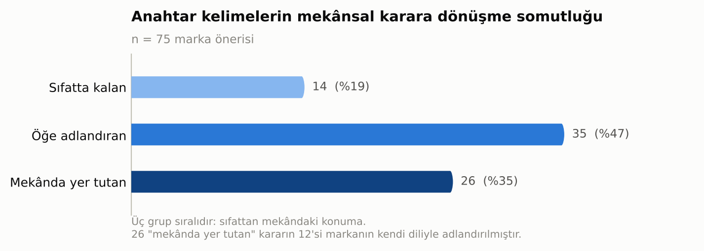

# Markayı Okumaktan Mekânı Kurmaya: İç Mimarlık Stüdyosunda Marka Kimliğinin Mekânsal Tasarım Kararlarına Dönüşümü

**Betül Ünal**
Dr. Öğr. Üyesi, Kapadokya Üniversitesi, Mimarlık, Tasarım ve Güzel Sanatlar Fakültesi, İç Mimarlık ve Çevre Tasarımı Bölümü

---

## Özet

Perakende mekânı tasarımı stüdyosunda öğrencinin karşılaştığı temel güçlük, biçim üretmek değil, ürettiği biçimi gerekçelendirmektir. Marka kimliği tam da bu gerekçeyi sağlayabilecek bir veridir; ancak kimliğin soyut nitelikleri ile çizilebilir mekânsal kararlar arasındaki geçiş, stüdyo pratiğinde çoğunlukla sezgiye bırakılır. Bu çalışma söz konusu geçişi doğrudan araştırma nesnesi yapmaktadır. Veri, Kapadokya Üniversitesi İç Mimarlık ve Çevre Tasarımı Bölümü üçüncü sınıf stüdyosunda (IMC301) 29 öğrenciyle yürütülen bir giriş atölyesine aittir. Atölye üç çalışma kâğıdı üzerinden kurgulanmıştır: rastgele atanan beş perakende mekânının bireysel okunması, aynı mekâna düşen öğrencilerin grup sentezi ve sunumu, ve fiziksel mağazası bulunmayan niş markalar arasından üç aday markanın araştırılarak anahtar kelimelerinin mekânsal karara çevrilmesi. Toplanan 25 teslim, 75 marka önerisi ve 225 "anahtar kelime → mekânsal karar" eşleşmesi içerik analiziyle incelenmiştir. Öğrencilerin markayı en çok kendini ifade (%24), zanaat ve el üretimi (%20) ile yerellik ve kültürel köken (%16) eksenlerinden okudukları; buna karşılık ürettikleri 225 anahtar kelime etiketinin yalnızca %4,9'unun doğrudan bir duyuya gönderme yaptığı görülmüştür. Kararların somutluğu üç grupta toplanmıştır: önerilerin %18,7'si anahtar kelimeyi başka bir sıfatla karşılamış, %46,7'si bir tasarım öğesi adlandırmış ancak öğenin mekândaki yerini söylememiş, %34,7'si öğeyi bir konuma, ilişkiye ya da ölçüye bağlamıştır. Tasarım kararlarının dağılımı belirgin biçimde dengesizdir: sergileme birimi (%73) ve malzeme-yüzey (%60) baskınken, dolaşım ve plan kurgusu %19, koku ve ses donatısı %9 oranında görünmektedir. Mekânda yer tutan 26 kararın 12'si, markanın kendi dilinden türetilmiş bir ad taşımaktadır; adlandırma, kimliğin mekânda bir karşılık bulduğunun en açık işareti olarak öne çıkmaktadır.

**Anahtar kelimeler:** perakende mekânı tasarımı, iç mimarlık stüdyo eğitimi, marka kimliği, marka analizi, anahtar kelime, mekânsal tasarım kararı

## Abstract

The core difficulty a student faces in the retail design studio is not producing form but justifying the form produced. Brand identity is precisely the kind of data that can supply that justification; yet the passage from a brand's abstract attributes to drawable spatial decisions is usually left to intuition in studio practice. This study makes that passage its direct object of inquiry. The data comes from an introductory workshop with 29 third-year students in the Interior Architecture and Environmental Design programme at Cappadocia University (IMC301), structured around three worksheets: individual reading of five randomly assigned retail interiors, group synthesis and presentation by students assigned to the same space, and investigation of three candidate niche brands without physical stores, translating their keywords into spatial decisions. The resulting 25 submissions, 75 brand proposals and 225 keyword-to-decision pairings were examined through content analysis. Students read brands primarily through self-expression (24%), craft and handmaking (20%) and locality and cultural origin (16%); yet only 4.9% of the 225 keyword tags they produced referred directly to a sense. Decisions fell into three groups by concreteness: 18.7% answered the keyword with another adjective, 46.7% named a design element without stating its place in the space, and 34.7% tied an element to a position, relationship or dimension. The distribution of design decisions is markedly unbalanced: display units (73%) and material-surface choices (60%) dominate, while circulation and plan configuration appear in 19% and scent-sound provision in 9% of proposals. Twelve of the 26 decisions that held a place in space carried a name derived from the brand's own language; naming emerges as the clearest sign that an identity has found a spatial equivalent.

**Keywords:** retail interior design, interior design studio education, brand identity, brand analysis, keyword, spatial design decision

---

## 1. Giriş

Perakende mekânı, iç mimarlık pratiğinin ürün ile beden, kimlik ile yüzey, anlatı ile rota arasındaki ilişkiyi en yoğun biçimde kurduğu alanlardan biridir. Teknolojik, ekonomik ve sosyokültürel eğilimlerin biçimlendirdiği perakende ortamı sürekli dönüşmekte; markalar mekânın müşteri deneyimi üzerindeki belirleyici etkisini giderek daha açık biçimde tanımaktadır (Petermans ve Van Cleempoel 2009). Bu dönüşüm, alanı yalnızca bir tasarım pratiği değil, ayrı bir uzmanlık hâline getirmiştir. Perakende tasarımı; markalaşma ve pazarlama, mimarlık ve iç mimarlık, psikoloji, lojistik, teknoloji entegrasyonu ve kullanıcı deneyimi tasarımını bir araya getiren çok disiplinli bir alandır ve tasarımcıdan marka ile müşteri arasında kalıcı bir bağ kurmasını bekler (Quartier, Claes ve Vanrie 2017, 2020; Lemon ve Verhoef 2016). Bu beklenti, tasarım eğitimi için doğrudan bir müfredat sorusu üretir: soyut bir marka kimliği, hangi öğretilebilir adımlarla çizilebilir bir mekânsal karara dönüşür?

Sorunun stüdyo içindeki karşılığı pedagojiktir ve sanıldığından daha temeldir. Üçüncü sınıf düzeyinde bir öğrencinin asıl güçlüğü biçim üretmek değildir; öğrenciler çoğunlukla biçim üretmekte zorlanmaz. Güçlük, ürettikleri biçimi gerekçelendirmektir. Gerekçesi olmayan bir tasarım, kritikte savunulamaz hâle gelir; öğrenci de bu durumda ya estetik tercihe ya da hocasının beğenisine sığınır. Marka kimliği, tam olarak bu boşluğu dolduracak bir veridir: dışarıdan gelen, araştırmayla elde edilen, tartışılabilir ve test edilebilir bir ölçüt sağlar. Bir mağazada niş duvarının neden kavisli, aydınlatmanın neden noktasal, rotanın neden kıvrımlı olduğu sorusunun yanıtı "böyle güzel oluyor" değil, "marka zanaati görünür kılmak üzerine kurulu" olabilir. Dönem projesinin marka kimliği üzerine kurgulanmasındaki temel gerekçe budur: öğrencinin boşlukta tasarım yapmasını önlemek.

Ancak bu gerekçenin işlemesi, kimliğin gerçekten mekânsal bir karara dönüşmesine bağlıdır. Öğrenciler markayı araştırmayı görece hızlı öğrenir; araştırmanın çıktısı olan anahtar kelimeyi üretmeyi de öğrenir. Fakat anahtar kelimenin kendisi hiçbir şey çizmez. "Zarafet" bir plan üretmez; "zanaat" bir kesit vermez; "sürdürülebilirlik" bir detay doğurmaz. Çeviri tam olarak burada — kelimeyle çizgi arasındaki boşlukta — gerçekleşir ya da gerçekleşmez. Gerçekleşmediğinde ortaya çıkan şey, marka araştırması yapılmış ama tasarıma hiç yansımamış bir proje; yani gerekçenin yalnızca pafta üzerinde durduğu, mekânın ise hâlâ boşlukta kurulduğu bir durumdur. Stüdyo kültürü bu riski çoğunlukla kritikle, yani sözlü ve bireysel bir müdahaleyle yönetir. Bu müdahale değerlidir; ancak izlenebilir ve dönemler arasında karşılaştırılabilir bir veri üretmez.

Bu makale söz konusu geçişi doğrudan incelemektedir. İnceleme birimi bitmiş proje değil, çevirinin kendisidir: bir öğrencinin belirli bir marka için ürettiği belirli bir anahtar kelimenin karşısına yazdığı belirli mekânsal karar. Veri, dönem sonunda değil, dönemin ilk haftasında — henüz hiçbir kritik müdahalesi yapılmamışken — üretilmiştir. Bu tercih, öğrencinin stüdyoya getirdiği beceriyi olduğu gibi görünür kılar ve müfredat müdahalesinin nereye yapılması gerektiğini gösterir.

Araştırma soruları şunlardır: Öğrenciler bir markayı neyin üzerinden okumakta, hangi değerleri kimliğin taşıyıcısı saymaktadır? Bu okumadan hangi anahtar kelimeler çıkmaktadır? Anahtar kelimeler hangi somutlukta mekânsal karara dönüşmekte, bu kararlar hangi tasarım alanlarında yoğunlaşıp hangilerinde eksik kalmaktadır? Ve kimliğin mekânda gerçekten karşılık bulduğu durumları, bulamadığı durumlardan ayıran gözlemlenebilir bir işaret var mıdır?

---

## 2. Kuramsal Arka Plan

Perakende mekânının bir iletişim aracı olarak kavramsallaştırılması Kotler'in (1973) *atmospherics* kavramıyla başlar. Kotler, satın alma kararının yalnızca ürün ve fiyat tarafından değil, mekânın bilinçli olarak tasarlanmış duyusal niteliklerince de belirlendiğini öne sürerek mekânı pazarlama değişkenleri arasına katmıştır. Mehrabian ve Russell'ın (1974) çevre psikolojisi modeli bu etkinin mekanizmasını haz–uyarılma–baskınlık üçlüsü üzerinden formüle ederek atmosfer ile davranış arasındaki bağı deneysel olarak çalışılabilir kılmış; Bitner (1992) *servicescape* kavramıyla modeli hizmet ortamlarına genişletmiş ve fiziksel çevrenin yalnızca müşteri değil çalışan davranışını da biçimlendirdiğini göstermiştir. Pine ve Gilmore'un (1999) deneyim ekonomisi tezi bu çizgiyi ekonomik bir dönüşüm iddiasına bağlamış; Lemon ve Verhoef (2016) müşteri deneyimini tek bir temas anı değil, satın alma öncesi, satın alma ve sonrası evrelerinden oluşan çok kanallı bir yolculuk olarak yeniden tanımlamıştır. Stein ve Ramaseshan (2016) bu yolculuğun temas noktalarını atmosferik, teknolojik, iletişimsel, süreçsel, çalışan–müşteri etkileşimi, müşteri–müşteri etkileşimi ve ürün etkileşimi olmak üzere yedi öğeye ayırmış; Zomerdijk ve Voss (2010) yolculuk haritasını deneyimin kritik anlarını diziye koyan bir storyboard olarak okumuştur. Bu birikim iç mimarlık stüdyosu için önemli bir sonuç doğurur: mekân statik bir kap değil, zaman içinde açılan bir sekanstır.

Marka kimliğini sistematik olarak çözümleme çabası tasarım alanına büyük ölçüde Wheeler'ın (2017) çalışmasıyla aktarılmıştır. Wheeler, bütüncül bir marka deneyimini imge ve kimlik, ürün ve hizmetler, insanlar ve kültür, satış süreçleri, fiziksel ve sanal mekânlar ile farkındalık stratejisi olmak üzere altı bileşen üzerinden kurar; bu çerçeve pazarlama kökenli olmasına karşın iç mimarlık için doğrudan kullanışlıdır, çünkü fiziksel mekânı marka kimliğinin eşdeğer bir taşıyıcısı olarak konumlandırır. Marka anahtarı araçları — rekabet, hedef kitle, amaçlar, misyon, değerler, faydalar, kişilik, görsel dil, iletişim tonu ve öz — markayı çözümlenebilir bileşenlere ayırır ve öğrenciye araştırma için bir iskelet verir.

Ancak bu araçların tasarım eğitimine aktarımında kritik bir eşik vardır: marka anahtarı markayı *anlamak* için tasarlanmıştır, markayı *çizmek* için değil. Bir markanın misyonunu, değerlerini ve kişiliğini eksiksiz çözümlemiş bir öğrenci, bu çözümlemeden tek bir duvar kesiti çıkarmak zorunda değildir. Klingmann'ın (2010) brandscape kavramı ile Klanten, Ehmann ve Borges'in (2013) derlediği markalı mimarlık örnekleri kimliğin mekânsallaşmasının mümkün olduğunu gösterir; ancak bu örnekler ürünü sunar, yöntemi değil. Köprülü ve Boz (2023) tek bir showroom örneği üzerinden marka hikâyesinin mekân tasarımına dönüşme sürecini izleyerek bu boşluğa yaklaşmıştır. Mesher (2010) ise perakende tasarımını doğrudan bir eğitim nesnesi olarak ele alan sayılı kaynaktan biri olarak marka ve kimliği konsept geliştirmenin başlangıç noktası sayar; markayı bir tema değil bir başlangıç verisi olarak konumlandırır.

Perakende atmosferinin yalnızca görsel olmadığına ilişkin kanıt birikimi güçlüdür. Spence ve arkadaşları (2014) mağaza ortamının görsel, işitsel, dokunsal, kokusal ve tatsal boyutlarına ilişkin bilimsel kanıtları derleyerek çok duyulu atmosfer kavramını sistemleştirmiş; duyular arası uyumun tek bir duyuya yapılan yatırımdan daha güçlü etkiler ürettiğini göstermiştir. Underhill (2008) alışveriş davranışının beden ölçeğindeki belirleyicilerini — geçiş genişlikleri, dokunma eğilimi — etnografik gözlemle ortaya koymuştur. Mimarlık kuramı tarafında Pallasmaa (2005) modern mimarlığın göz-merkezliliğini eleştirerek mekânın bedenin tamamıyla deneyimlendiğini savunur; bu, görselleştirme araçlarının hâkim olduğu bir temsil kültüründe tasarım düşüncesinin yapısal olarak görmeye doğru yanlılaşacağı uyarısını taşır. Bu makalenin bulgularından biri söz konusu uyarının stüdyo düzeyindeki karşılığını göstermektedir.

Perakende tasarımı eğitimini kendisine araştırma nesnesi yapan çizgi büyük ölçüde Quartier ve arkadaşlarının çalışmalarıyla şekillenmiştir. Quartier, Claes ve Vanrie (2017) hızla evrilen disiplinde perakende tasarımcısının hangi yetkinliklere gereksinim duyduğunu sormuş; aynı ekip (2020) araştırma, tasarım, sosyokültürel bilimler, markalaşma, pazarlama ve strateji, çok kanallılık ve dijital, iletişim ile örgütlenme ve yönetim olmak üzere sekiz temada toplanan kapsamlı bir yetkinlik çerçevesi geliştirmiştir. Di Iorio ve Spagnoli (2023) deneyim temelli öğrenme için yeniden çerçevelenmiş öğrenme araçları önermiş; Rolla, Hasırcı, Anal ve Edes (2021) disiplinlerarası bir konsept mağaza tasarım sürecini belgelemiştir. Sunar Bükülmez, Girginkaya Akdağ ve Ekin (2025), marka anahtarı ve müşteri yolculuğu haritalamayı bir iç mimarlık stüdyosuna entegre eden sınanmış bir çerçeve sunmuş ve bu araçların yetkinlik kazanımları üzerindeki etkisini on dört haftalık bir süreç boyunca izlemiştir.

Bu birikim, markanın mekânsallaşmasının mümkün olduğunu ve bu aktarımın eğitimde ölçülebileceğini göstermektedir. Arada kalan şey çevirinin kendisidir: hangi tür bir marka okuması hangi tür bir mekânsal karara dönüşür, bir öğrenci "zanaat" kelimesinden "camlı atölye duvarı"na nasıl geçer, geçemediğinde yerine ne koyar? Bu makale söz konusu soruya, bir atölyenin birincil ürünleri üzerinden yanıt aramaktadır.

---

## 3. Yöntem

### Bağlam ve atölyenin kurgusu

Araştırma, Kapadokya Üniversitesi Mimarlık, Tasarım ve Güzel Sanatlar Fakültesi İç Mimarlık ve Çevre Tasarımı Bölümü'nde yürütülen IMC301 İç Mimari Tasarım Stüdyosu IV dersi kapsamında gerçekleştirilmiştir. Ders, 2026–2027 Güz yarıyılında haftada sekiz saat yüz yüze ve on dört hafta süreyle yürütülen zorunlu bir stüdyo dersidir; derse kayıtlı öğrenci sayısı 29'dur. Dönem projesinin alanı Mersin Marina'dır. Proje tanımı öğrencilerden az bilinen bir perakende markası seçmelerini, alanı çözümlemelerini ve kullanıcı odaklı, etkileşimli, duyusal bir mekânsal deneyim geliştirmelerini beklemektedir. Çözülmesi zorunlu alanlar arasında giriş ve marka eşiği, sergileme alanları, dolaşım ve mekânsal akış, satış ve kasa bölgesi, depolama, personel alanları, deneyim ve etkileşim alanları ile malzeme ve mimari öğeler sayılmıştır. Dersin ayırt edici odağı, izlencede açıkça belirtildiği üzere "bir markanın kimliğinin çözümlenip mekânsal bir dile çevrilmesi"dir.

Bu araştırmanın verisi dönemin ilk haftasına ve onu izleyen iki haftalık teslim penceresine aittir. Veri, bireysel kritik sürecinin henüz başlamadığı bir anda üretilmiştir ve öğrencilerin stüdyoya getirdiği beceriyi olduğu gibi temsil eder.

İlk hafta iki oturumluk bir giriş atölyesi olarak kurgulanmıştır. Kuramsal girişte marka kimliği, kullanıcı profili ve müşteri yolculuğu kavramları dört başlık altında sunulmuştur: markadan mekâna, kullanıcı, deneyim ve etkileşim, mekân. Müşteri yolculuğu sekiz aşamalı olarak tanımlanmıştır (farkındalık, çekim, eşik, yönlenme, keşif, etkileşim, satın alma, ayrılış). Duyusal çerçeve beş duyu ve bedensel algı üzerinden kurulmuş; anahtar kelime üretimi için üç ölçüt verilmiştir: her markaya uyacak kadar genel olmamalı, araştırmada karşılığı bulunmalı, mekânda somut bir karşılığı kurulabilmeli. Son ölçüt, bu araştırmanın inceleme nesnesinin doğrudan ifadesidir.

Kuramsal girişin ardından atölye üç çalışma kâğıdı üzerinden ilerlemiştir (Tablo 1, Şekil 1–3).

**Tablo 1. Atölyenin üç çalışma kâğıdı**

| | Çalışma Kâğıdı 1 | Çalışma Kâğıdı 2 | Çalışma Kâğıdı 3 |
|---|---|---|---|
| **Başlık** | Bir Mağazayı Okumak: Bireysel Çalışma | Bir Mağazayı Okumak: Grup Sentezi | Marka Araştırması |
| **Çalışma biçimi** | Bireysel | Grup (aynı mekâna atananlar) | Bireysel, ödev |
| **Girdi** | Rastgele atanan, marka adı verilmemiş bir perakende mekânının fotoğraf seti | Grup üyelerinin bireysel okumaları | Öğrencinin kendi seçtiği üç aday marka |
| **Bölümler** | Genel bakış · mekânsal analiz · deneyim analizi · duyusal analiz · markanın kimliği | Ortak okumalar · markadan tasarıma · mekânı çizimle anlat · mekân–marka analizi · görüş ve öneriler | Markayı anlamak · mekânın ihtiyacı · anahtar kelime → mekânsal tasarım kararı |
| **Çıktı** | Üç kelimelik atmosfer ve kimlik okuması | Dört başlıkta üçer ortak madde, diyagram, stüdyo sunumu | Marka başına üç anahtar kelime ve üç mekânsal karar |

**Şekil 1.** Çalışma Kâğıdı 1 — "Bir Mağazayı Okumak: Bireysel Çalışma". Kâğıt, mekânı beş katmanda okutur: ne satıyor ve kime, sergileme–dolaşım–satış nasıl çözülmüş, kullanıcı ne yapıyor ve ne hissediyor, beş duyu, markanın kimliği.

**Şekil 2.** Çalışma Kâğıdı 2 — "Grup Sentezi". Bireysel okumalar dört başlıkta üçer ortak maddeye indirgenir; ikinci bölüm bu maddeleri tasarım kararlarıyla eşleştirir.

**Şekil 3.** Çalışma Kâğıdı 3 — "Marka Araştırması". Üç aday marka yan yana çalışılır. Alt bölümdeki iki sütunlu tablo ("anahtar kelime → mekânsal tasarım kararı / öğesi") bu araştırmanın inceleme birimini oluşturur.

Çalışma Kâğıdı 1 için seçilen beş mekân, perakende tipolojisi ve atmosfer stratejisi bakımından bilinçli olarak farklılaştırılmıştır (Şekil 4, Tablo 2). Mekânlar öğrencilere marka adı verilmeksizin, yalnızca fotoğraf setleri hâlinde sunulmuş; kimliğin mekândan geriye doğru okunması istenmiştir. Farklılaştırma, atölyenin temel sorusunu beş ayrı atmosfer stratejisi üzerinden sınamayı amaçlamaktadır: renk, doku, strüktür, hammadde ve saydamlık, her biri bir başka mekânda baskın taşıyıcı konumundadır.

**Şekil 4.** Çalışma Kâğıdı 1'in beş vaka mekânı, öğrencilere dağıtılan fotoğraf setleri hâlinde. Soldan sağa: Mekân 1–5.

**Tablo 2. Çalışma Kâğıdı 1'in beş vaka mekânı**

| No | Tipoloji | Atmosfer stratejisi |
|---|---|---|
| 1 | Çocuk ve genç giyim | Yoğun renk bloklaması, kemerli nişler, oyunsu geometri |
| 2 | Gözlük / optik markası mağazası | Perde, kanelürlü yüzey, sıcak ışık; yumuşak doku |
| 3 | Kitabevi | Parametrik ahşap tavan, sürekli raf duvarları, geniş hacim |
| 4 | Giyim | Brüt beton, ahşap makas, mekân ortasında canlı ağaç; ham-doğal |
| 5 | Moda | Mermer, ahşap çerçeve, yarı saydam tekstil bölücüler; minimal-rafine |

### Veri ve analiz

Çalışma Kâğıdı 3 için 25 teslim arşivlenmiştir (kayıtlı öğrencilerin %86'sı). Her teslim üç marka önerisi, her öneri üç çeviri satırı içerdiğinden toplam **75 marka önerisi** ve **225 anahtar kelime – mekânsal karar eşleşmesi** elde edilmiştir. Çalışma Kâğıdı 2 için dört grubun sentezi incelenebilmiştir (Mekân 1–4).

Veri, nitel içerik analizi ve bunu izleyen betimsel istatistikle incelenmiştir (Krippendorff 2019). Kategoriler veriden tümevarımla türetilmiş, ardından dersin izlencesindeki "çözülmesi zorunlu alanlar" listesi ve Stein ve Ramaseshan'ın (2016) temas noktası öğeleriyle çapraz denetlenmiştir. Dört eksende kodlama yapılmıştır.

**Markanın okunduğu değer ekseni.** Çalışma kâğıdının "değer / hikâye" alanında öğrencinin markayı neyin üzerinden tanımladığı; marka başına bir ya da iki etiketle, çok etiketli olarak kodlanmıştır (ör. zanaat ve el üretimi, yerellik ve kültürel köken, kendini ifade, sürdürülebilirlik ve etik üretim).

**Anahtar kelimeler.** Marka başına üç kelime; sıklık dağılımı, tekrar oranı ve tematik kümeler üzerinden incelenmiştir.

**Kararın somutluğu.** Her marka önerisinin üç çeviri satırı birlikte değerlendirilerek, anahtar kelimenin mekânda ne ölçüde karşılık bulduğu üç grupta toplanmıştır (Tablo 3). Gruplar arasındaki ayrım, kararın çizilebilir olup olmamasına dayanmaktadır: "vitrin" bir öğe adıdır, "giriş aksında, arkasında çalışan çarkın görüldüğü tek parçalık vitrin" ise plana işlenebilen bir karardır.

**Tablo 3. Kararların somutluğuna göre üç grup**

| Grup | Ölçüt | Veriden örnek |
|---|---|---|
| **Sıfatta kalan** | Anahtar kelime başka bir sıfatla karşılanmış; çizilecek bir şey yok | "Sade ve estetik"; "Doğayı mekânda hissedebilmeli"; "Ferah dolaşım alanları"; "Güncel modaya uygun" |
| **Öğe adlandıran** | Bir tasarım öğesi adlandırılmış, ama mekândaki yeri söylenmemiş | "Ahşap raflar"; "Ray spot aydınlatma"; "Açık raf düzeni"; "Nötr renk paleti" |
| **Mekânda yer tutan** | Öğe bir konuma, ilişkiye ya da ölçüye bağlanmış | "Camlı atölye duvarı ve açık kuruma rafı"; "Ana giriş hizasında hızlı erişimli interaktif sipariş kioskları"; "Rafların arkasında sarı ışıkla birlikte perde kullanımı" |

**Tasarım aygıtı ailesi.** Kararın hangi tasarım alanına değindiği, çok etiketli olarak kodlanmıştır: sergileme birimi; malzeme ve yüzey; aydınlatma; dolaşım ve plan kurgusu; grafik ve anlatı yüzeyi; üretim görünürlüğü; kişiselleştirme ve etkileşim istasyonu; dijital ve teknoloji; renk; oturma ve dinlenme; koku, ses ve duyusal donatı. Marka önerileri ayrıca ürün kategorisi, menşe ve ölçek bakımından kodlanmıştır.

---

## 4. Bulgular

### 4.1. Mekândan kimliğe: mağazayı okumak

Grup sentezleri, farklı bireysel okumaların ortak bir sözlükte buluşma kapasitesini göstermektedir (Tablo 4). Dört grubun tamamı atmosfer okumasını üç sıfata indirgemeyi başarmıştır.

**Tablo 4. Grup sentezlerinin ortak okumaları**

| Mekân | Hedef kullanıcı | Atmosfer | Markanın kimliği |
|---|---|---|---|
| **1** Çocuk ve genç giyim | çocuklar · aile · gençler | dikkat çekici · renkli · eğlenceli | eğlence · renk · dinamik |
| **2** Gözlük / optik | deneyim · görme · lüks ve prestij amaçlı | ritim · lüks · kontrollü | zarif · dinamik · estetik |
| **3** Kitabevi | araştırmacılar · akademisyenler · düzenli okuyucular | sıcak · sakin · modern | prestij · organik · değişim |
| **4** Giyim (ham-doğal) | sürdürülebilir modayı benimseyen · premium tasarım arayan · dingin mekân tercih eden | sakin ve dingin · doğal ve organik · ferah ve modern | sürdürülebilirlik · zarafet ve lüks · modern |

Daha dikkate değer olan, grupların kendi okumalarını eleştirebilmesidir. Mekân 2 grubu, "kullanılan renk tonları sebebiyle mekânı deneyimleme yetersiz kalmıştır; ruhsuz bir mekân yaratılmıştır, burası bir lobi ya da eczane gibi mekânları andırıyor ve gözlüğe doğrudan bir vurgu yapılmamış" değerlendirmesiyle marka–mekân uyumsuzluğunu teşhis etmiştir. Mekân 4 grubu uyumun "mekânın merkezindeki canlı ağaç ve organik dairesel zemin kurgusunda" okunduğunu saptamış ve mekânı bir merkez–çeper diyagramına dönüştürmüştür. Mekân 3 grubu ise beş mekânı tek bir eksen üzerinde (4 ↔ 1 ↔ 2 ↔ 5 ↔ 3) sıralayarak kendi mekânını diğerlerine göre konumlandırmıştır; bu, atölyenin istemediği ancak ürettiği bir çıktıdır.

Grup sentezlerinin ikinci bölümü, belirlenen üç anahtar kelimeyi tasarım kararlarıyla eşleştirmeyi istemektedir; yani Çalışma Kâğıdı 3'teki çevirinin grup ölçeğindeki provasıdır. Burada üretilen kararlar bireysel çalışmaya kıyasla belirgin biçimde daha somuttur. Mekân 2 grubu "dinamik" kelimesini "rafların bir bütün hâlinde kıvrımlı şekilde devam etmesi, rafların arkasında sarı ışıkla birlikte perde kullanımı, kıvrımlı-dalga şeklinde dairesel banko tasarımı" biçiminde açmış; Mekân 4 grubu "organik" kelimesini "merkezine canlı bir ağacı alan dairesel zemin kurgusu ve akışkan yollar sayesinde katı, keskin hatlardan uzak bir dolaşım şeması" olarak tanımlamıştır. Her iki karar da öğeyi mekândaki bir konuma ve bir harekete bağlamaktadır.

Grupların beşinci bölümde ürettiği öneriler de aynı yönde çalışmaktadır. Mekân 1 grubu "mekândaki pencerenin konumu değiştirilmeli, ayna boyutu büyütülmeli, çocuklar için elverişli askılık yüksekliği olmalı, oturma alanı eklenmeli" diyerek doğrudan ergonomi ve yerleşim diline geçmiş; Mekân 3 grubu "yönlendirmeler artırılabilir ve okuma alanlarında ergonomiyi düşünerek konfor arttırılabilir" demiştir. Eleştiri kipinin öneri kipinden daha somut sonuç verdiği görülmektedir: öğrenciler mevcut bir mekânı yargılarken ölçü, konum ve yükseklik gibi kavramlara kendiliğinden başvurmaktadır.

Bu bulgular atölyenin ilk iki aşamasının amacına ulaştığını göstermektedir. Önlerinde okunacak bir mekân bulunduğu sürece öğrenciler kimliği mekândan çıkarabilmekte, ortak bir sözlüğe indirgeyebilmekte ve bu sözlüğü eleştirel biçimde sınayabilmektedir. Asıl güçlük bir sonraki adımdadır — okunan mekân ortadan kalkıp yerine yalnızca bir marka ve bir kelime kaldığında.

### 4.2. Hangi markalar seçildi

Yetmiş beş marka önerisinin ürün kategorisi dağılımı belirgin biçimde yoğunlaşmıştır (Şekil 5). İlk dört kategori — giyim, ev ve yaşam ürünleri, takı ve mücevher, parfüm ve koku — önerilerin %64'ünü oluşturmaktadır.

**Şekil 5.** Önerilen markaların ürün kategorisi dağılımı.

Bu yoğunlaşma atölye sunumunda verilen ürün grubu listesiyle uyumludur; ancak listenin daha az temsil edilen uçlarının (halı ve kilim, bisiklet, seramik) neredeyse hiç seçilmediğini de göstermektedir. Öğrenciler kendi tüketim deneyimlerine en yakın kategorilere yönelmektedir.

Markaların %74,7'si Türkiye menşelidir; bu, "az bilinen marka" kısıtının yerel bağımsız markaları görünür kıldığını göstermektedir. Önerilerin %81,3'ü niş-bağımsız ölçektedir, yani brifin temel kısıtına uyulmuştur. Buna karşılık yedi öğrenci (%28) en az bir yerleşik kurumsal marka önermiş; iki öğrencinin üç önerisinin tamamı kurumsal ölçekte kalmıştır. Bu sapma briften kopuş olarak değil, bir okuma güçlüğü olarak yorumlanmalıdır: "az bilinen" ile "benim bilmediğim" arasındaki fark öğrenciler için her zaman açık değildir ve brifin bu kısıtı ölçütlendirilmeye muhtaçtır.

İki öğrencinin bağımsız olarak aynı markayı (Atelier Rebul) seçmiş olması beklenmedik bir karşılaştırma fırsatı sunmuştur. Her iki öğrencinin ürettiği anahtar kelime setleri — *zarafet · nostalji · duyusallık* ve *zarif · geleneksel · duyusal* — üç kelimeden ikisinde kök düzeyinde örtüşmektedir. Aynı araştırma yönergesinin farklı kişilerce uygulandığında benzer kelimelere yakınsaması, çalışma kâğıdının tutarlı bir okuma ürettiğine ilişkin bir işaret sayılabilir.

### 4.3. Marka neyin üzerinden okundu

Çalışma kâğıdının "değer / hikâye" alanı, öğrencinin markayı hangi eksenden tanımladığını gösterir ve bu bakımdan tüm çevirinin başlangıç noktasıdır. Bir markayı "zanaat" ekseninden okuyan öğrenci farklı bir mekân kuracak, "erişilebilirlik" ekseninden okuyan başka bir mekân kuracaktır. Yetmiş beş markanın değer okumaları Şekil 6'da verilmiştir.

**Şekil 6.** Öğrencilerin markayı okuduğu değer eksenleri.

En sık başvurulan eksen **kendini ifade**tir (%24): markanın kullanıcıya kendi kimliğini, tarzını ya da kişiliğini kurma imkânı sunduğu okuması. Öğrenciler bunu "kendini ifade etme ve kişilik keşfetme", "makyajı kişisel tarzı ifade etmenin bir yolu olarak görüyor", "klasik moda anlayışına bağlı kalmadan kendilerini özgürce ifade etmesini destekliyor" gibi ifadelerle yazmıştır. Bu, kuşağın marka ilişkisini tüketim değil kimlik üzerinden kurduğunu gösteren dikkate değer bir sonuçtur.

İkinci sırada **zanaat ve el üretimi** (%20) yer almaktadır: "el yapımı", "usta tezgâhı", "slow fashion", "tek bir zanaatkâr tarafından baştan sona üretilebiliyor". Bunu **yerellik ve kültürel köken** (%16) izlemektedir: "İstanbul'da eczacılık kökeninden gelen geleneksel kolonya kültürü", "yerli üretim", "kültürel kökler, modern vizyon". Bu iki eksenin toplamı, önerilerin üçte birinden fazlasının markayı bir *üretim biçimi* ve bir *coğrafya* üzerinden okuduğunu göstermektedir.

Bu üç baskın eksenin mekânsal tasarım açısından önemli bir ortak özelliği vardır: üçü de mekânda bir karşılık *gerektirir*. Kendini ifade, kullanıcının denediği, seçtiği, kendine göre düzenlediği bir alan ister; zanaat, üretimin görünür kılındığı bir yüzey ya da bir tezgâh ister; yerellik, malzemenin ve coğrafyanın anlatıldığı bir bağlam ister. Nitekim bulguların ilerleyen bölümlerinde en somut kararların bu eksenlerden türediği görülecektir.

Buna karşılık **sürdürülebilirlik ve etik üretim** (%8) ile **bilimsellik ve içerik şeffaflığı** (%4) gibi, güncel perakende söyleminde merkezî yer tutan eksenler geride kalmıştır. Dersin öğrenme çıktıları arasında sürdürülebilirlik açıkça sayılmasına rağmen, öğrenciler markayı bu eksenden okumaya ilk haftada pek yönelmemektedir. İki öneride ise değer alanı hiç doldurulmamış, markanın hikâyesi yalnızca "moda" ya da "kalite" gibi bir sektör adıyla geçiştirilmiştir; bu iki öneri, ilerleyen bölümlerde görüleceği gibi, en düşük somutluktaki kararları da üretmiştir.

### 4.4. Anahtar kelimeler

Yetmiş beş marka için üretilen 225 anahtar kelime etiketinin 146'sı tekildir. Tekil kelimelerin %73'ü (107 kelime) yalnızca bir kez kullanılmıştır; bu, tüm etiketlerin %48'ine karşılık gelir. En sık kullanılan on kelime toplam etiketlerin yalnızca %24'ünü oluşturmaktadır. Bu, oldukça dağınık bir sözlüktür. Olumlu okumada öğrenciler markaya özgü ve kalıplaşmamış sözcükler üretmektedir; olumsuz okumada ortak bir mesleki sözlüğün yokluğu stüdyo içi tartışmayı ve karşılaştırmayı güçleştirmektedir. İki okuma birbirini dışlamaz; veriler her ikisini de desteklemektedir.

Kök düzeyinde birleştirildiğinde en sık kelime kümeleri şunlardır: *doğal / doğallık / doğa* (14), *zarif / zarafet* (10), *özgün / özgünlük* (10), *zanaat / el işçiliği / el yapımı* (9), *keşif* (7), *konfor / konforlu / rahatlık* (7), *zamansız / zamansızlık* (6), *kişisel / kişisellik / kişiselleştirme* (6).

**Şekil 7.** Anahtar kelimelerin tematik kümelere dağılımı.

Şekil 7'de dikkat çekici olan, duyusallık kümesinin sondan ikinci sırada yer almasıdır. Doğrudan duyuya gönderme yapan etiketler tüm etiketlerin yalnızca %4,9'unu oluşturmaktadır. Oysa atölyenin kuramsal girişi beş duyu ve bedensel algı üzerine kurulmuş, Çalışma Kâğıdı 1 beş duyu için ayrı kutular ayırmış, Çalışma Kâğıdı 3'te "deneyim + duyu" başlığı ayrı bir alan olarak yer almıştır. Yani duyusal çerçeve araçta mevcuttur ancak anahtar kelime üretimine taşınmamaktadır. Öğrenciler duyuyu bir deneyim açıklaması olarak yazmakta, bir kimlik niteliği olarak kodlamamaktadır.

Değer ekseni ile anahtar kelime arasındaki ilişki genellikle doğrudandır: markayı zanaat ekseninden okuyan öğrenci "zanaat", "el işçiliği" ya da "iz" kelimesini üretmekte; kendini ifade ekseninden okuyan "özgünlük", "kimlik" ya da "özgüven" demektedir. Bu, çalışma kâğıdının ilk iki bölümünün birbirini beslediğini göstermektedir. Kopuş bir sonraki adımda yaşanmaktadır.

### 4.5. Anahtar kelimeden mekânsal karara

Yetmiş beş marka önerisinin kararları somutluk bakımından Şekil 8'deki gibi dağılmaktadır.

**Şekil 8.** Anahtar kelimelerin mekânsal karara dönüşme somutluğu.

Önerilerin %18,7'si anahtar kelimeyi başka bir sıfatla karşılamış, yani mekâna hiç ulaşmamıştır. %46,7'si bir tasarım öğesi adlandırmış ancak öğenin mekândaki yerini söylememiştir. Yalnızca %34,7'si öğeyi bir konuma, ilişkiye ya da ölçüye bağlamıştır. En büyük yığılma, önerilerin neredeyse yarısını kapsayan orta grupta, yani öğesi olan ama yeri olmayan kararlardadır. Bulgunun özeti şudur: **öğrencilerin çoğunluğu "ne" sorusunu yanıtlamakta, "nerede, neyle, hangi ilişkide" sorusunu yanıtlamamaktadır.**

Aradaki farkın niteliği, tek bir anahtar kelimenin farklı teslimlerdeki karşılıkları yan yana konduğunda netleşir. "Zanaat" ve türevleri veri setinde dokuz kez geçmekte ve karşılıkları üç grubun tamamına dağılmaktadır (Tablo 5). Aynı kelime, aynı hafta, aynı brif altında birbirinden çok farklı somutlukta karşılıklar bulmaktadır.

**Tablo 5. Tek bir anahtar kelimenin ("zanaat / el işçiliği") karşılıkları**

| Grup | Veriden karşılık | Neden bu grup |
|---|---|---|
| Sıfatta kalan | "Ürün detaylarının yakından görülebileceği sergileme alanları" | Bir nitelik beyan ediliyor; hangi öğeyle sağlanacağı yok |
| Öğe adlandıran | "Ahşap, deri ve doğal taş gibi malzemelerin kullanılması" | Malzemeler sayılıyor; aralarında ya da mekânla ilişki kurulmuyor |
| Öğe adlandıran | "Açık atölye / üretim köşesi" | Bir birim adlandırılıyor; mekândaki yeri ve ne göstereceği belirsiz |
| Mekânda yer tutan | "Dokuma detaylarının sergilendiği malzeme duvarı, el dokuması halıların askılı sistemde öne çıkarılması, el işçiliğini gösteren yakın inceleme alanı" | Üç öğe birbirine ve tek bir amaca — görünürlüğe — bağlanıyor |
| Mekânda yer tutan | "*Visible Atelier*: üretimin gizlenmediği, ürünün yalnızca bitmiş hâlinin değil arkasındaki kesim, dikiş ve yüzey işleme sürecinin de izlendiği bölüm" | Aygıt adlandırılıyor, markanın diline bağlanıyor ve bir ilkeye dönüşüyor |

"Açık atölye köşesi" ile "dokuma detaylarının sergilendiği malzeme duvarı" arasındaki fark bir kelime dağarcığı farkı değildir; birincisi bir oda adı, ikincisi bir tasarım kararıdır. Birincisi plana bir etiket koyar, ikincisi plana bir yüzey çizdirir.

Öğrenci düzeyinde bakıldığında profil Şekil 9'daki gibidir. Yirmi beş öğrenciden 13'ü en az bir önerisinde mekânda yer tutan bir karar üretmiş; 12'si üç önerisinde de bu düzeye ulaşamamıştır. Baskın karar türü bakımından öğrencilerin 12'si öğe adlandırma, 8'i mekânda yer tutma, 5'i sıfatta kalma grubundadır.

**Şekil 9.** Öğrenci başına karar somutluğu: üç öneride ulaşılan en somut karar ve baskın karar.

Bu dağılımın en önemli özelliği, aynı araç, aynı brif ve aynı süre altında ortaya çıkmış olmasıdır. Becerinin sıfatta kalmaktan mekânda yer tutmaya kadar bu genlikte yayılması, farkın bireysel yetenekten çok henüz öğretilmemiş bir yöntemden kaynaklandığını düşündürmektedir.

Marka özelliklerinin etkisi sınırlıdır. Türkiye menşeli markalarda mekânda yer tutan karar oranı %36, yurt dışı menşelilerde %32'dir. Niş markalarda bu oran %38 iken kurumsal markalarda %21'e düşmektedir. Ürün kategorisine göre farklılık daha belirgindir (Tablo 6).

**Tablo 6. Ürün kategorisine göre mekânda yer tutan karar oranı**

| Kategori | n | Mekânda yer tutan |
|---|---|---|
| Aksesuar ve deri | 6 | %67 |
| Ev ve yaşam ürünleri | 13 | %46 |
| Parfüm ve koku | 8 | %38 |
| Takı ve mücevher | 10 | %30 |
| Giyim | 17 | %29 |
| Kitap, plak, kırtasiye | 3 | %0 |
| Kozmetik ve bakım | 5 | %0 |

Deri, ev ürünleri ve parfüm kategorilerinin yüksek oranları, bu ürünlerin tekil nesne olarak kavranabilir, elle tutulabilir ve kokusuyla ya da dokusuyla deneyimlenebilir olmasıyla ilgilidir; bu nitelikler "kaide", "niş", "numune paneli", "koku istasyonu" gibi mekânsal karşılıkları kendiliğinden çağırır. Giyim ise en çok seçilen kategori olmasına rağmen en düşük oranlardan birine sahiptir — çünkü askılık, kabin ve kasa üçlüsü öğrencinin zihnindeki en yerleşik şablondur ve bu şablon kendini bir çözüm gibi sunar. Kitap-plak ve kozmetik kategorilerinin hiç mekânda yer tutan karar üretememesi küçük örneklem nedeniyle temkinli yorumlanmalıdır; ancak bu iki kategorinin de "raf dolusu küçük ürün" tipolojisini paylaşması dikkat çekicidir.

Kararların hangi tasarım alanına değindiği, repertuvarın dengesizliğini ortaya koymaktadır (Şekil 10).

**Şekil 10.** Mekânsal kararların tasarım aygıtı ailelerine dağılımı.

İki alan — sergileme birimi ve malzeme — repertuvarı domine etmektedir; dokuz öneri (%12) yalnızca bu ikisiyle sınırlı kalmıştır. Buna karşılık dolaşım ve plan kurgusu önerilerin yalnızca %19'unda, koku ve ses donatısı yalnızca %9'unda görünmektedir. Öğrenci düzeyinde bakıldığında 25 öğrenciden yalnızca 11'i en az bir kez dolaşım kararı, yalnızca 7'si en az bir kez duyusal donatı kararı üretmiştir.

Bu dağılım iki eksende okunabilir. Birinci eksen **nesne–mekân** eksenidir: öğrenciler markayı nesneye çevirmektedir (raf, kaide, vitrin, yüzey), mekâna değil (rota, görüş hattı, eşik sekansı, bölge ilişkisi). Veride bunun tipik görünümü, bir markanın üç kararının da sergileme ve malzeme üzerinden kurulmasıdır: "ince profilli vitrinler", "tekil ürün standları", "ahşap raflar ve taş yüzeyler". Üç karar da doğru, üçü de aynı aileden ve hiçbiri mağazanın nasıl gezileceğine dair bir şey söylememektedir. Dolaşım kararı üreten öğrencilerin çıktıları ise niteliksel olarak farklıdır: "giriş → teknik / yarış bölümü → günlük giyim → kabinler, iskele gibi uzun bir rota", "kıvrımlı rota, nişler arasında duraklar", "kokuların aşamalı deneyimlendiği keşif rotası". Bu ifadeler bir sıra ve bir yön içerir; yani mekânı zamansal bir sekans olarak kurarlar. Dolaşımı düşünebilen öğrencinin mekânda yer tutan karara ulaşmasının kolay olması tesadüf değildir: dolaşım, doğası gereği ilişki kurmayı zorunlu kılan tek alandır.

İkinci eksen **göz–beden** eksenidir. Sergileme, malzeme, aydınlatma, grafik ve renk — yani doğrudan görsel olanlar — birlikte repertuvarın büyük kısmını oluştururken, koku, ses ve dokunmaya ayrılmış donatı önerilerin onda birinde kalmaktadır. Bu oran, parfüm ve koku kategorisinin önerilerin %10,7'sini oluşturduğu düşünüldüğünde daha da anlamlıdır: öğrenciler koku satan bir markayı seçmekte, ancak kokuyu mekânda nasıl tutacaklarını, taşıyacaklarını ya da ayıracaklarını çoğunlukla çözmemektedir.

Aygıt çeşitliliği ile somutluk arasında düzenli bir ilişki vardır: sıfatta kalan önerilerde öneri başına ortalama 2,08 tasarım alanına değinilirken, bu sayı öğe adlandıranlarda 2,77'ye, mekânda yer tutanlarda 3,15'e yükselmektedir. Yani somut karar yalnızca daha keskin değil, aynı zamanda daha bileşiktir: birden çok tasarım alanını aynı karar içinde ilişkilendirir. "Camlı atölye duvarı ve açık kuruma rafı" kararı aynı anda üretim görünürlüğünü, malzemeyi ve sergileme birimini birleştirir.

### 4.6. Markanın diliyle adlandırılan kararlar

Mekânda yer tutan 26 kararın 12'sinde ortak ve beklenmedik bir örüntü saptanmıştır: bu öğrenciler ürettikleri karara **özel bir ad** vermiştir. Adlar markanın kendi dilinden türetilmiş ve mekândaki bir birimi tekilleştirmiştir (Tablo 7).

**Tablo 7. Markanın diliyle adlandırılan mekânsal birimler**

| Birim | Marka | Tanımı |
|---|---|---|
| *Patina Wall* | Philini | Derinin zamanla kazandığı yüzey değişimini sergileyen duvar |
| *Visible Atelier* | Philini | Üretim sürecinin gizlenmediği, görünür atölye bölümü |
| *Leather Library* | Philini | Farklı deri, renk ve dokuların denendiği alan |
| *Scent Bar* · *Ingredient Library* | Montale Paris | Koku ailelerinin ve ham maddelerin aşamalı deneyimlendiği istasyonlar |
| *Stone / Diamond Library* · *Custom Atelier* | Āzlee | Taş ve kesim seçeneklerinin karşılaştırıldığı ve kişiselleştirmenin yapıldığı birimler |
| *Light Experience* | Āzlee | Mücevherin farklı aydınlatma koşullarında denendiği alan |
| *Koku Barı (Fragrance Bar)* | MAD Parfüm | Mağaza merkezinde, damıtma havası veren dairesel interaktif birim |
| Form imzası | Shulebags | Çanta sapının geometrisinden türetilip mekânda tekrar eden form |
| Atölye köşesi · malzeme duvarı | Hereu · Art Doku Halı | Usta tezgâhının ve dokuma detaylarının görünür kılındığı birimler |

Bu tür bir adlandırma 75 önerinin yalnızca 12'sinde ve 25 öğrencinin yalnızca 7'sinde görülmüştür; ancak adlandırma yapan her öneri, aynı zamanda mekânda yer tutan karar grubundadır. Örüntünün rastlantısal olmadığı açıktır, çünkü bir mekânsal karara ad vermek üç şeyi aynı anda gerektirir. Kararın bir tekillik taşıdığının, yani genel bir raf ya da genel bir vitrin olmadığının farkına varmak; kararın mekân içinde bir yer ve sınır edindiğini kabul etmek; ve kararın marka anlatısıyla doğrudan bağını kurmak — çünkü ad çoğunlukla markanın kendi sözlüğünden gelmektedir. "Patina" deri markasının, "ingredient" parfüm markasının kelimesidir.

Adlandırmanın ikinci bir işlevi, birimi tekrarlanabilir kılmasıdır. Bir öğrencinin "nişler ve kaideler" demesiyle "Stone Library" demesi arasındaki fark, ikincisinin mekânda bir kez görünüp geçmeyecek olmasıdır; ad, birimi mağazanın diğer bölümlerinde de aranacak bir sabit hâline getirir. Shulebags önerisindeki "çanta sapının geometrisinden türetilip mekânda tekrar eden form" bu mantığı en açık biçimde dile getirmektedir: öğrenci burada tek bir öğe değil, mekân boyunca uygulanacak bir kural tanımlamaktadır.

Üçüncüsü, adlandırılan birimlerin çoğunun bir *eylem* barındırdığı dikkat çekicidir. "Scent Bar"da koklanır, "Light Experience"ta denenir, "Custom Atelier"de birlikte tasarlanır, "Visible Atelier"de izlenir. Bu birimler yalnızca ürünü göstermez; müşteriye yapacak bir şey verir. Buna karşılık öğe adlandıran kararların büyük kısmı edilgendir: raf gösterir, vitrin korur, aydınlatma vurgular. Deneyimsel perakendenin temel vaadi — mağazanın bir sahne değil bir etkinlik yeri olması — veride yalnızca bu on iki öneride karşılık bulmaktadır.

Dolayısıyla adlandırma, kimliğin mekânda gerçekten bir karşılık bulduğunun en açık işaretidir. Pedagojik olarak da kullanışlı bir işarettir: hem öğrenci hem yürütücü için anında görülebilir, kritikte doğrudan sorulabilir. "Bu kararın adı ne?" sorusu, "bu karar yeterince somut mu?" sorusundan çok daha işlemseldir.

---

## 5. Tartışma ve Sonuç

Bulguların bütünü, marka kimliğinin mekânsal karara dönüşmesinin öğretilebilir bir beceri olduğunu desteklemektedir. Öğrenciler markayı okuyabilmekte, okumadan anahtar kelime çıkarabilmekte, hatta önlerinde bir mekân varken bu kelimeleri somut tasarım kararlarına bağlayabilmektedir. Kopuş, mekân ortadan kalkıp yerine yalnızca marka ve kelime kaldığında yaşanmaktadır. Bu, bir yetenek sorunu değil, bir aşama atlama sorunudur: kelimeden doğrudan öğeye geçilmekte, arada bulunması gereken ilke ve konum kararı atlanmaktadır.

Araştırmanın en açık pratik sonucu, aracın kendisiyle ilgilidir. Tasarım kararlarının %73'ünün sergileme, %60'ının malzeme alanında toplanmasına karşılık dolaşımın %19'da kalması, öğrencilerin markayı mekânın içine yerleştirilen nesneler üzerinden düşündüğünü, mekânın kendisini — rotayı, eşiği, görüş hattını, bölgeler arası ilişkiyi — marka taşıyıcısı olarak kullanmadığını göstermektedir. Bu bulgu, izlencedeki "çözülmesi zorunlu alanlar" listesiyle birlikte okunduğunda daha anlamlıdır: liste giriş ve marka eşiğini, dolaşım ve mekânsal akışı açıkça saymaktadır. Yani brif bu alanları talep etmekte, fakat ilk hafta çeviri aracı bunları üretmemektedir. Çalışma Kâğıdı 3'ün "mekânın ihtiyacı" bölümü sergileme, aydınlatma, davranış ve duyu başlıklarını içermekte; dolaşım ve eşik için ayrı bir alan içermemektedir. Araç ne sorarsa, öğrenci onu üretmektedir.

Aynı mantık duyusal boyut için de geçerlidir. Duyusal etiketlerin %4,9, duyusal donatı kararlarının %9 oranında kalması, Pallasmaa'nın (2005) göz-merkezlilik eleştirisinin stüdyo düzeyindeki karşılığıdır; ancak bulguların ayrıntısı daha incelikli bir tablo çizmektedir. Öğrenciler duyuyu betimlemekte, fakat tasarlamamaktadır. Çalışma kâğıdının "deneyim + duyu" alanlarında koku, ses ve dokunmaya ilişkin zengin ifadeler bulunmaktadır: "koku en önemli duyusal deneyimdir", "dalga sesi, tuz ve ahşap kokusu", "koklama ana duyudur". Fakat bu ifadeler karar sütununa taşınmamaktadır. İstisnalar kuralı doğrulamaktadır: duyusal donatıyı somut karara taşıyan öğrenciler bunu bir mekânsal nesne icat ederek yapmıştır — "Koku Barı", "koku istasyonları" ve özellikle dikkate değer biçimde "mağazadaki yoğun esans kokularını sürekli tazeleyen gizli havalandırma ve iklimlendirme kanalları". Sonuncusu kokuyu bir atmosfer sıfatı olarak değil, bir tesisat kararı olarak ele almaktadır. Buradan çıkan ilke açıktır: duyusal tasarım, duyu hakkında yazmakla öğretilemez; duyunun bir donatıya, bir yüzeye, bir havalandırma kanalına ya da bir akustik bölücüye bağlanması istenmelidir.

Markanın okunduğu değer ekseni ile kararın somutluğu arasındaki ilişki de bu yöndedir. En somut kararlar, markayı zanaat, kendini ifade ve yerellik eksenlerinden okuyan önerilerden çıkmıştır; çünkü bu eksenler mekânda bir karşılık *gerektirir*. Zanaat, üretimin görünür kılındığı bir yüzey ister; kendini ifade, kullanıcının denediği ve kendine göre düzenlediği bir alan ister. Buna karşılık değer alanını "moda" ya da "kalite" gibi bir sektör adıyla geçiştiren öneriler, mekânsal karar sütununda da sıfatta kalmıştır. Marka okumasının zayıflığı, doğrudan tasarım kararının zayıflığına dönüşmektedir. Bu, atölyenin temel varsayımını — markanın tasarımın gerekçesi olabileceğini — doğrulayan ama aynı zamanda koşulunu da gösteren bir bulgudur: gerekçe ancak yeterince somut bir okumadan çıkarsa iş görür.

Kurumsal markaların niş markalara göre daha düşük somutluk üretmesi ve giyimin en çok seçilen kategori olmasına rağmen en düşük oranlardan birinde kalması aynı mekanizmaya işaret etmektedir. Öğrenci tanıdığı bir markayı ya da tanıdığı bir mağaza tipini çalıştığında, çeviri yapmak yerine hatırlamaktadır. "IKEA → gerçek yaşam alanları ve modüler sergileme" bir çeviri değil, bir betimlemedir; öğrenci markayı mekâna çevirmemiş, markanın zaten var olan mekânını tarif etmiştir. Niş ve bilinmeyen marka ise böyle bir hazır görüntü sunmadığı için öğrenciyi kararı kendisi üretmeye zorlar. Brifteki "fiziksel mağazası olmayan az bilinen marka" kısıtının yalnızca özgünlük değil, doğrudan bir bilişsel gerekçesi olduğu buradan anlaşılmaktadır: kısıt, hatırlamayı imkânsız kılarak çeviriyi zorunlu hâle getirir. Kısıt ayrıca güncel perakende eğilimleriyle de örtüşmektedir; çevrim içi doğan markaların fiziksel mağazaya geçişi son yılların en belirgin perakende hareketlerinden biridir ve bu geçiş çoğunlukla deneyim odaklı, topluluk merkezli, küçük ölçekli mekânlar üzerinden gerçekleşmektedir. Dolayısıyla öğrencilere verilen senaryo kurgusal bir egzersiz değil, sektörün fiilî bir sorusudur.

Bu bulgular, atölye kurgusunda birkaç düzeltmeyi işaret etmektedir. En önemlisi, çeviri tablosunun iki sütundan üç sütuna çıkarılmasıdır: anahtar kelime, mekânsal ilke, tasarım öğesi. Ortadaki sütun, kelimeden doğrudan nesneye yapılan sıçramayı yavaşlatır ve bulguların işaret ettiği asıl boşluğu — öğesi olan ama yeri olmayan kararı — hedefler. Atölye sunumunun kendi örnek vakası bu üçlü yapıyı zaten kullanmaktadır ("görünürlük → görüş hattı ve sınır → camlı atölye duvarı"); yapının çalışma kâğıdına taşınması yeterlidir. Buna, her tasarım öğesi için tek satırlık bir "nerede?" alanı eklenmesi eşlik edebilir. Repertuvardaki iki yapısal açık, basit bir kota ile kapatılabilir: üç karardan en az birinin dolaşım, eşik ya da görüş hattıyla, en az birinin duyusal donatıyla ilgili olması istenebilir. Öğrencilerden her marka için en az bir birimi markanın kendi sözlüğünden türetilmiş bir adla adlandırmaları beklenebilir; bulgular bu edimin en somut kararlarla birlikte gittiğini göstermektedir. Son olarak "az bilinen niş marka" ifadesi kontrol edilebilir ölçütlere bağlanmalıdır: Türkiye'de fiziksel mağazası bulunmayan, yalnızca çevrim içi ya da seçili satış noktaları üzerinden satan, ulusal zincir olmayan. Üç somutluk grubunun öğrencilerle paylaşılması da başlı başına bir öğretim aracıdır; "bu karar bir öğe adlandırıyor ama mekânda bir yer tutmuyor" geri bildirimi, "bu karar yeterince gelişmemiş" geri bildiriminden çok daha işlemseldir.

### Sınırlılıklar

Bu çalışmanın sonuçları, aşağıdaki sınırlar içinde okunmalıdır.

Birincisi ve en önemlisi, **kodlamanın tek araştırmacı tarafından yapılmış olmasıdır.** İçerik analizinde kategori atamaları yorum içerir ve bu yorumun güvenirliği ancak bağımsız kodlayıcılarla sınanabilir. Bu araştırmada kodlayıcılar arası güvenirlik katsayısı hesaplanmamıştır. Üç somutluk grubundan ikisi arasındaki sınır — öğe adlandıran ile mekânda yer tutan arasındaki sınır — özellikle yoruma açıktır; "açık raf düzeni" ile "kullanıcının ürünü inceleyip dokunabileceği erişilebilir sergileme düzeni ve geniş geçiş alanları" arasında nerede durulacağı tartışmalıdır. Aynı güçlük, değer eksenlerinin çok etiketli kodlanmasında da geçerlidir: bir markanın hem zanaat hem yerellik ekseninden okunduğu durumlarda etiket sayısı kodlayıcı kararına bağlıdır. Bulguların doğrulanması için bir sonraki adım, verinin en az beşte birinin ikinci bir kodlayıcı tarafından bağımsız olarak kodlanması ve uyum katsayısının raporlanmasıdır.

İkincisi, **örneklemin tek bir bağlamla sınırlı olmasıdır.** Veri tek bir kurumda, tek bir dönemde, tek bir öğrenci grubunda ve tek bir yürütücü ekibin kurguladığı bir atölyede toplanmıştır. Yirmi beş teslim, istatistiksel genelleme için küçük bir örneklemdir; nitekim bazı ürün kategorilerinde n üç ya da beştir ve bu kategorilere ilişkin oranlar yalnızca betimleyici değer taşır. Bulgular, benzer düzeydeki başka stüdyolar için bir hipotez kaynağı sayılmalı, bir genelleme olarak değil.

Üçüncüsü, **tasarımın kesitsel olmasıdır.** Veri dönemin ilk haftasına aittir ve bu, kritik müdahalesinden arındırılmış bir taban çizgisi sağladığı için bilinçli bir tercihtir; ancak aynı tercih, becerinin dönem içinde nasıl geliştiğini görmeyi imkânsız kılar. İlk haftada sıfatta kalan bir öğrencinin ara jüride mekânda yer tutan kararlar üretip üretmediği bu veriden bilinemez. Bu nedenle çalışma, çeviri becerisinin düzeyini değil, stüdyoya getirilen başlangıç düzeyini betimlemektedir.

Dördüncüsü, **ilişki ile nedenselliğin ayrı tutulması gerektiğidir.** Markanın diliyle adlandırma ile somut karar üretme arasındaki örtüşme güçlüdür; ancak bu örtüşme, adlandırmanın somutluğu *doğurduğunu* göstermez. Adlandırma büyük olasılıkla somut düşünmenin bir sonucudur, nedeni değil. Adlandırmanın bir öğretim aracı olarak işe yarayıp yaramadığı, ancak adlandırmanın açıkça istendiği bir sonraki uygulamayla karşılaştırılarak anlaşılabilir. Benzer biçimde, grup çalışmasının bireysel çalışmaya göre daha somut kararlar ürettiği izlenimi de bu veriyle kanıtlanamaz; bunun için grup ve bireysel çıktıların aynı ölçütle karşılaştırıldığı bir tasarım gerekir.

Beşincisi, **analizin yalnızca yazılı çıktıya dayanmasıdır.** Çalışma kâğıtları öğrencinin düşüncesinin tamamını değil, kâğıda geçirdiği kadarını kaydeder. Bir öğrenci kararını sözlü sunumda ayrıntılandırmış, çizimle açıklamış ya da yalnızca yazıya dökmekte zorlanmış olabilir. Dolayısıyla "sıfatta kalan" olarak kodlanan bir karar, öğrencinin düşüncesinin değil, o düşünceyi yazıya geçirme becerisinin sınırını gösteriyor olabilir. Bu, yazılı çalışma kâğıdına dayanan her analizin paylaştığı bir kısıttır ve bulguların, öğrenci yeterliğine ilişkin bir yargı olarak değil, aracın ürettiği çıktıya ilişkin bir betimleme olarak okunmasını gerektirir.

### Sonuç

Bu çalışma, perakende tasarımı stüdyosunda marka kimliğinin mekânsallaşması sorusunu, bitmiş projeden alıp çevirinin kendisine taşımıştır. Öğrenciler markayı ağırlıklı olarak kendini ifade, zanaat ve el üretimi ile yerellik eksenlerinden okumakta; bu okumadan markaya özgü ama son derece dağınık bir anahtar kelime sözlüğü üretmektedir. Kelimelerin mekânsal karara dönüşmesinde ise belirgin bir darboğaz vardır: önerilerin neredeyse yarısı bir tasarım öğesi adlandırmakta, ancak öğenin mekândaki yerini söylememektedir. Kararlar sergileme ve malzeme alanlarında yoğunlaşmakta; dolaşım, eşik ve duyusal donatı sistematik olarak eksik kalmaktadır. Kimliğin mekânda gerçekten karşılık bulduğu durumlar ise ortak bir işaret taşımaktadır: öğrenci, ürettiği birimi markanın kendi diliyle adlandırmaktadır.

Bu bulguların toplamı, basit ama sonuçları geniş bir savı destekler. Marka kimliğinin mekâna çevrilmesi sezgisel bir sıçrama değil, adımları tanımlanabilir bir beceridir; dolayısıyla öğretilebilir ve geliştirilebilir. Daha da önemlisi, bu beceri yalnızca bir teknik değildir: öğrencinin tasarımını gerekçelendirebilmesinin, yani boşlukta tasarım yapmamasının koşuludur. Dönem sonunda "konsept ile tasarım arasında kopukluk" olarak görünen şey, dönemin ilk haftasında, anahtar kelimenin mekânda bir yer tutmadığı anda başlamaktadır. Müdahalenin yeri de burasıdır.

---

## Kaynakça

Bitner, Mary Jo. 1992. "Servicescapes: The Impact of Physical Surroundings on Customers and Employees." *Journal of Marketing* 56 (2): 57–71. https://doi.org/10.1177/002224299205600205

Di Iorio, Mariagiovanna ve Alessandra Spagnoli. 2023. "Retail Design Education: Designing New and Reframed Learning Tools for Experience-Based Learning." *9th International Conference on Higher Education Advances (HEAd'23)* bildiri kitabı. Valencia. https://doi.org/10.4995/HEAd23.2023.16111

Klanten, Robert, Sven Ehmann ve Sofia Borges, ed. 2013. *Brand Spaces: Branded Architecture and the Future of Retail Design*. Berlin: Gestalten.

Klingmann, Anna. 2010. *Brandscapes: Architecture in the Experience Economy*. Cambridge, MA: MIT Press.

Kotler, Philip. 1973. "Atmospherics as a Marketing Tool." *Journal of Retailing* 49 (4): 48–64.

Köprülü, Amara ve Yunus E. Boz. 2023. "Process of Telling the Brand Story Through Space Design in Interior-Brand Interaction: The Case of Decovita Etiler Showroom Store." *ICCAUA Proceedings* 6 (1): 169–184. https://doi.org/10.38027/iccaua2023en0282

Krippendorff, Klaus. 2019. *Content Analysis: An Introduction to Its Methodology*. 4. baskı. Thousand Oaks, CA: SAGE.

Lemon, Katherine N. ve Peter C. Verhoef. 2016. "Understanding Customer Experience Throughout the Customer Journey." *Journal of Marketing* 80 (6): 69–96. https://doi.org/10.1509/jm.15.0420

Mehrabian, Albert ve James A. Russell. 1974. *An Approach to Environmental Psychology*. Cambridge, MA: MIT Press.

Mesher, Lynne. 2010. *Basics Interior Design: Retail Design*. Lozan: AVA Publishing.

Pallasmaa, Juhani. 2005. *Tenin Gözleri: Mimarlık ve Duyular*. İstanbul: YEM Yayın.

Petermans, Ann ve Koenraad Van Cleempoel. 2009. "Retail Design and the Experience Economy: Where Are We (Going)?" *Design Principles and Practices* 3 (1): 171–182. https://doi.org/10.18848/1833-1874/cgp/v03i01/37604

Pine, B. Joseph ve James H. Gilmore. 1999. *The Experience Economy: Work Is Theatre and Every Business a Stage*. Boston: Harvard Business School Press.

Quartier, Katelijn, Stephanie Claes ve Jan Vanrie. 2017. "Rethinking the Education of Retail Design: What Are the Competences a Retail Designer Needs in This Fast Evolving Discipline?" *The Design Journal* 20 (sup1): 1285–1292. https://doi.org/10.1080/14606925.2017.1352657

Quartier, Katelijn, Stephanie Claes ve Jan Vanrie. 2020. "A Holistic Competence Framework for (Future) Retail Design and Retail Design Education." *Journal of Retailing and Consumer Services* 55: 101914. https://doi.org/10.1016/j.jretconser.2019.101914

Rolla, Silvia, Deniz Hasırcı, Yücel Selin Anal ve Zeynep Edes. 2021. "Designing a Concept Store: An Interdisciplinary Design Process." *GRID – Architecture, Planning and Design Journal* 4 (2): 101–145. https://doi.org/10.37246/grid.889515

Spence, Charles, Nancy M. Puccinelli, Dhruv Grewal ve Anne L. Roggeveen. 2014. "Store Atmospherics: A Multisensory Perspective." *Psychology & Marketing* 31 (7): 472–488. https://doi.org/10.1002/mar.20709

Stein, Alisha ve B. Ramaseshan. 2016. "Towards the Identification of Customer Experience Touch Point Elements." *Journal of Retailing and Consumer Services* 30: 8–19. https://doi.org/10.1016/j.jretconser.2015.12.001

Sunar Bükülmez, Pınar, Suzan Girginkaya Akdağ ve Gamze Ekin. 2025. "Retail Design Competencies and Customer Journey Mapping Tools: A Holistic Interior Design Studio Perspective." *The International Journal of Design Education* 19 (2): 25–50. https://doi.org/10.18848/2325-128X/CGP/v19i02/25-50

Underhill, Paco. 2008. *Why We Buy: The Science of Shopping*. New York: Simon & Schuster.

Wheeler, Alina. 2017. *Designing Brand Identity: An Essential Guide for the Whole Branding Team*. 5. baskı. Hoboken, NJ: Wiley.

Zomerdijk, Leonieke G. ve Christopher A. Voss. 2010. "Service Design for Experience-Centric Services." *Journal of Service Research* 13 (1): 67–82. https://doi.org/10.1177/1094670509351960

---

## Ek

Yirmi beş teslimde önerilen 75 marka; kategori, menşe, ölçek, değer ekseni, anahtar kelimeler ve karar somutluğuyla birlikte `makale/veri/marka-onerileri.md` ve `makale/veri/kodlama.csv` dosyalarında listelenmiştir. Metindeki tüm sayısal bulgular `makale/veri/analiz.py`, şekiller ise `makale/veri/sekiller.py` çalıştırılarak yeniden üretilebilir.
